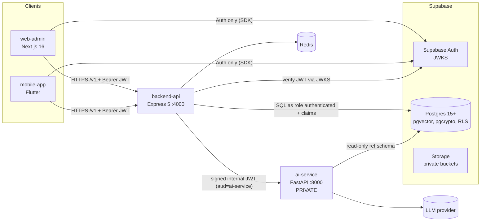
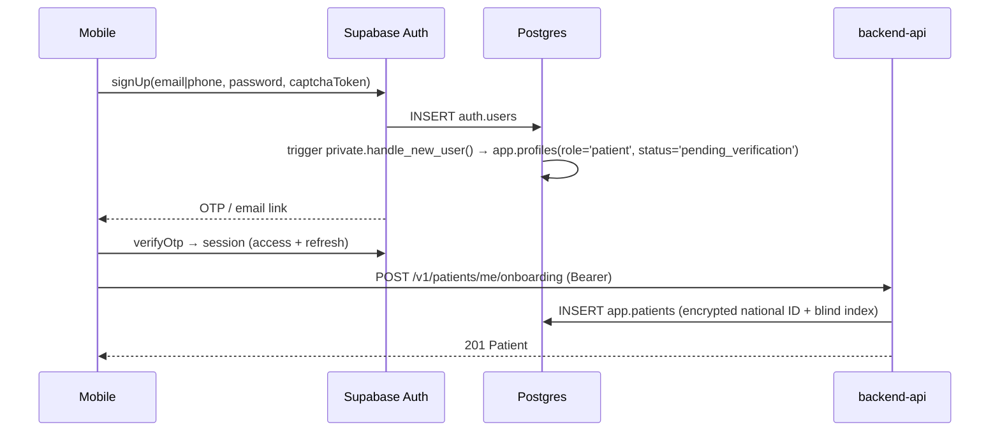

# 03 — API Contracts & Integration

This document is the **human-readable** contract. The machine-readable source of truth is
`packages/contracts/openapi/smarthealth.v1.yaml`, generated from the Zod schemas in
`packages/contracts/src/schemas/`. If this document and the YAML disagree, the YAML wins. Fix this doc in the same PR.

---

## 1. System Topology



Rules:
- **Clients → backend-api only** for data (SD-07). Clients use Supabase only for sign-up/sign-in/refresh/MFA.
- **ai-service is never reachable from clients.** It binds to a private network. In local dev it's only on `localhost`, and in prod only reachable over the platform's private networking.
- **ai-service is stateless with respect to identity.** It never receives patient names, MRNs or national IDs.

---

## 2. Conventions

### 2.1 Base URLs & versioning

| Env | Public API | Internal AI |
|-----|-----------|-------------|
| local | `http://localhost:4000/v1` | `http://localhost:8000/internal/v1` |
| staging | `https://api-staging.smarthealth.app/v1` | private `http://ai-service.internal:8000/internal/v1` |
| prod | `https://api.smarthealth.app/v1` | private |

URI versioning (`/v1`). Breaking changes need `/v2`. Additive changes (new optional fields, new endpoints) are allowed in v1. Clients **must ignore unknown fields**.

### 2.2 Standard request headers

| Header | Required | Description |
|--------|----------|-------------|
| `Authorization: Bearer <supabase_access_token>` | All except `/health`, `/.well-known/*` | Supabase-issued JWT (ES256 asymmetric) |
| `Content-Type: application/json` | JSON bodies | `multipart/form-data` for image uploads |
| `Accept-Language: ar` \| `en` | Recommended | Localises `title`/`detail` in errors and reference-data labels. Default `en` |
| `X-Request-Id: <uuidv4>` | Recommended | Echoed back; generated server-side if missing |
| `X-Client: web/1.4.0` \| `mobile-android/1.2.0` \| `mobile-ios/1.2.0` | Required | Used for min-version enforcement (`426 Upgrade Required` if below minimum) |
| `X-Device-Id: <uuid>` | Mobile: required | The registered device ID from `POST /v1/auth/devices` |
| `Idempotency-Key: <uuidv4>` | Required where marked **[IDEMPOTENT]** | 24 h replay window |
| `X-Step-Up-Token: <token>` | Where marked **[STEP-UP]** | From `POST /v1/auth/step-up/verify` |
| `If-Match: <version>` | Where marked **[VERSIONED]** | Optimistic concurrency |

### 2.3 Standard response headers

`X-Request-Id`, `Cache-Control: no-store` (on **every** PHI response), `Content-Type: application/json; charset=utf-8`, `RateLimit-Limit`, `RateLimit-Remaining`, `RateLimit-Reset`, and `Retry-After` on 429/503.

### 2.4 Error format (RFC 9457 Problem Details + `code`)

```json
{
  "type": "https://docs.smarthealth.app/errors/RX_QUANTITY_EXCEEDED",
  "title": "Requested quantity exceeds remaining quantity",
  "status": 409,
  "code": "RX_QUANTITY_EXCEEDED",
  "detail": "Item 2 has 10 tablet(s) remaining; 20 requested.",
  "instance": "/v1/pharmacy/prescriptions/7d4…/dispensations",
  "request_id": "5b0d7f3e-6a39-4b8b-9d9c-1a2b3c4d5e6f",
  "errors": [
    { "path": "items[1].quantity", "code": "too_big", "message": "Max 10" }
  ]
}
```

- `Content-Type: application/problem+json`.
- `errors[]` appears only for `VALIDATION_FAILED` and quantity/override errors.
- **Never** include stack traces, SQL, internal IDs of other patients, or PHI in `detail`.

### 2.5 Pagination

Cursor-based: `?limit=20&cursor=<opaque>`. The response looks like this:

```json
{ "data": [ … ], "page": { "next_cursor": "eyJ0IjoiMjAyNi0xMS0yMFQxMDowMDowMFoiLCJpZCI6Ijc…", "has_more": true } }
```

`limit` max 100, default 20. The cursor is base64url JSON `{t, id}` (sort key + tiebreaker) and is HMAC-signed to stop tampering.

### 2.6 Common types

| Type | Format |
|------|--------|
| `UUID` | RFC 4122 v4 (v7 for time-ordered IDs is allowed server-side) |
| `Timestamp` | RFC 3339 UTC, e.g. `2026-11-24T08:15:30Z` |
| `Date` | `YYYY-MM-DD` |
| `Phone` | E.164, e.g. `+201001234567` |
| `LocalizedText` | `{ "en": "…", "ar": "…" }`. Only reference data; user content is single-language |
| `MRN` | `^SH-[0-9A-HJKMNP-TV-Z]{8}$` |
| `RxNumber` | `^RX-\d{4}-\d{6}$` |

### 2.7 Idempotency

- Required on: `POST /v1/prescriptions`, `POST /v1/pharmacy/prescriptions/{id}/dispensations`, `POST /v1/emergency/identify`, `POST /v1/emergency/identify/card`, `POST /v1/patients/me/biometrics/face`.
- The server stores `{key, user_id, route, body_sha256, status, response}` in Redis for 24 h (and in DB unique columns where noted).
- Same key + same body → replay of the original status/body with header `Idempotency-Replayed: true`.
- Same key + different body → `409 IDEMPOTENCY_KEY_CONFLICT`.
- Same key still in progress → `409 IDEMPOTENCY_KEY_CONFLICT` with `detail: "in_progress"`. The client retries after 1 s.

### 2.8 Rate limits (defaults; see role-01 §8)

| Bucket | Limit | Key |
|--------|-------|-----|
| `global` | 300 req/min | user ID |
| `auth` | 10 req/min | IP |
| `emergency_identify` | 5/min, 20/hour | user ID |
| `rx_check` | 60/min | user ID |
| `share_code_redeem` | 5 failures/15 min | user ID |
| `assistant_message` | 30/hour | user ID |
| `biometric_enroll` | 5 failures/hour → 24 h lock | user ID |

---

## 3. Authentication Flows

### 3.1 Sign-up & onboarding (patient)



### 3.2 Staff MFA (aal2)

Staff sign in with password via the Supabase SDK, then `mfa.challengeAndVerify()` with TOTP. The resulting JWT has `aal: "aal2"`. The backend rejects staff routes otherwise (`AUTH_MFA_REQUIRED`).

### 3.3 JWT claims expected by the backend

Issued by Supabase. The **Custom Access Token Hook** (`private.custom_access_token_hook`, see role-02) adds `app_role`, `account_status`, `session_epoch`:

```json
{
  "iss": "https://<ref>.supabase.co/auth/v1",
  "aud": "authenticated",
  "sub": "0b8f2f0e-6b8a-4a5f-9a77-0f5a8c1d2e3f",
  "exp": 1795950000,
  "iat": 1795949100,
  "auth_time": 1795949000,
  "role": "authenticated",
  "aal": "aal2",
  "session_id": "d2c…",
  "app_role": "doctor",
  "account_status": "active",
  "session_epoch": 3
}
```

The backend **does not trust** `app_role`/`account_status` blindly. It cross-checks them against the cached `app.profiles` row (≤ 30 s staleness). A mismatch means the claim is stale → `401 AUTH_SESSION_REVOKED`, and the client refreshes.

### 3.4 Device-bound step-up (SD-02)

#### `POST /v1/auth/devices` — register device key
- **Auth:** any role · **Step-up:** none (first registration requires a session `auth_time` ≤ 5 min)
- **Request**
```json
{
  "device_id": "5f6a2c1e-3b4d-4e5f-8a9b-0c1d2e3f4a5b",
  "platform": "android",
  "model": "OPPO CPH2641",
  "public_key_spki_b64": "MFkwEwYHKoZIzj0CAQYIKoZIzj0DAQcDQgAE…",
  "key_algorithm": "ES256",
  "biometric_bound": true
}
```
- **201**
```json
{ "device_id": "5f6a2c1e-…", "registered_at": "2026-11-24T08:00:00Z" }
```
- **Errors:** `422 VALIDATION_FAILED` (bad key), `409 VALIDATION_FAILED` (device already registered to another user), `403 AUTH_STEP_UP_REQUIRED` (session too old)

#### `POST /v1/auth/step-up/challenge`
- **Request** `{ "device_id": "5f6a…", "purpose": "pickup_token" }` (`purpose` ∈ `pickup_token`, `dispense`, `view_emergency_card_manage`, `biometric_delete`, `logout_all`)
- **200** `{ "challenge_id": "c1…", "nonce_b64": "q2Vv…", "expires_at": "2026-11-24T08:01:00Z" }`

#### `POST /v1/auth/step-up/verify`
- **Request** (client signs `nonce || purpose || device_id` with the biometric-gated private key)
```json
{ "challenge_id": "c1…", "signature_b64": "MEUCIQ…" }
```
- **200** `{ "step_up_token": "eyJhbGciOiJFZERTQSJ9…", "expires_in": 300, "purpose": "pickup_token" }`
- **Errors:** `401 AUTH_STEP_UP_INVALID`, `410 AUTH_STEP_UP_INVALID` (challenge expired/used)

#### `POST /v1/auth/logout-all` [STEP-UP]
- **204**. Increments `session_epoch`, revokes Supabase refresh tokens (`auth.admin.signOut(user, 'global')`). Audited `SESSION_REVOKED_ALL`.

#### `DELETE /v1/auth/devices/{deviceId}`
- **204**. Revokes the device; audited.

---

## 4. Account & Profile

#### `GET /v1/me`
- **Auth:** any active user
- **200**
```json
{
  "id": "0b8f2f0e-…",
  "role": "patient",
  "status": "active",
  "full_name": "Mona Adel",
  "email": "mona@example.com",
  "phone": "+201001234567",
  "preferred_locale": "ar",
  "mfa": { "enrolled": false, "aal": "aal1" },
  "patient": { "mrn": "SH-7K2M9Q4D", "onboarded": true, "is_minor": false },
  "practitioner": null,
  "permissions": ["profile:read:self", "patient_record:read:self", "…"]
}
```
For practitioners, `practitioner` = `{ "type": "doctor", "license_number": "EG-MD-123456", "license_status": "verified", "specialty": {"code": "internal_medicine", "name": {"en": "Internal Medicine", "ar": "الباطنة"}}, "facilities": [{"id": "…", "name": "…", "type": "clinic"}], "active_facility_id": "…" }`.

#### `PATCH /v1/me`
- **Request** (all optional) `{ "full_name": "Mona Adel Hassan", "phone": "+201001234567", "preferred_locale": "en" }`
- **200** same shape as `GET /v1/me`
- **Errors:** `422 VALIDATION_FAILED`. Changing `phone` triggers Supabase phone change OTP and returns `202 { "pending": "phone_verification" }`.

#### `POST /v1/patients/me/onboarding`
- **Auth:** role `patient`, status `pending_verification` or `active` without a patient row · **Idempotent by nature** (second call → `409`)
- **Request**
```json
{
  "id_document_type": "national_id",
  "id_document_number": "29001011234567",
  "date_of_birth": "1990-01-01",
  "sex": "female",
  "blood_type": "O+",
  "consents": [
    { "type": "terms_of_service", "version": "2026-10" }
  ]
}
```
- **201**
```json
{
  "patient_id": "0b8f2f0e-…",
  "mrn": "SH-7K2M9Q4D",
  "date_of_birth": "1990-01-01",
  "sex": "female",
  "blood_type": { "value": "O+", "source": "patient_reported" },
  "is_minor": false
}
```
- **Errors:** `422 VALIDATION_FAILED` (format, DOB mismatch with national ID), `409 VALIDATION_FAILED` (`detail: "id_already_registered"`), `409` (already onboarded)

#### `POST /v1/patients/me/consents`
- **Request** `{ "type": "biometric_face", "version": "2026-10", "granted": true }`
- **201** `{ "type": "biometric_face", "version": "2026-10", "granted": true, "recorded_at": "…" }`
- `granted: false` = withdrawal. Withdrawing `biometric_face` also hard-deletes templates.

---

## 5. Patient APIs (role `patient`, own data only)

#### `GET /v1/patients/me/critical-info` (US-04)
- **200**
```json
{
  "blood_type": { "value": "O+", "source": "clinician_confirmed", "confirmed_at": "2026-05-02T10:00:00Z" },
  "allergies": [
    {
      "id": "a1…", "allergen_type": "drug_class",
      "allergen": { "code": "CLS-PENICILLINS", "name": { "en": "Penicillins", "ar": "البنسلينات" } },
      "free_text": null, "severity": "anaphylaxis", "reaction": "Throat swelling",
      "source": "clinician_confirmed", "recorded_at": "…"
    }
  ],
  "chronic_conditions": [
    { "id": "c1…", "icd10_code": "J45.909", "name": { "en": "Asthma, unspecified", "ar": "ربو" }, "status": "active", "source": "clinician_confirmed" }
  ],
  "current_medications": [
    { "drug": { "id": "d1…", "display": "Salbutamol 100 mcg inhaler" }, "dose_text": "2 puffs as needed", "since": "2026-09-01", "until": null, "source": "prescription" }
  ]
}
```

#### `PUT /v1/patients/me/blood-type`
- **Request** `{ "value": "O+" }` · **200** `{ "value": "O+", "source": "patient_reported" }`
- **Errors:** `403 RBAC_FORBIDDEN` if the current value is `clinician_confirmed`.

#### `POST /v1/patients/me/allergies`
- **Request**
```json
{ "allergen_type": "ingredient", "allergen_code": "ING-AMOXICILLIN", "free_text": null, "severity": "moderate", "reaction": "Rash" }
```
or for uncoded: `{ "allergen_type": "other", "allergen_code": null, "free_text": "Some herbal remedy", "severity": "mild", "reaction": "Itching" }`
- **201** allergy object (as in critical-info). **Errors:** `422`.

#### `DELETE /v1/patients/me/allergies/{id}`
- Only `patient_reported` allergies can be deleted by the patient → `204`. Otherwise `403 RBAC_FORBIDDEN`.

#### `GET /v1/patients/me/medical-history?type=all|visits|diagnoses|medications&limit=20&cursor=`
- **200**
```json
{
  "data": [
    {
      "kind": "encounter",
      "id": "e1…",
      "started_at": "2026-10-12T09:30:00Z",
      "encounter_type": "outpatient",
      "facility": { "id": "f1…", "name": "Ismailia Medical Center" },
      "doctor": { "id": "u2…", "name": "Dr. Karim Nabil", "specialty": { "code": "internal_medicine", "name": { "en": "Internal Medicine", "ar": "الباطنة" } } },
      "diagnoses": [ { "icd10_code": "J45.909", "name": { "en": "Asthma, unspecified", "ar": "ربو" }, "is_primary": true } ],
      "prescription_ids": ["p1…"],
      "visibility": "normal"
    }
  ],
  "page": { "next_cursor": null, "has_more": false }
}
```

#### `GET /v1/patients/me/encounters/{encounterId}`
- **200**
```json
{
  "id": "e1…",
  "started_at": "…", "ended_at": "…",
  "encounter_type": "outpatient",
  "facility": { "id": "f1…", "name": "…" },
  "doctor": { "id": "u2…", "name": "Dr. Karim Nabil" },
  "chief_complaint": "Shortness of breath at night",
  "patient_summary": "Asthma flare. Use inhaler, follow up in 2 weeks.",
  "diagnoses": [ … ],
  "prescriptions": [ { "id": "p1…", "rx_number": "RX-2026-000123", "status": "pending" } ],
  "addenda": [ { "created_at": "…", "author": "Dr. Karim Nabil", "text": "…" } ],
  "visibility": "normal"
}
```
- `notes_internal` is **never** returned to patients.
- **Errors:** `404 RESOURCE_NOT_FOUND`

#### `PATCH /v1/patients/me/encounters/{encounterId}/visibility` (US-20)
- **Request** `{ "visibility": "restricted" }` (`normal` | `restricted`) · **200** `{ "id": "e1…", "visibility": "restricted" }`

#### `GET /v1/patients/me/prescriptions?status=active|past&limit=&cursor=`
- **200**
```json
{
  "data": [
    {
      "id": "p1…", "rx_number": "RX-2026-000123", "status": "partially_dispensed",
      "issued_at": "2026-11-20T10:00:00Z", "expires_at": "2026-12-20T10:00:00Z",
      "doctor": { "name": "Dr. Karim Nabil", "specialty": { "code": "internal_medicine", "name": {"en":"Internal Medicine","ar":"الباطنة"} } },
      "item_count": 3, "remaining_item_count": 1
    }
  ],
  "page": { "next_cursor": null, "has_more": false }
}
```

#### `GET /v1/patients/me/prescriptions/{id}`
- **200**: `PrescriptionDetail` (see §7.4) **without** `clinical_alerts` overrides text, plus `"verification_code_hint": "Show this code if you have no phone: K7Q-2MX"`. That's the only time the code is shown; it's stored hashed.

#### `POST /v1/patients/me/prescriptions/{id}/pickup-tokens` [STEP-UP purpose=`pickup_token`]
- **201**
```json
{
  "pickup_token": "SH1.eyJhbGciOiJFZERTQSIsImtpZCI6InJ4LTIwMjYtMTEifQ.eyJ0eXAiOiJwaWNrdXAiLCJyeCI6InAxLi4uIiwicm4iOiJSWC0yMDI2LTAwMDEyMyIsImV4cCI6MTc5NTk1MDcwMCwianRpIjoiOWI…",
  "expires_at": "2026-11-24T08:25:00Z",
  "qr_payload": "SH1.eyJ…"
}
```
- Format: `SH1.` + compact JWS (EdDSA) with claims `{typ:"pickup", rx, rn, iss_at (prescription issued_at), pr_lic, items_hash, jti, exp}`. Single-use (`jti` stored on consumption).
- **Errors:** `409 RX_EXPIRED|RX_CANCELLED|RX_ALREADY_DISPENSED`, `403 AUTH_STEP_UP_REQUIRED`

#### Emergency contacts (US-05)
- `GET /v1/patients/me/emergency-contacts` → `200 { "data": [EmergencyContact] }`
- `POST /v1/patients/me/emergency-contacts`
```json
{ "full_name": "Adel Hassan", "relationship": "father", "phone": "+201112223334", "priority": 1, "share_with_emergency": true }
```
→ `201 EmergencyContact`
```json
{ "id": "ec1…", "full_name": "Adel Hassan", "relationship": "father", "phone": "+201112223334", "priority": 1, "share_with_emergency": true, "updated_at": "…" }
```
- `PATCH /v1/patients/me/emergency-contacts/{id}` (partial) → `200`
- `DELETE /v1/patients/me/emergency-contacts/{id}` → `204` (soft delete)
- `relationship` ∈ `parent`, `father`, `mother`, `spouse`, `sibling`, `child`, `relative`, `friend`, `guardian`, `other`
- **Errors:** `422 VALIDATION_FAILED` (max 5, phone format, priority 1–5)

#### `GET /v1/patients/me/emergency-card` (EXT-04)
- **200**
```json
{
  "card_jws": "eyJhbGciOiJFZERTQSIsImtpZCI6ImVjLTIwMjYtMTEifQ.eyJ0eXAiOiJlbWVyZ2VuY3lfY2FyZCIsIm1ybiI6IlNILTdLMk05UTREIiwibiI6Ik1vbmEgQWRlbCIsImRvYiI6IjE5OTAiLCJzeCI6ImYiLCJidCI6Ik8rIiwiYWwiOlt7ImEiOiJQZW5pY2lsbGlucyIsInMiOiJhbmFwaHlsYXhpcyJ9XSwiY2MiOlsiQXN0aG1hIl0sIm1lZCI6WyJTYWxidXRhbW9sIl0sImVjIjpbeyJuIjoiQWRlbCIsInIiOiJmYXRoZXIiLCJwIjoiKzIwMTExMjIyMzMzNCJ9XSwiaWF0IjoxNzk1OTQ5MTAwLCJleHAiOjE3OTg1NDExMDB9.sig",
  "expires_at": "2026-12-24T08:00:00Z",
  "qr_payload": "SHEC1.eyJ…"
}
```
- Claims: `mrn, n (name), dob (year only), sx, bt, al[{a,s}], cc[], med[], ec[{n,r,p}] (only shared contacts), iat, exp`. Compressed with deflate before base64url if > 1,500 bytes so it fits a version-25 QR code.

#### Access grants & sharing (US-09, US-20, EXT-06)
- `POST /v1/patients/me/share-codes` [STEP-UP purpose=`pickup_token` reused] → `201 { "code": "482913", "expires_at": "…", "grant_duration_days": 30, "scope": "read_write" }`
  - Request (optional) `{ "grant_duration_days": 30, "scope": "read_write" }` (`read_only` | `read_write`, days 1–365)
- `GET /v1/patients/me/access-grants` → `200 { "data": [ { "id": "g1…", "grant_type": "patient_share", "practitioner": { "name": "Dr. Karim Nabil", "type": "doctor", "facility": "…" }, "scope": "read_write", "status": "active", "granted_at": "…", "expires_at": "…" } ] }`
- `DELETE /v1/patients/me/access-grants/{grantId}` → `204`
- `GET /v1/patients/me/access-log?limit=&cursor=` → `200 { "data": [ { "at": "…", "actor": { "name": "Dr. Karim Nabil", "role": "doctor", "facility": "…" }, "action": "PATIENT_RECORD_READ" | "EMERGENCY_PROFILE_READ" | "RX_DISPENSED" | …, "context": "grant" | "emergency" | "pharmacy" } ], "page": {…} }`

#### Biometrics (EXT-03)
- `GET /v1/biometric/challenge?purpose=enroll|verify` → `200 { "challenge_id": "bc1…", "sequence": ["blink","turn_left","turn_right"], "expires_in": 60 }`
- `POST /v1/patients/me/biometrics/face` [IDEMPOTENT] `multipart/form-data`:
  - `challenge_id`: string
  - `frames[]`: 3–5 JPEG files, each ≤ 300 KB, ≥ 480 px shortest side
  - `client_signals`: JSON string `{"blink_detected":true,"yaw_deltas":[-28.4,27.9],"capture_ms":4200}`
  - **201** `{ "enrolled": true, "template_count": 1, "model_version": "buffalo_l-arcface-r50@1", "enrolled_at": "…" }`
  - **Errors:** `403 BIO_CONSENT_REQUIRED`, `422 BIO_NO_FACE|BIO_MULTIPLE_FACES|BIO_LOW_QUALITY|BIO_LIVENESS_FAILED`, `409 BIO_ALREADY_ENROLLED`, `429 RATE_LIMITED`, `503 AI_SERVICE_UNAVAILABLE`
- `DELETE /v1/patients/me/biometrics/face` [STEP-UP purpose=`biometric_delete`] → `204`

---

## 6. Doctor APIs (role `doctor`, `aal2`, licence `verified`)

#### `POST /v1/doctor/access/redeem`
- **Request** `{ "patient_mrn": "SH-7K2M9Q4D", "code": "482913" }`
- **201**
```json
{ "grant_id": "g1…", "patient_id": "0b8f…", "scope": "read_write", "expires_at": "2026-12-24T08:00:00Z" }
```
- **Errors:** `422 VALIDATION_FAILED (detail: invalid_or_expired_code)` (generic; doesn't reveal which), `429 RATE_LIMITED`

#### `GET /v1/doctor/patients?query=SH-7K2M9Q4D|29001011234567&limit=20`
- Searches **only** among patients with active grants for this doctor. National-ID queries are matched via blind index.
- **200** `{ "data": [ { "patient_id": "0b8f…", "mrn": "SH-7K2M9Q4D", "full_name": "Mona Adel", "age": 36, "sex": "female", "grant": { "id": "g1…", "expires_at": "…" } } ], "page": {…} }`

#### `GET /v1/doctor/patients/{patientId}/summary`
- **200**
```json
{
  "patient": { "id": "0b8f…", "mrn": "SH-7K2M9Q4D", "full_name": "Mona Adel", "age": 36, "sex": "female" },
  "critical": { "blood_type": {…}, "allergies": [ … ], "chronic_conditions": [ … ], "current_medications": [ … ] },
  "recent_encounters": [ { "id": "e1…", "started_at": "…", "doctor": "…", "primary_diagnosis": "…" } ],
  "active_prescriptions": [ { "id": "p1…", "rx_number": "…", "status": "pending" } ],
  "restricted_record_count": 1,
  "grant": { "id": "g1…", "scope": "read_write", "expires_at": "…" }
}
```
- **Errors:** `403 ACCESS_GRANT_REQUIRED`, `404 RESOURCE_NOT_FOUND`

#### `GET /v1/doctor/patients/{patientId}/history?type=&limit=&cursor=`
Same shape as the patient's medical history, plus `notes_internal` for encounters authored at the doctor's facilities. Restricted encounters authored by others appear as:
```json
{ "kind": "restricted_placeholder", "id": null, "started_at": "2026-03-01T00:00:00Z" }
```
(The date is truncated to month.)

#### `POST /v1/doctor/patients/{patientId}/encounters`
- **Request**
```json
{ "encounter_type": "outpatient", "facility_id": "f1…", "chief_complaint": "Shortness of breath at night" }
```
- **201** `{ "id": "e2…", "status": "open", "started_at": "…", "version": 1 }`
- If the doctor has no grant but the patient is physically present, the doctor first asks for a share code. There is no "create encounter without grant" path.

#### `PATCH /v1/doctor/encounters/{encounterId}` [VERSIONED]
- **Request** `{ "chief_complaint": "…", "notes_internal": "…", "patient_summary": "…", "end": true }`
- **200** `{ "id": "e2…", "status": "closed", "ended_at": "…", "version": 2 }`
- **Errors:** `409 CONFLICT_VERSION`, `409 VALIDATION_FAILED (detail: edit_window_closed)` → use addenda

#### `POST /v1/doctor/encounters/{encounterId}/addenda`
- **Request** `{ "text": "Correction: symptom onset 3 days not 5." }` → **201** `{ "id": "ad1…", "created_at": "…" }`

#### `POST /v1/doctor/encounters/{encounterId}/entered-in-error`
- **Request** `{ "reason": "wrong_patient" }` → **200**

#### `POST /v1/doctor/encounters/{encounterId}/diagnoses`
- **Request**
```json
{ "icd10_code": "J45.909", "is_primary": true, "clinical_notes": "Nocturnal symptoms 3×/week", "add_to_problem_list": true, "is_chronic": true }
```
- **201** `{ "id": "dx1…", "icd10_code": "J45.909", "is_primary": true, "condition_id": "c1…" }`

#### `POST /v1/doctor/patients/{patientId}/conditions`
- **Request** `{ "icd10_code": "E11.9", "is_chronic": true, "status": "active", "onset_year": 2019 }` → **201** condition object `{ "id", "icd10_code", "name": {en, ar}, "is_chronic", "status", "source": "clinician_confirmed", "onset_year" }`
- `PATCH /v1/doctor/patients/{patientId}/conditions/{id}` → `{ "status": "resolved" | "inactive", "is_chronic": false }` → **200**

#### `POST /v1/doctor/patients/{patientId}/allergies`
Same body as the patient endpoint. Stored as `clinician_confirmed`. **201**.

#### `PATCH /v1/doctor/patients/{patientId}/allergies/{id}`
Confirm, refute, or code a patient-reported allergy: `{ "verification": "confirmed" | "refuted", "allergen_type": "…", "allergen_code": "…" }` → **200**.

#### `PUT /v1/doctor/patients/{patientId}/blood-type`
`{ "value": "O+", "verified_by_lab": true }` → **200**.

#### Reference lookups (doctor/pharmacist)
- `GET /v1/ref/drugs?query=amox&limit=20` → `200 { "data": [ { "id": "d9…", "brand_name": "Amoxil", "generic_name": "Amoxicillin", "strength": "500 mg", "dosage_form": "capsule", "route": "oral", "is_controlled": false, "ingredients": [ { "code": "ING-AMOXICILLIN", "name": "Amoxicillin", "strength": "500 mg" } ] } ] }`
- `GET /v1/ref/drugs?equivalent_to=<drug_id>` → active drugs with the identical ingredient set and strengths (used for generic substitution, E-RX-11).
- `GET /v1/ref/icd10?query=asthma&limit=20` → `200 { "data": [ { "code": "J45.909", "name": { "en": "…", "ar": "…" } } ] }`
- `GET /v1/ref/allergens?query=penic` → ingredients + drug classes.
- `GET /v1/ref/specialties` → list.

---

## 7. Prescriptions (doctor) — US-08, EXT-01, EXT-02

### 7.1 `POST /v1/prescriptions/check` — live safety check (draft)
- **Auth:** doctor · **Rate:** `rx_check`
- **Request**
```json
{
  "patient_id": "0b8f…",
  "items": [
    { "client_key": "i1", "drug_id": "d9…" },
    { "client_key": "i2", "drug_id": "d4…" }
  ]
}
```
- **200**
```json
{
  "checks_status": "complete",
  "engine_version": "rules-2026.11.1",
  "dataset_version": "ddinter2-2024-05+seed-2026-11",
  "alerts": [
    {
      "alert_key": "DA:ING-AMOXICILLIN:CLS-PENICILLINS",
      "type": "drug_allergy",
      "severity": "contraindicated",
      "item_keys": ["i1"],
      "title": { "en": "Allergy: Penicillins", "ar": "حساسية: البنسلينات" },
      "message": { "en": "Patient has a recorded ANAPHYLAXIS allergy to penicillins. Amoxicillin is a penicillin.", "ar": "…" },
      "management": { "en": "Choose a non-beta-lactam alternative (e.g. a macrolide) unless benefit clearly outweighs risk.", "ar": "…" },
      "source": "seed:allergy-class-rules",
      "requires_override": true,
      "previously_reviewed": null
    },
    {
      "alert_key": "DD:ING-WARFARIN:ING-ASPIRIN",
      "type": "drug_drug",
      "severity": "major",
      "item_keys": ["i2"],
      "involves_current_medication": { "display": "Warfarin 5 mg", "from_restricted_record": false },
      "title": { "en": "Warfarin + Aspirin", "ar": "…" },
      "message": { "en": "Increased bleeding risk.", "ar": "…" },
      "management": { "en": "Avoid unless indicated; monitor INR and bleeding.", "ar": "…" },
      "source": "ddinter2:DDInter12345",
      "requires_override": true,
      "previously_reviewed": { "by": "Dr. Karim Nabil", "at": "2026-09-01T10:00:00Z" }
    }
  ]
}
```
- `checks_status` ∈ `complete` | `partial` (some drugs unmapped) | `unavailable` (AI down → `alerts: []`).
- `alert_key` is deterministic: `DD:<ingA>:<ingB>` (sorted), `DA:<ingredient>:<allergen>`, `DUP:<class>`, `DC:<ingredient>:<icd10>`.

### 7.2 `POST /v1/prescriptions` — issue [IDEMPOTENT]
- **Auth:** doctor · Requires an active `read_write` grant and an encounter with status `open` or closed within the last 24 h. If `now − auth_time > 15 min`, returns `403 AUTH_STEP_UP_REQUIRED` and the web app re-prompts TOTP.
- **Request**
```json
{
  "patient_id": "0b8f…",
  "encounter_id": "e2…",
  "items": [
    {
      "client_key": "i1",
      "drug_id": "d4…",
      "dose": "1 tablet",
      "route": "oral",
      "frequency": "twice_daily",
      "duration_days": 7,
      "quantity": 14,
      "quantity_unit": "tablet",
      "instructions": "After meals",
      "substitution_allowed": true
    }
  ],
  "overrides": [
    {
      "alert_key": "DD:ING-WARFARIN:ING-ASPIRIN",
      "reason_code": "benefit_outweighs_risk",
      "justification": "Post-stent dual therapy per cardiology, INR monitored weekly"
    }
  ],
  "manual_review_attested": false,
  "notes_to_pharmacist": "Patient is on warfarin; counsel on bleeding signs."
}
```
- `frequency` ∈ `once_daily`, `twice_daily`, `three_times_daily`, `four_times_daily`, `every_x_hours`, `at_bedtime`, `as_needed`, `once`, `weekly`. With `every_x_hours`, `frequency_interval_hours` (1–24) is required.
- `reason_code` ∈ `benefit_outweighs_risk`, `allergy_disputed`, `desensitisation_protocol`, `monitored_setting`, `other`.
- **201** `PrescriptionDetail` (§7.4)
- **Errors:** `403 ACCESS_GRANT_REQUIRED`, `403 LICENSE_NOT_VALID`, `422 VALIDATION_FAILED`, `422 RX_ALERT_OVERRIDE_REQUIRED` (with `errors[].path = "overrides"`, `errors[].alert_key`), `409 IDEMPOTENCY_KEY_CONFLICT`

### 7.3 `POST /v1/prescriptions/{id}/cancel`
- **Request** `{ "reason_code": "prescribing_error" | "patient_request" | "therapy_changed" | "adverse_reaction" | "other", "item_ids": null }` (`null` = all remaining items)
- **200** `PrescriptionDetail` · **Errors:** `403 RBAC_FORBIDDEN` (not the issuing doctor), `409 RX_ALREADY_DISPENSED`

#### `GET /v1/doctor/prescriptions?status=&patient_id=&limit=&cursor=` → list of the doctor's issued prescriptions.

### 7.4 `PrescriptionDetail` schema

```json
{
  "id": "p1…",
  "rx_number": "RX-2026-000123",
  "status": "partially_dispensed",
  "issued_at": "2026-11-20T10:00:00Z",
  "expires_at": "2026-12-20T10:00:00Z",
  "patient": { "id": "0b8f…", "mrn": "SH-7K2M9Q4D", "full_name": "Mona Adel", "age": 36, "sex": "female" },
  "prescriber": { "id": "u2…", "name": "Dr. Karim Nabil", "license_number": "EG-MD-123456", "specialty": "Internal Medicine", "facility": "Ismailia Medical Center" },
  "items": [
    {
      "id": "pi1…",
      "drug": { "id": "d4…", "brand_name": "Aspocid", "generic_name": "Aspirin", "strength": "75 mg", "dosage_form": "tablet", "is_controlled": false },
      "dose": "1 tablet", "route": "oral", "frequency": "once_daily", "duration_days": 30,
      "quantity_prescribed": 30, "quantity_dispensed": 20, "quantity_remaining": 10, "quantity_unit": "tablet",
      "instructions": "After breakfast",
      "substitution_allowed": true,
      "status": "partially_dispensed"
    }
  ],
  "alerts_summary": [ { "alert_key": "DD:ING-WARFARIN:ING-ASPIRIN", "severity": "major", "overridden": true, "reason_code": "benefit_outweighs_risk" } ],
  "safety_check_bypassed": false,
  "notes_to_pharmacist": "…",
  "dispensations": [
    { "id": "ds1…", "dispensed_at": "2026-11-21T18:00:00Z", "pharmacy": { "id": "f9…", "name": "El-Shifa Pharmacy" }, "items": [ { "prescription_item_id": "pi1…", "quantity": 20 } ] }
  ],
  "signature": { "alg": "EdDSA", "kid": "rx-2026-11", "value_b64": "…" },
  "version": 3
}
```

`alerts_summary` justification text is visible only to the prescriber and pharmacist roles, never to patients.

### 7.5 Canonical signing payload (for `signature`)

RFC 8785 (JCS) canonical JSON of:

```json
{
  "v": 1,
  "rx_id": "p1…",
  "rx_number": "RX-2026-000123",
  "patient_id": "0b8f…",
  "prescriber_id": "u2…",
  "prescriber_license": "EG-MD-123456",
  "facility_id": "f1…",
  "issued_at": "2026-11-20T10:00:00Z",
  "expires_at": "2026-12-20T10:00:00Z",
  "items": [
    { "id": "pi1…", "drug_id": "d4…", "dose": "1 tablet", "route": "oral", "frequency": "once_daily", "frequency_interval_hours": null, "duration_days": 30, "quantity": 30, "quantity_unit": "tablet", "substitution_allowed": true }
  ]
}
```

Items are sorted by `id`. `signature = Ed25519(RX_SIGNING_PRIVATE_KEY, JCS(payload))`. `payload_sha256` is stored too. Public keys are published at `GET /v1/.well-known/rx-jwks.json`.

---

## 8. Pharmacy APIs (role `pharmacist`, `aal2`, licence `verified`, active membership in a facility of type `pharmacy`)

### 8.1 `POST /v1/pharmacy/prescriptions/verify` (US-10)
- **Request**: exactly one of the three modes:
```json
{ "mode": "pickup_token", "pickup_token": "SH1.eyJ…", "pharmacy_id": "f9…" }
```
```json
{ "mode": "rx_code", "rx_number": "RX-2026-000123", "verification_code": "K7Q2MX", "pharmacy_id": "f9…",
  "presence": { "method": "sms_otp", "otp_request_id": null } }
```
```json
{ "mode": "rx_code", "rx_number": "RX-2026-000123", "verification_code": "K7Q2MX", "pharmacy_id": "f9…",
  "presence": { "method": "face_1to1", "face_verification_id": "fv1…" } }
```
For `sms_otp`: the first call (with `otp_request_id: null`) returns `202 { "otp_request_id": "o1…", "sent_to": "+20100*****67" }`. The second call includes `otp_request_id` and `otp_code`.

- **200**
```json
{
  "verification_id": "v1…",
  "result": "valid",
  "valid_until": "2026-11-24T08:30:00Z",
  "prescription": "<PrescriptionDetail (§7.4); dispensations[].pharmacy shows name only>",
  "patient_for_pharmacy": { "full_name": "Mona Adel", "age": 36, "sex": "female", "allergies": [ { "name": "Penicillins", "severity": "anaphylaxis" } ] },
  "prescriber_status": { "license_status": "verified", "note": null },
  "checks": { "signature": "ok", "payload_integrity": "ok", "expiry": "ok", "status": "ok", "prescriber": "ok" }
}
```
- `result` ∈ `valid` | `already_dispensed` | `expired` | `cancelled` | `prescriber_invalid`. Non-`valid` results still return `200` with details when the request was well-formed and the prescription exists, so the UI can explain. Exceptions are `RX_SIGNATURE_INVALID` (422) and `PICKUP_TOKEN_INVALID` (401).
- `verification_id` opens a **15-min pharmacy access context** for this prescription + pharmacist (required by §8.2–8.4).
- **Errors:** `401 PICKUP_TOKEN_INVALID`, `422 RX_SIGNATURE_INVALID`, `404 RX_NOT_FOUND`, `403 LICENSE_NOT_VALID`, `429`

### 8.2 `GET /v1/pharmacy/prescriptions/{id}?verification_id=v1…` (US-11)
- **200** same `prescription` + `patient_for_pharmacy` as verify. **Errors:** `403 RBAC_FORBIDDEN` (no valid verification context)

### 8.3 `POST /v1/pharmacy/prescriptions/{id}/lease` (soft lease)
- **Request** `{ "verification_id": "v1…", "force": false }`
- **201** `{ "lease_id": "l1…", "expires_at": "…" }`
- **409 RX_LEASE_HELD** `{ "held_by_pharmacy": "Another pharmacy", "expires_at": "…" }`. Retry with `force: true` after user confirmation (audited `RX_LEASE_FORCED`).
- `DELETE /v1/pharmacy/prescriptions/{id}/lease` → `204`

### 8.4 `POST /v1/pharmacy/prescriptions/{id}/dispensations` [IDEMPOTENT] (US-12)
- **Request**
```json
{
  "verification_id": "v1…",
  "expected_version": 3,
  "items": [
    { "prescription_item_id": "pi1…", "quantity": 10, "substituted_drug_id": null, "batch_number": "B2301", "expiry_date": "2027-06-30" },
    { "prescription_item_id": "pi2…", "quantity": 14 }
  ],
  "counselling_given": true,
  "notes": null
}
```
- `expected_version` is advisory. If it differs, the server still validates quantities under lock and returns `200/201` when valid; the client refreshes.
- **201**
```json
{
  "dispensation_id": "ds2…",
  "prescription_status": "dispensed",
  "items": [
    { "prescription_item_id": "pi1…", "quantity_dispensed_now": 10, "quantity_remaining": 0, "status": "dispensed" },
    { "prescription_item_id": "pi2…", "quantity_dispensed_now": 14, "quantity_remaining": 0, "status": "dispensed" }
  ],
  "dispensed_at": "2026-11-24T08:20:00Z",
  "version": 4
}
```
- **Errors:** `409 RX_ALREADY_DISPENSED`, `409 RX_QUANTITY_EXCEEDED` (with `errors[]`), `409 RX_CANCELLED`, `409 RX_EXPIRED`, `409 RX_PRESCRIBER_INVALID`, `403 RBAC_FORBIDDEN` (context expired), `422 VALIDATION_FAILED` (substitution invalid), `400 IDEMPOTENCY_KEY_REQUIRED`, `409 IDEMPOTENCY_KEY_CONFLICT`

### 8.5 `POST /v1/pharmacy/face-verifications` (1:1 presence check)
- `multipart/form-data`: `challenge_id`, `frames[]` (3), `rx_number`, `pharmacy_id`
- **200** `{ "face_verification_id": "fv1…", "result": "match" | "no_match", "valid_for_seconds": 300 }` (the score is not returned to clients)
- **Errors:** `422 BIO_*`, `404 RX_NOT_FOUND`, `409 BIO_CONSENT_REQUIRED` (patient has no template → use SMS)

### 8.6 `GET /v1/pharmacy/dispensations?from=&to=&limit=&cursor=` — the pharmacy's own history.

---

## 9. Emergency APIs (role `paramedic`, `aal2`, licence `verified`, member of `ambulance_service` or `hospital`)

### 9.1 `POST /v1/emergency/identify` [IDEMPOTENT] (US-16)
- `multipart/form-data`:
  - `frames[]`: 1–3 JPEG (≤ 200 KB each)
  - `incident_ref`: string ≤ 64 (optional, e.g. ambulance dispatch number)
  - `reason_code`: `unconscious` | `unable_to_communicate` | `altered_mental_status` | `language_barrier` | `other`
  - `location`: JSON `{"lat":30.59,"lng":32.27,"accuracy_m":25}` (optional)
- **200** (match)
```json
{
  "result": "match",
  "session": { "id": "es1…", "expires_at": "2026-11-24T09:20:00Z", "low_confidence": false },
  "patient_preview": { "full_name": "Mona Adel", "age": 36, "sex": "female", "mrn_last4": "9Q4D" }
}
```
- **200** (possible match)
```json
{
  "result": "possible_match",
  "candidates": [
    { "candidate_token": "ct1…", "sex": "female", "age_band": "30-39" },
    { "candidate_token": "ct2…", "sex": "female", "age_band": "30-39" }
  ],
  "candidate_tokens_expire_in": 120
}
```
Then `POST /v1/emergency/identify/confirm` with `{ "candidate_token": "ct1…", "reason_code": "unconscious" }` → **200** with a match-shaped body and `session.low_confidence = true`.
- **200** (no match) `{ "result": "no_match", "fallbacks": ["emergency_card_qr", "national_id_search"] }`
- **Errors:** `422 BIO_NO_FACE|BIO_MULTIPLE_FACES|BIO_LOW_QUALITY|BIO_LIVENESS_FAILED` (with `hints[]`), `429 RATE_LIMITED`, `503 AI_SERVICE_UNAVAILABLE` (with `fallbacks[]`)

### 9.2 `POST /v1/emergency/identify/card` [IDEMPOTENT]
- **Request** `{ "card_qr_payload": "SHEC1.eyJ…", "reason_code": "unconscious", "incident_ref": "AMB-4471" }`
- **200** match-shaped body (`method = emergency_card_qr`). Expired card → still `200` with `card_expired: true` (live data is served from the DB anyway).
- **Errors:** `422 RX_SIGNATURE_INVALID` (reused code meaning "signature invalid" for cards: `detail: "card_signature_invalid"`)

### 9.3 `POST /v1/emergency/identify/manual`
- **Request** `{ "id_document_type": "national_id", "id_document_number": "29001011234567", "reason_code": "…" }` → match-shaped or `no_match`. Rate limited (5/hour).

### 9.4 `GET /v1/emergency/sessions/{sessionId}/profile` (US-17)
- **200** (this schema is **closed**; no additional properties are allowed)
```json
{
  "session": { "id": "es1…", "expires_at": "…", "low_confidence": false, "method": "face" },
  "patient": { "full_name": "Mona Adel", "age": 36, "sex": "female", "mrn_last4": "9Q4D" },
  "blood_type": { "value": "O+", "verified": true },
  "allergies": [ { "name": "Penicillins", "severity": "anaphylaxis", "verified": true } ],
  "chronic_conditions": [ { "name": "Asthma", "since_year": 2015 } ],
  "current_medications": [ { "name": "Salbutamol inhaler", "dose_text": "2 puffs as needed" }, { "name": "Warfarin 5 mg", "dose_text": "once daily" } ],
  "has_shared_contacts": true,
  "generated_at": "2026-11-24T08:21:00Z"
}
```
- **Errors:** `410 EMERG_SESSION_EXPIRED`, `403 RBAC_FORBIDDEN` (session belongs to another paramedic)

### 9.5 `GET /v1/emergency/sessions/{sessionId}/contacts` (US-18)
- **200** `{ "data": [ { "full_name": "Adel Hassan", "relationship": "father", "phone": "+201112223334", "priority": 1 } ] }`
- **Errors:** `403 EMERG_CONTACTS_NOT_SHARED`, `410 EMERG_SESSION_EXPIRED`

### 9.6 `POST /v1/emergency/sessions/{sessionId}/extend` → `{ "reason": "patient still in transport" }` → **200** `{ "expires_at": "…" }` (once only; 2nd → `409 VALIDATION_FAILED`)
### 9.7 `POST /v1/emergency/sessions/{sessionId}/close` → **204**
### 9.8 `POST /v1/emergency/offline-events`
- **Request** `{ "events": [ { "event_id": "uuid", "type": "offline_card_view", "card_mrn": "SH-7K2M9Q4D", "card_iat": 1795949100, "occurred_at": "…", "device_signature_b64": "…" } ] }` → **202** `{ "accepted": 1, "rejected": 0 }`

---

## 10. AI Assistant APIs (role `patient`, adult, consent `ai_assistant`)

#### `POST /v1/assistant/sessions`
- **Request** `{ "locale": "ar" }` → **201** `{ "session_id": "as1…", "disclaimer": { "ar": "…", "en": "…" }, "created_at": "…" }`
- **Errors:** `403 RBAC_FORBIDDEN (detail: minor_account | consent_required)`

#### `POST /v1/assistant/sessions/{sessionId}/messages`
- **Request** `{ "text": "عندي صداع شديد من امبارح ومش قادر أبص للنور", "client_message_id": "uuid" }` (max 2,000 chars)
- **200**
```json
{
  "message_id": "am2…",
  "triage": {
    "level": "urgent",
    "red_flag": false,
    "red_flag_rule_ids": [],
    "source": "llm+rules"
  },
  "reply": {
    "text": "الصداع الشديد مع الحساسية من الضوء محتاج تقييم من دكتور خلال ٢٤ ساعة…",
    "self_care": ["…"],
    "warning_signs": ["لو ظهر تيبس في الرقبة أو حرارة عالية أو قيء متكرر، اطلب الإسعاف فوراً ١٢٣"]
  },
  "recommended_specialty": { "code": "neurology", "name": { "en": "Neurology", "ar": "المخ والأعصاب" }, "reason": "…" },
  "follow_up_questions": [],
  "disclaimer": "هذه إرشادات عامة وليست تشخيصاً…",
  "emergency_action": null
}
```
- When `triage.level = "emergency"`:
```json
{
  "message_id": "am3…",
  "triage": { "level": "emergency", "red_flag": true, "red_flag_rule_ids": ["RF-CARDIAC-01"], "source": "rules" },
  "reply": { "text": "أعراضك قد تكون علامة على حالة طارئة في القلب. اتصل بالإسعاف ١٢٣ الآن…", "self_care": [], "warning_signs": [] },
  "recommended_specialty": { "code": "emergency_medicine", "name": { "en": "Emergency Medicine", "ar": "الطوارئ" }, "reason": null },
  "follow_up_questions": [],
  "disclaimer": "…",
  "emergency_action": { "type": "call", "phone": "123", "label": { "ar": "اتصل بالإسعاف ١٢٣", "en": "Call ambulance 123" } }
}
```
- **Errors:** `429 RATE_LIMITED`, `410 VALIDATION_FAILED (detail: session_closed)`. Never `503`: the endpoint always degrades to the rules + fallback text.

#### `GET /v1/assistant/sessions/{sessionId}` → session with messages. `DELETE /v1/assistant/sessions/{sessionId}` → **204** (hard delete).

---

## 11. Admin APIs (role `admin`, `aal2`; sensitive actions need `auth_time` ≤ 5 min)

| Method & Path | Purpose | Request | Response |
|---------------|---------|---------|----------|
| `GET /v1/admin/users?role=&status=&query=` | List users | — | `{data:[{id, full_name, email, role, status, created_at, practitioner?}], page}` |
| `POST /v1/admin/users` | Invite staff | `{email, full_name, role: "doctor"|"pharmacist"|"paramedic"|"admin", practitioner?: {license_number, license_authority, license_expires_at, specialty_code?, facility_ids:[]}}` | `201 {id, invite_sent: true}` |
| `PATCH /v1/admin/users/{id}/status` | Suspend/reactivate | `{status: "suspended"|"active"|"deactivated", reason}` | `200 {id, status}` |
| `PATCH /v1/admin/users/{id}/role` | Change role (two-person rule for `admin`) | `{role, reason}` | `200` or `202 {pending_approval_id}` |
| `POST /v1/admin/approvals/{id}/approve` | Second admin approval | `{}` | `200` |
| `PATCH /v1/admin/practitioners/{id}/license` | Verify/suspend/revoke | `{license_status, reason, license_expires_at?}` | `200 {license_status, license_status_changed_at}` |
| `GET/POST/PATCH /v1/admin/facilities` | Manage facilities | `{name, type, address, phone, license_number}` | Facility |
| `POST /v1/admin/facilities/{id}/members` | Add practitioner to facility | `{practitioner_id, role_at_facility}` | `201` |
| `GET /v1/admin/audit-events?actor_id=&action=&patient_mrn=&outcome=&from=&to=` | Audit search | — | `{data:[{id, occurred_at, actor:{id,name,role}, action, resource_type, resource_id, patient_mrn_last4, outcome, reason, ip}], page}` |
| `GET /v1/admin/audit-events/export?…` | CSV (no PHI columns) | — | `text/csv` |
| `GET /v1/admin/audit-integrity` | Last chain verification | — | `{verified_at, last_event_id, status: "ok"|"broken", broken_at_event_id?}` |
| `GET /v1/admin/emergency-sessions?review_status=pending` | Break-glass queue | — | `{data:[{id, paramedic, patient_mrn_last4, method, low_confidence, match_score_band, started_at, reason_code}]}` |
| `POST /v1/admin/emergency-sessions/{id}/review` | Review | `{outcome: "appropriate"|"inappropriate", note}` | `200` |
| `GET /v1/admin/security-flags` | Spoof/abuse flags | — | list |
| `POST /v1/admin/drug-requests/{id}/resolve` | Catalogue requests | `{action: "added"|"rejected", drug_id?}` | `200` |
| `GET /v1/admin/metrics` | Dashboard KPIs | — | `{active_patients, rx_issued_7d, dispense_rate, override_rate_by_doctor:[…], face_enrolment_coverage, ai_red_flags_7d}` |

---

## 12. System Endpoints

| Path | Auth | Response |
|------|------|----------|
| `GET /v1/health` | none | `200 {status:"ok", version:"1.0.0", commit:"abc123"}` (liveness, no dependencies) |
| `GET /v1/ready` | none (internal network only) | `200 {db:"ok", redis:"ok", ai:"ok"\|"degraded"}` or `503` |
| `GET /v1/.well-known/rx-jwks.json` | none | `{keys:[{kty:"OKP", crv:"Ed25519", kid:"rx-2026-11", x:"…", use:"sig"}]}` |
| `GET /v1/.well-known/emergency-card-jwks.json` | none | same shape, `kid: "ec-2026-11"` |
| `GET /v1/config/mobile` | none | `{min_version:{android:"1.0.0", ios:"1.0.0"}, emergency_phone:"123", feature_flags:{…}}` |

---

## 13. Internal AI Service API (`ai-service`, backend → AI only)

### 13.1 Internal authentication
Every request carries `Authorization: Bearer <internal_jwt>`:
- EdDSA-signed by backend with `INTERNAL_JWT_SIGNING_KEY`
- Claims `{iss: "backend-api", aud: "ai-service", iat, exp: iat+60, jti, scope: "face|clinical|assistant", rid: <request_id>}`
- ai-service verifies the signature with `INTERNAL_JWT_PUBLIC_KEY`, `aud`, `exp` (±30 s), and that `jti` hasn't been seen in the last 120 s (in-memory LRU)

Also: `X-Request-Id`, and `X-Priority: emergency` on calls made for `/v1/emergency/*` (routes them to the reserved worker pool, role-04 §2.3). Requests that fail auth → `401` with no body detail.

### 13.2 `POST /internal/v1/face/analyze`
- **Request** `multipart/form-data`:
  - `mode`: `enroll` | `identify` | `verify`
  - `liveness_mode`: `active` | `passive`
  - `challenge`: JSON `{"challenge_id":"bc1…","sequence":["blink","turn_left"],"issued_at":"…"}` (required for `active`)
  - `client_signals`: JSON (optional)
  - `frames[]`: 1–5 JPEG
- **200**
```json
{
  "face_detected": true,
  "face_count": 1,
  "selected_face": { "bbox": [112, 80, 402, 430], "det_score": 0.93 },
  "quality": { "score": 0.71, "blur": 0.12, "brightness": 128, "yaw": -4.2, "pitch": 3.1, "passed": true, "hints": [] },
  "liveness": { "mode": "active", "score": 0.94, "passed": true, "checks": { "pad_model": 0.94, "challenge_completed": true, "frame_consistency": true } },
  "template": { "vector": [0.0123, -0.0456, "… 512 floats, L2-normalised, TRANSFORMED …"], "dim": 512 },
  "model_version": "buffalo_l-arcface-r50@1",
  "transform_key_version": 1,
  "timings_ms": { "decode": 8, "detect": 42, "liveness": 31, "embed": 55, "total": 141 }
}
```
- When checks fail, the service returns `200` with `passed: false` and `template: null`. The **backend** maps this to `BIO_*` error codes, so business mapping lives in one place.
- **Errors:** `400` (bad image), `413` (too large), `401`, `503` (model not loaded)

### 13.3 `POST /internal/v1/clinical/check-interactions`
- **Request** (no patient identity)
```json
{
  "proposed": [ { "key": "i1", "drug_id": "d9…" }, { "key": "i2", "drug_id": "d4…" } ],
  "current": [ { "key": "m1", "drug_id": "d2…", "from_restricted_record": false } ],
  "allergies": [
    { "allergen_type": "drug_class", "allergen_code": "CLS-PENICILLINS", "severity": "anaphylaxis" },
    { "allergen_type": "other", "free_text_present": true, "severity": "mild" }
  ],
  "conditions": [ { "icd10_code": "N18.4" } ],
  "locale": "en"
}
```
- **200**
```json
{
  "checks_status": "complete",
  "engine_version": "rules-2026.11.1",
  "dataset_version": "ddinter2-2024-05+seed-2026-11",
  "unmapped_drug_ids": [],
  "alerts": [ { "alert_key": "DA:ING-AMOXICILLIN:CLS-PENICILLINS", "type": "drug_allergy", "severity": "contraindicated", "item_keys": ["i1"], "related_keys": [], "rule_id": "ALG-CLASS-001", "title": {…}, "message": {…}, "management": {…}, "source": "seed:allergy-class-rules" } ]
}
```
The backend enriches the result with `requires_override`, `previously_reviewed`, and `involves_current_medication` display names.

### 13.4 `POST /internal/v1/assistant/triage`
- **Request**
```json
{
  "session_ref": "opaque-hash",
  "locale": "ar",
  "history": [ { "role": "user", "text": "…" }, { "role": "assistant", "text": "…" } ],
  "message": "…",
  "patient_context": { "age_band": "30-39", "sex": "female", "pregnant": null }
}
```
- **200** same structure as the public `reply` object plus `{ "triage": {…}, "recommended_specialty_code": "neurology", "llm_used": true, "validator": { "violations": [], "regenerated": false, "fallback_used": false } }`

### 13.5 `POST /internal/v1/fingerprint/identify` → `501 FEATURE_NOT_IMPLEMENTED` (SD-01)

### 13.6 `GET /internal/v1/health` → `200 {status, models:{face:"loaded", pad:"loaded"}, rules:{dataset_version}, llm:"reachable"|"unreachable"}`

---

## 14. Key Integration Sequences

### 14.1 Emergency identification (US-16/17)

```mermaid
sequenceDiagram
  autonumber
  participant P as Paramedic app
  participant API as backend-api
  participant AI as ai-service
  participant DB as Postgres
  P->>P: ML Kit pre-check (face size, pose, light)
  P->>API: POST /v1/emergency/identify (frames, Idempotency-Key)
  API->>API: authn (JWKS) → role=paramedic, aal2, licence verified, rate-limit
  API->>AI: POST /internal/v1/face/analyze (mode=identify, liveness=passive)
  AI-->>API: template (transformed) + quality + liveness
  alt liveness/quality failed
    API-->>P: 422 BIO_* + hints
  else ok
    API->>DB: private.match_face(template, model_version, k=5) (security definer)
    DB-->>API: top-k (patient_id, score)
    API->>API: apply ACCEPT / POSSIBLE / MARGIN rules
    alt match
      API->>DB: INSERT emergency_sessions; audit FACE_IDENTIFY_ATTEMPT + EMERGENCY_SESSION_OPENED
      API-->>P: 200 match + session
      P->>API: GET /v1/emergency/sessions/{id}/profile
      API->>DB: private.get_emergency_profile(session) (checks session active & owner)
      API-->>P: 200 closed emergency schema; audit EMERGENCY_PROFILE_READ; notify patient (outbox)
    else possible / no match
      API-->>P: 200 possible_match | no_match
    end
  end
```

### 14.2 Prescribing with live alerts (US-08, EXT-01/02)

```mermaid
sequenceDiagram
  participant W as Doctor web
  participant API as backend-api
  participant AI as ai-service
  participant DB as Postgres
  W->>API: POST /v1/prescriptions/check (debounced)
  API->>DB: load active meds, allergies, conditions (as doctor; grant enforced by RLS)
  API->>AI: /internal/v1/clinical/check-interactions
  AI-->>API: alerts
  API-->>W: alerts (+ requires_override)
  W->>API: POST /v1/prescriptions (+ overrides, Idempotency-Key)
  API->>DB: BEGIN; re-load meds/allergies
  API->>AI: re-check (authoritative)
  API->>API: all blocking alerts overridden? else 422
  API->>DB: INSERT prescription, items, clinical_alerts; sign payload; UPDATE signature; COMMIT
  API-->>W: 201 PrescriptionDetail
```

### 14.3 Dispensing (US-10/11/12)

```mermaid
sequenceDiagram
  participant Pt as Patient app
  participant Ph as Pharmacist app
  participant API as backend-api
  participant DB as Postgres
  Pt->>Pt: local_auth biometric → sign step-up challenge
  Pt->>API: POST /v1/auth/step-up/verify → step_up_token
  Pt->>API: POST /v1/patients/me/prescriptions/{id}/pickup-tokens
  API-->>Pt: SH1.<JWS> (10 min)
  Ph->>Ph: scan QR → verify JWS offline with cached rx-jwks (fast UX)
  Ph->>API: POST /v1/pharmacy/prescriptions/verify
  API->>DB: load rx, re-verify stored signature vs current rows, prescriber licence, status
  API-->>Ph: 200 valid + verification_id
  Ph->>API: POST /v1/pharmacy/prescriptions/{id}/dispensations (Idempotency-Key)
  API->>DB: BEGIN; SELECT … FOR UPDATE (rx, items by id); validate; INSERT dispensation(+items); UPDATE quantities/status; consume pickup jti; audit; COMMIT
  API-->>Ph: 201
```

---

## 15. Contract Governance

1. **Source of truth:** Zod schemas in `packages/contracts/src/schemas/*.ts` → `pnpm contracts:openapi` generates `openapi/smarthealth.v1.yaml` (via `@asteasolutions/zod-to-openapi`).
2. **Web** imports Zod schemas and generated types directly (`@smarthealth/contracts`).
3. **Flutter** models are generated from the YAML (`openapi-generator-cli` with the `dart-dio` generator into `packages/contracts/dart`), or hand-written `freezed` models validated by a contract test that parses example payloads from `packages/contracts/examples/*.json`.
4. **AI service** Pydantic models mirror §13. A contract test in CI posts every example in `packages/contracts/examples/internal/*.json` to a running ai-service and validates the responses.
5. **CI gate:** `pnpm contracts:check` fails if the generated YAML differs from the committed one, or if a breaking change is detected (`oasdiff breaking`) without a version bump.
6. **Changing a contract** requires approval from the Backend Lead + one consumer (Web or Mobile or AI) and updating examples.
