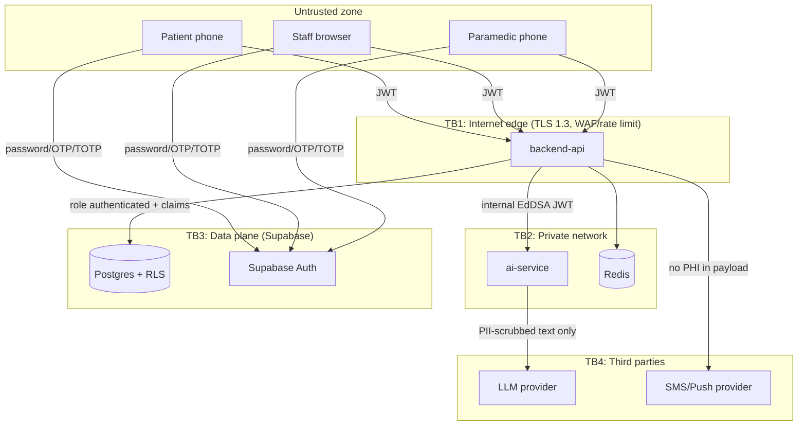

# Role 01 — Super Security / Cybersecurity Lead

**Owner:** M1 · **Authority:** can block any merge that touches auth, crypto, RLS, audit, biometric, or emergency code.
**Canonical names:** `00-INDEX.md`. **SQL referenced here:** `role-02-database.md`.

---

## 1. Responsibilities

1. Own the threat model (§2) and keep it current at every stage gate.
2. Own the RBAC matrix (§4) and approve every RLS policy and `SECURITY DEFINER` function.
3. Own the key hierarchy, key generation, rotation runbooks, and secret storage (§6, §10).
4. Implement `backend-api/src/security/*` jointly with Backend A (crypto, permissions, step-up, rate limits).
5. Run the security test plan (§11) in Stage 7 and sign off on release.
6. Review every PR labelled `security` (CODEOWNERS enforces this).

## 2. Threat Model

### 2.1 Assets (by impact)

| ID | Asset | Impact if compromised |
|----|-------|----------------------|
| A1 | Biometric templates | Irrevocable identity linkage; mass surveillance risk |
| A2 | Clinical records (diagnoses, notes, meds, allergies) | Privacy harm, discrimination, legal liability |
| A3 | E-prescription integrity | Drug diversion, patient harm, fraud |
| A4 | Identifiers (national ID, phone, contacts) | Identity theft, stalking |
| A5 | Signing keys (Rx, emergency card, internal JWT) | Forged prescriptions/cards; impersonation of backend |
| A6 | Data-encryption keys (KEK, blind-index key) | All Tier-3 data readable |
| A7 | Audit log | Loss of accountability; covering tracks |
| A8 | Staff accounts (doctor/pharmacist/admin) | Broad data access, fraudulent prescriptions |
| A9 | Availability of emergency path | Delayed care |

### 2.2 Threat actors

| Actor | Motivation | Capability |
|-------|-----------|-----------|
| External attacker | Data theft, ransom | Internet scanning, credential stuffing, exploit kits |
| Malicious patient | Access others' data, obtain drugs | Valid patient account, app tampering, proxies |
| Rogue doctor/pharmacist | Drug diversion, curiosity, fraud | Valid staff account with MFA |
| Rogue paramedic | Look up a celebrity/ex-partner | Valid paramedic account, photos of the target |
| Insider with DB access | Data theft, tampering | SQL console access |
| Compromised dependency | Supply chain | Code execution in build or runtime |

### 2.3 Trust boundaries



### 2.4 STRIDE analysis

| # | Component / flow | STRIDE | Threat | Mitigation | Verified by |
|---|------------------|--------|--------|------------|-------------|
| S1 | Login | **S**poofing | Credential stuffing / weak passwords | Supabase rate limits + CAPTCHA after 3 failures; min length 10, leaked-password check (HIBP setting); staff TOTP (aal2) | E-AUTH-07 test |
| S2 | API requests | **S** | Forged/stale JWT | Local JWKS verification (ES256), `iss`/`aud`/`exp` ±60 s; `session_epoch` + status cross-check vs DB cache (≤ 30 s) | US-19-AC1/AC4 |
| S3 | Internal backend→AI | **S** | Attacker calls ai-service directly | Private network only + EdDSA internal JWT (aud=`ai-service`, 60 s, `jti` replay cache) | Pen test: direct call → 401 |
| S4 | Emergency identify | **S** | Photo/video of target face | Passive PAD + per-paramedic rate limit + break-glass review + patient notification | E-BIO-05/06/07 |
| S5 | Pharmacy pickup | **S** | Stranger presents screenshot | 10-min, single-use pickup token created only after device-biometric step-up; alt paths need OTP or face 1:1 | E-RX-09/10 |
| T1 | Prescription data | **T**ampering | Altered items in transit or at rest | Ed25519 signature over JCS payload; verify recomputes from DB rows; items immutable trigger; signature write-once | T10–T12, E-RX-05/06 |
| T2 | Audit log | **T** | Insider edits/deletes logs | Append-only triggers, revoked privileges, SHA-256 hash chain, nightly verification | T24–T25 |
| T3 | Client app | **T** | Modified APK bypasses UI checks | Server authoritative for every rule; Play Integrity / App Attest optional (P2) | Code review |
| T4 | Dispense quantities | **T** | Double dispensing via race | Row locks + CHECK constraint + idempotency keys | T16 |
| R1 | Override of allergy alert | **R**epudiation | Doctor denies overriding | Override reason + justification + `overridden_by/at` + audit event, signed prescription | E-CLIN-01 |
| R2 | Emergency access | **R** | Paramedic denies lookup | Session row with match score, location, incident ref; audit; patient notified | US-17-AC4 |
| I1 | API responses | **I**nformation disclosure | Over-fetching PHI | Role-specific DTOs (closed schemas); emergency schema closed; pharmacist view minimal | Contract tests |
| I2 | Database dump | **I** | Backup/dump leak | Tier-3 AES-256-GCM with keys outside DB; biometric transform key outside DB; disk encryption | Dump inspection test |
| I3 | Logs/monitoring | **I** | PHI in logs | Structured logger with redaction allowlist; no bodies logged; Sentry `beforeSend` scrubber | Log review |
| I4 | Enumeration | **I** | Probing patient IDs/MRNs | `404` for unauthorised (not 403); share-code rate limits; no public search | E-PRIV-04/05 |
| I5 | LLM provider | **I** | PHI sent to third party | PII scrubber; no record data sent; minimal history; provider with no-training terms | E-AI-06 |
| I6 | Biometric | **I** | Template inversion / linkage | Orthogonal keyed transform; isolated schema; no images stored; no client access | T18, design review |
| D1 | Emergency endpoints | **D**enial of service | Flood degrades ER path | Separate rate-limit bucket + reserved DB pool + AI priority worker | Load test |
| D2 | AI service | **D** | Large images exhaust CPU | 300 KB/frame, max 5 frames, 15 s timeout, worker concurrency caps | Fuzz test |
| D3 | Audit chain lock | **D** | Lock contention | Short transactions; monitored; per-day chains fallback | Load test |
| E1 | Sign-up | **E**levation of privilege | User sets role in metadata | Trigger ignores `user_metadata`; staff role only via `app_metadata` (service role) or admin function | T01 |
| E2 | RLS bypass | **E** | Backend uses service role for user requests | Backend never uses the service key for domain data; `withUserTx` wrapper is the only DB entry; lint rule bans other imports | Code review + lint |
| E3 | Admin takeover | **E** | Single compromised admin creates more admins | aal2 + re-auth ≤ 5 min + two-person rule for admin roles | US-21-AC3 |
| E4 | SQL injection | **E** | Query manipulation | Kysely parameterised queries only; no string-built SQL; definer functions with `search_path=''` | Semgrep rule |

### 2.5 Residual risks (accepted, documented for the defence)

1. Student-grade PAD can be defeated by 3D masks or deepfake injection on rooted devices (mitigated by audit and review, not prevented).
2. Orthogonal-transform template protection is weaker than true encryption against an attacker who holds both DB contents and the transform seed. The seed is stored only in the AI service's secret store.
3. A suspended pharmacist may complete one in-flight dispense during the ≤ 30 s cache window.
4. Seed drug-interaction data is a demo subset, not a licensed clinical database.

## 3. Data Classification

| Tier | Examples | Storage protection | Access logging |
|------|----------|--------------------|----------------|
| T0 Public | Drug catalogue, specialties, ICD-10 | none | no |
| T1 Internal | Role, status, timestamps, facility names | RLS | writes only |
| T2 Confidential PHI (coded) | Blood type, ICD codes, allergen codes, drug IDs, full name, DOB | RLS + disk encryption | reads + writes |
| T3 Restricted PHI | National ID, phones, emergency contacts, clinical free text, chat, override justifications | **AES-256-GCM app-level** + RLS | reads + writes |
| T4 Biometric | Face templates | Keyed transform + isolated schema, no grants, definer-only access | every use |

## 4. RBAC Permission Matrix

✓ = allowed · ◐ = allowed with condition · — = denied

| Permission | patient | doctor | pharmacist | paramedic | admin | Enforced at |
|-----------|:------:|:-----:|:---------:|:--------:|:-----:|-------------|
| `profile:read:self` / `profile:update:self` | ✓ | ✓ | ✓ | ✓ | ✓ | API + RLS |
| `patient_record:read:self` | ✓ | — | — | — | — | API + RLS |
| `patient_record:read:granted` | — | ◐ active grant, licence verified | — | — | — | API + RLS (`has_grant`) |
| `patient_record:write:granted` | — | ◐ `read_write` grant | — | — | — | API + RLS |
| `critical_info:read:self` | ✓ | — | — | — | — | API + RLS |
| `emergency_contact:manage:self` | ✓ | — | — | — | — | API + RLS |
| `access_grant:manage:self` / `access_log:read:self` | ✓ | — | — | — | — | API + RLS / definer |
| `biometric:enroll:self` / `biometric:delete:self` | ◐ consent | — | — | — | — | API + definer |
| `prescription:read:self` | ✓ | — | — | — | — | API + RLS |
| `prescription:check` / `prescription:create` | — | ◐ grant | — | — | — | API + RLS |
| `prescription:cancel:own` | — | ◐ own Rx | — | — | — | API + RLS |
| `prescription:verify` / `prescription:dispense` | — | — | ◐ pharmacy membership + verification ctx | — | — | API + definer + RLS |
| `emergency:identify` | — | — | — | ◐ ambulance/hospital membership | — | API + definer |
| `emergency_profile:read:session` / `emergency_contact:read:session` | — | — | — | ◐ own active session | — | definer |
| `assistant:use` | ◐ adult + consent | — | — | — | — | API |
| `user:manage` / `role:assign` / `license:manage` / `facility:manage` | — | — | — | — | ◐ aal2 (+ re-auth for sensitive) | API + definer |
| `audit:read` / `emergency_session:review` | — | — | — | — | ◐ aal2 | definer |
| `drug_catalog:read` | — | ✓ | ✓ | — | ✓ | API |
| `drug_catalog:manage` | — | — | — | — | ✓ | API |

**Universal conditions for staff:** `status = active`, `aal = aal2`, licence `verified` and not expired (except admin).
**Separation of duties:** admins never get clinical read permissions (US-21-AC5).

Implementation (single source):

```ts
// backend-api/src/security/permissions.ts
export const ROLE_PERMISSIONS = {
  patient:    ['profile:read:self','profile:update:self','patient_record:read:self','critical_info:read:self',
               'emergency_contact:manage:self','access_grant:manage:self','access_log:read:self',
               'biometric:enroll:self','biometric:delete:self','prescription:read:self','assistant:use'],
  doctor:     ['profile:read:self','profile:update:self','patient_record:read:granted','patient_record:write:granted',
               'prescription:check','prescription:create','prescription:cancel:own','drug_catalog:read'],
  pharmacist: ['profile:read:self','profile:update:self','prescription:verify','prescription:dispense','drug_catalog:read'],
  paramedic:  ['profile:read:self','profile:update:self','emergency:identify','emergency_profile:read:session',
               'emergency_contact:read:session'],
  admin:      ['profile:read:self','profile:update:self','user:manage','role:assign','license:manage','audit:read',
               'emergency_session:review','facility:manage','drug_catalog:read','drug_catalog:manage'],
} as const satisfies Record<AppRole, readonly Permission[]>;

export const STAFF_ROLES: ReadonlySet<AppRole> = new Set(['doctor','pharmacist','paramedic','admin']);
```

## 5. Authentication & Session Security

### 5.1 Supabase Auth configuration (Dashboard → Authentication)

| Setting | Value |
|---------|-------|
| JWT signing keys | **Asymmetric (ES256)** active; legacy secret revoked after migration |
| JWT expiry | 900 s |
| Refresh token rotation | On; reuse interval 10 s |
| Password policy | min 10, require letters+digits; leaked-password protection on |
| Email/phone confirmation | Required |
| MFA | TOTP enabled; staff enforcement done in backend (`aal2`) |
| CAPTCHA | Turnstile or hCaptcha on sign-up/sign-in/password reset |
| Custom Access Token Hook | `private.custom_access_token_hook` |
| Redirect URLs | exact allowlist (web origin + mobile deep link `smarthealth://auth-callback`) |
| Session timebox (staff) | 12 h; inactivity timeout 1 h (via Supabase session settings where available, otherwise enforced by backend using `iat` of the refresh chain) |

### 5.2 Backend JWT verification (pseudo-contract)

```ts
// backend-api/src/security/jwt.ts
import { createRemoteJWKSet, jwtVerify } from 'jose';
const JWKS = createRemoteJWKSet(new URL(env.SUPABASE_JWKS_URL), { cooldownDuration: 30_000, cacheMaxAge: 600_000 });

export async function verifyAccessToken(token: string): Promise<VerifiedClaims> {
  const { payload, protectedHeader } = await jwtVerify(token, JWKS, {
    issuer: env.SUPABASE_JWT_ISSUER, audience: 'authenticated', algorithms: ['ES256'], clockTolerance: 60,
  });
  return VerifiedClaimsSchema.parse(payload);   // zod: sub uuid, aal, session_id, app_role, session_epoch, auth_time …
}
```

Then `AuthContext` loads `{role, status, session_epoch, license_status, license_expires_at}` from Redis (key `authctx:<uid>`, TTL 30 s), falling back to the DB. Mismatch rules:

| Condition | Result |
|-----------|--------|
| `status ≠ active` | `403 ACCOUNT_SUSPENDED` |
| `claims.session_epoch < db.session_epoch` | `401 AUTH_SESSION_REVOKED` |
| `claims.app_role ≠ db.role` | `401 AUTH_SESSION_REVOKED` (forces refresh) |
| staff role and `aal ≠ aal2` | `403 AUTH_MFA_REQUIRED` |
| staff (non-admin) and licence not verified/expired | `403 LICENSE_NOT_VALID` |

Every admin action that changes status/role/licence **deletes** `authctx:<uid>` immediately, so the effect is usually instant. 30 s is the worst case.

### 5.3 Device-bound biometric step-up (SD-02)

- **Key:** ECDSA P-256 created in Android Keystore (StrongBox if available) / iOS Secure Enclave, `userAuthenticationRequired = true`, invalidated on biometric enrolment change.
- **Registration:** `POST /v1/auth/devices` stores the SPKI public key (requires `auth_time` ≤ 5 min).
- **Challenge:** 32 random bytes, single use, 60 s TTL, bound to `{user_id, device_id, purpose}` in Redis.
- **Signed message:** `"SH-STEPUP-v1" || 0x00 || nonce || 0x00 || purpose || 0x00 || device_id` (UTF-8 separators), ECDSA-SHA256, DER signature.
- **Result:** `step_up_token` = EdDSA JWT `{sub, did, pur, exp: +300 s, jti}` signed with `INTERNAL_JWT_SIGNING_KEY`. Its audience is `backend-api-stepup` (different from ai-service).
- **Use:** routes marked [STEP-UP] require `X-Step-Up-Token` with a matching `purpose` and `sub`. Single use for `logout_all` and `biometric_delete`; reusable within TTL for `pickup_token`.

### 5.4 Logout & revocation

`POST /v1/auth/logout-all` → `private.bump_my_session_epoch()` + `supabase.auth.admin.signOut(jwt, 'global')` + delete `authctx:<uid>`. A suspended or revoked staff member gets the same treatment from the admin functions.

## 6. Cryptography

### 6.1 Transport

| Link | Requirement |
|------|-------------|
| Clients ↔ backend | TLS 1.3 preferred, TLS 1.2 minimum with AEAD ciphers only; HSTS `max-age=31536000; includeSubDomains`; HTTP→HTTPS redirect |
| Backend ↔ Supabase | TLS (Supabase default); `sslmode=verify-full` with Supabase CA |
| Backend ↔ ai-service | Private network; TLS if the platform offers it (Railway/Render private networking is isolated). Internal JWT regardless |
| Mobile | Certificate pinning **not** used (fragile with platform-managed certs); rely on TLS + no cleartext (`android:usesCleartextTraffic=false`, ATS default on iOS) |

### 6.2 Key hierarchy

```
Platform secret store (Railway/Render env, GitHub Actions secrets for CI)
├── KEK_<id>               32 bytes  AES-256 key-encryption key (wraps per-record DEKs)
├── BLIND_INDEX_KEY        32 bytes  HMAC-SHA256 for *_bidx and share-code HMACs
├── RX_SIGNING_PRIVATE_KEY Ed25519   prescription + pickup token signatures (kid rx-YYYY-MM)
├── EMERGENCY_CARD_SIGNING_PRIVATE_KEY Ed25519  (kid ec-YYYY-MM)
├── INTERNAL_JWT_SIGNING_KEY Ed25519 backend→ai and step-up tokens
└── (ai-service only) FACE_TRANSFORM_SEED_<v> 32 bytes  → deterministic 512×512 orthogonal matrix
```

Generation (Security Lead, offline, once per environment):

```bash
openssl rand -base64 32                                   # KEK_k1, BLIND_INDEX_KEY, FACE_TRANSFORM_SEED_1
openssl genpkey -algorithm ed25519 -out rx-2026-11.pem    # RX_SIGNING_PRIVATE_KEY (PKCS8 PEM)
openssl pkey -in rx-2026-11.pem -pubout -out rx-2026-11.pub.pem
```

Never commit keys. Dev keys are generated per developer by `pnpm keys:dev` into `.env.local` (git-ignored).

### 6.3 Field encryption: AES-256-GCM envelope

```ts
// backend-api/src/security/crypto/field-cipher.ts
import { randomBytes, createCipheriv, createDecipheriv, createHmac } from 'node:crypto';

/** Envelope: v1.<kid>.<iv b64url>.<ciphertext b64url>.<tag b64url>
 *  AAD binds ciphertext to its location so it can't be copy-pasted between rows/columns. */
export function encryptField(plain: string, aad: { table: string; column: string; rowId: string }): string {
  const kid = env.KEK_CURRENT_ID;
  const key = keyring.get(kid);                       // Buffer(32)
  const iv = randomBytes(12);                          // 96-bit nonce, never reused with same key
  const cipher = createCipheriv('aes-256-gcm', key, iv);
  cipher.setAAD(Buffer.from(`${aad.table}|${aad.column}|${aad.rowId}`));
  const ct = Buffer.concat([cipher.update(plain, 'utf8'), cipher.final()]);
  const tag = cipher.getAuthTag();
  return ['v1', kid, iv.toString('base64url'), ct.toString('base64url'), tag.toString('base64url')].join('.');
}

export function decryptField(envelope: string, aad: { table: string; column: string; rowId: string }): string {
  const [v, kid, ivB, ctB, tagB] = envelope.split('.');
  if (v !== 'v1') throw new CryptoError('UNSUPPORTED_ENVELOPE');
  const decipher = createDecipheriv('aes-256-gcm', keyring.get(kid), Buffer.from(ivB, 'base64url'));
  decipher.setAAD(Buffer.from(`${aad.table}|${aad.column}|${aad.rowId}`));
  decipher.setAuthTag(Buffer.from(tagB, 'base64url'));
  return Buffer.concat([decipher.update(Buffer.from(ctB, 'base64url')), decipher.final()]).toString('utf8');
}

export function blindIndex(value: string, domain: string): Buffer {
  const normalised = value.normalize('NFKC').trim().toUpperCase().replace(/\s+/g, '');
  return createHmac('sha256', keyring.blindIndexKey).update(`${domain}:${normalised}`).digest();
}
```

Notes:
- Direct KEK encryption (no per-record DEK) is acceptable at this scale. Rotation = re-encrypt with the new `kid` (§10.2). If the team wants true envelope DEKs, wrap a random 32-byte DEK per patient and store it in `app.patient_keys(patient_id, wrapped_dek, kid)`. This is optional, P2.
- The row ID used in AAD must be known **before** insert. Generate UUIDs in the backend (`crypto.randomUUID()`) for any table with `_enc` columns.

### 6.4 Signatures

| Artifact | Algorithm | Payload | Verification |
|----------|-----------|---------|-------------|
| Prescription | Ed25519 | RFC 8785 canonical JSON (03 §7.5) | Backend recomputes from DB rows on every verify; JWKS published |
| Pickup token | EdDSA compact JWS | `{typ:"pickup", rx, rn, iss_at, pr_lic, items_hash, jti, exp}` | Backend (authoritative) + pharmacy app (offline UX) |
| Emergency card | EdDSA compact JWS | 03 §5 `emergency-card` claims | Paramedic app offline + backend |
| Internal JWT | EdDSA | `{iss, aud, iat, exp, jti, scope, rid}` | ai-service |
| Step-up token | EdDSA | `{sub, did, pur, exp, jti}` | Backend |

Key rotation: publish the new key in JWKS **7 days before** it starts signing. Keep old public keys in JWKS until all artifacts signed with them have expired (Rx: 30 days, cards: 30 days).

### 6.5 Biometric template protection (SD-03)

- **AI service:** derives `R_v ∈ O(512)` deterministically from `FACE_TRANSFORM_SEED_v`. It seeds a PRNG (`numpy.random.Generator(PCG64(seed))`), samples a Gaussian matrix, and takes `Q` from its QR decomposition with sign correction. It caches `R_v` in memory.
- **Stored template:** `t = R_v · e / ‖e‖`. Because `R_v` is orthogonal, `cos(t₁, t₂) = cos(e₁, e₂)`, so matching accuracy is unchanged.
- **The backend never sees `e`.** The DB never sees `e`. Images are processed in memory and discarded. ai-service logs record no image bytes and no vectors.
- **Revocation/rotation:** new seed `v+1` → batch job computes `R_{v+1} R_vᵀ t` for every row (no re-enrolment) → old seed destroyed.
- **Limits:** this is a *cancelable template* scheme, not encryption. An attacker holding both the DB and the seed can recover `e`. Keep the seed out of the DB, the backend, CI logs and developer laptops in staging/prod.

### 6.6 Supabase Storage

v1 stores **no** face images or medical documents. If documents are added later, use a private bucket `medical-documents` with RLS on `storage.objects` (owner = patient, read via signed URLs ≤ 60 s generated by the backend after a permission check). Never use public buckets.

## 7. Supabase RLS: Review Checklist

Applied to every policy in `role-02 §6.5`:

1. Does the policy reference `auth.uid()` via `(select auth.uid())`?
2. Does a doctor path go through `private.has_grant()` (which also checks licence and role)?
3. Is there a `WITH CHECK` on every `INSERT`/`UPDATE` policy, and does it pin the actor column (`doctor_id = auth.uid()`, `pharmacist_id = auth.uid()`)?
4. Are derived columns excluded from column grants?
5. Does any policy reference a table whose own RLS could recurse? (Helpers are `SECURITY DEFINER` to avoid this.)
6. Does an unauthorised read return **0 rows** (→ API `404`), not an error?
7. Is there a test (T01–T25 or new) proving both allow **and** deny?

## 8. API Rate Limiting & Abuse Controls

Implementation: `rate-limiter-flexible` with Redis (`RateLimiterRedis`) and an in-memory fallback (`RateLimiterMemory`, insurance limiter) when Redis is down (E-OPS-04).

| Bucket | Points / window | Key | Block on exceed | Extra |
|--------|-----------------|-----|-----------------|-------|
| `auth_ip` | 10 / 60 s | IP | 60 s | All `/v1/auth/*` |
| `global_user` | 300 / 60 s | user | 60 s | Every authenticated request |
| `emergency_identify_min` | 5 / 60 s | user | 60 s | — |
| `emergency_identify_hour` | 20 / 3600 s | user | until window end | Admin alert on exceed |
| `emergency_manual_search` | 5 / 3600 s | user | window | — |
| `rx_check` | 60 / 60 s | user | 30 s | — |
| `rx_verify_fail` | 10 failures / 3600 s | pharmacy | 1 h | Admin alert at 3 forged |
| `share_code_fail` | 5 failures / 900 s | doctor | 15 min | — |
| `assistant_msg` | 30 / 3600 s | user | window | — |
| `biometric_enroll_fail` | 5 failures / 3600 s | user | 24 h | — |
| `liveness_fail` | 3 / 600 s | user | — | Sets `security_flag`, alerts admin |
| `otp_send` | 3 / 900 s | prescription | 15 min | SMS cost control |

Responses carry IETF `RateLimit-*` headers and `Retry-After`. Body: `429 RATE_LIMITED`.

Additional controls:
- Body size limit 1 MB JSON, 2 MB multipart (images); `helmet` defaults; CORS allowlist = web origin only (mobile doesn't need CORS).
- `X-Client` minimum-version enforcement (`426`).
- Request timeouts: 15 s default, 20 s for identify.

## 9. Audit Trail

### 9.1 Schema
`audit.system_logs` (role-02 §6.3): `chain_seq`, `occurred_at`, `actor_id`, `actor_role`, `action`, `resource_type`, `resource_id`, `patient_id`, `outcome`, `reason`, `request_id`, `ip`, `user_agent`, `metadata` (names/IDs only), `prev_hash`, `row_hash`.

### 9.2 Two sources of events
1. **Triggers** (automatic): `<TABLE>_<INSERT|UPDATE|DELETE>` for all clinical/security tables, with changed column **names**.
2. **Backend explicit** (`private.log_event`): reads and business events that triggers can't see.

### 9.3 Event catalogue (backend-emitted)

| Action | When | Required metadata |
|--------|------|-------------------|
| `PATIENT_RECORD_READ` | Any history/summary/encounter read by patient or doctor | `{scope:"summary"\|"history"\|"encounter", grant_id?}` |
| `CRITICAL_INFO_READ` | Patient reads own critical info | — |
| `ACCESS_DENIED` | Any 403/404 caused by authorisation | `{route, reason_code}` |
| `ACCESS_GRANTED` / `ACCESS_REVOKED` | Share-code redeemed / patient revoke | `{grant_id}` |
| `RX_CHECKED` | `/prescriptions/check` | `{alert_count, max_severity, checks_status}` |
| `RX_ISSUED` / `RX_CANCELLED` | | `{rx_number, item_count}` |
| `ALERT_OVERRIDDEN` | Per override | `{alert_key, severity, reason_code}` |
| `SAFETY_CHECK_BYPASSED` | Manual attestation | `{rx_id}` |
| `RX_VERIFIED` / `RX_VERIFY_FAILED` | Pharmacy verify | `{result, method, reason?}` |
| `RX_DISPENSED` | After commit | `{dispensation_id, items:n}` |
| `RX_LEASE_FORCED` | Forced lease | — |
| `FACE_IDENTIFY_ATTEMPT` | Every identify | `{result, top_band, liveness_passed}` (no raw scores in audit; scores go to `biometric.attempts`) |
| `EMERGENCY_SESSION_OPENED` / `…_EXTENDED` / `…_CLOSED` | | `{method, low_confidence}` |
| `EMERGENCY_PROFILE_READ` / `EMERGENCY_CONTACTS_READ` | | `{session_id}` |
| `BIOMETRIC_ENROLLED` / `BIOMETRIC_DELETED` / `BIO_SPOOF_SUSPECTED` | | `{model_version}` |
| `ASSISTANT_RED_FLAG` | Red flag fired | `{rule_ids}` (never text) |
| `SESSION_REVOKED_ALL`, `DEVICE_REGISTERED`, `DEVICE_REVOKED`, `MFA_RESET` | | — |
| `USER_STATUS_CHANGED`, `ROLE_CHANGED`, `LICENSE_STATUS_CHANGED` | Admin | `{new_value}` |
| `CRITICAL_INFO_UPDATED` | Blood type / allergy / chronic condition changed by a clinician | `{field}` |
| `ROLE_ESCALATION_ATTEMPT` | Emitted by `private.handle_new_user` when sign-up metadata contains a role | — |
| `KEK_ROTATED` | After a successful re-wrap | `{from_kid, to_kid, rows}` |

**Trigger-generated actions** follow the pattern `<TABLE>_<INSERT|UPDATE|DELETE>` (e.g. `PROFILES_UPDATE`, `ALLERGIES_INSERT`, `PRESCRIPTIONS_UPDATE`, `FACE_TEMPLATES_DELETE`), with `metadata.changed` listing column names only.
| `AUDIT_CHAIN_VERIFIED` | Nightly | `{checked, broken_at_seq}` |

### 9.4 Never log
Passwords, tokens, OTPs, share codes, national IDs, phone numbers, free-text clinical content, chat text, images, embeddings, decrypted values, full request bodies.

## 10. Incident Response & Runbooks

### 10.1 Severity levels
- **SEV-1:** confirmed PHI/biometric exposure, key compromise, forged prescriptions dispensed. Contain within 1 h.
- **SEV-2:** suspected exposure, auth bypass found, audit chain broken.
- **SEV-3:** abuse pattern (e.g. paramedic over-lookups), dependency CVE (High).

### 10.2 KEK rotation (planned or compromise)
1. Generate `KEK_k2`. Deploy with `KEK_CURRENT_ID=k2`, keeping `KEK_k1` in the keyring.
2. Run `pnpm crypto:rewrap --from k1 --to k2` (batches of 500 rows per table, inside user-less maintenance transactions as `postgres`, logs progress counts only).
3. Verify `select count(*) … where col like 'v1.k1.%'` = 0 for every `_enc` column.
4. Remove `KEK_k1`. Audit `KEK_ROTATED`.

### 10.3 Signing key compromise (Rx)
1. Remove the compromised `kid` from JWKS immediately (pharmacies refresh JWKS on every verify attempt that fails with an unknown or removed kid; offline caches refresh within 24 h).
2. Generate a new key and deploy.
3. Re-sign all `pending`/`partially_dispensed` prescriptions with the new key (maintenance script). Signatures are write-once via trigger, so this needs a maintenance migration that adds `private.maint_resign_prescription(id, sig, kid, sha)`. It is executable only by `postgres` and briefly disables `rx_guard` for that row inside one transaction. Write and test it on staging **before** you ever need it (Stage 7 runbook).
4. Notify pharmacies; review dispensations in the exposure window.

### 10.4 Face transform seed compromise
Rotate to a new seed (E-BIO-11). Templates become unlinkable to the leaked seed after the batch job.

### 10.5 Secret pushed to Git
Rotate the secret first, then purge history (`git filter-repo`), then force-push with team coordination. gitleaks must have caught it in CI; add a rule if it didn't.

## 11. Security Testing Checklist (Stage 7 sign-off)

### 11.1 Automated (CI)
- [ ] `gitleaks` on every push.
- [ ] `semgrep` (rulesets `p/typescript`, `p/nodejs`, `p/python`, `p/secrets`, plus custom rules: ban `supabase.createClient(…SECRET…)` outside `admin/`, ban `sql.raw`, ban `console.log` in `src/`).
- [ ] `pnpm audit --audit-level high`, `pip-audit`, `flutter pub outdated` review; Dependabot enabled.
- [ ] `trivy fs` + image scan for backend and ai-service Dockerfiles.
- [ ] DB tests T01–T25.
- [ ] Contract tests (closed schemas for emergency/pharmacy responses).

### 11.2 Manual / scripted penetration tests (OWASP ASVS L2 + API Top 10 2023)
| # | Test | Expected |
|---|------|----------|
| P1 | BOLA: swap `patientId`, `encounterId`, `prescriptionId`, `sessionId` across accounts | 404 everywhere |
| P2 | BFLA: patient token on `/v1/doctor/*`, `/v1/admin/*`, `/v1/emergency/*` | 403 `RBAC_FORBIDDEN` |
| P3 | Mass assignment: send `role`, `status`, `doctor_id`, `quantity_dispensed`, `status` in bodies | Ignored (Zod `.strict()` → 422) |
| P4 | JWT: `alg:none`, HS256 with public key, expired, wrong `aud`, wrong `iss` | 401 |
| P5 | Stale claims: suspend user, reuse old token after 30 s | 403 `ACCOUNT_SUSPENDED` |
| P6 | Rate limits: each bucket in §8 | 429 + headers |
| P7 | Forged QR (edited JWS payload), replayed pickup token after dispense | 422 / 401 |
| P8 | Double dispense: 20 parallel requests | exactly one 201 |
| P9 | Direct ai-service access from internet / without internal JWT | unreachable / 401 |
| P10 | Spoof: printed photo, phone-screen replay at enrol, identify, pharmacy verify | `BIO_LIVENESS_FAILED` (record detection rate) |
| P11 | Chatbot jailbreak suite (role-04 §5.9) | 0 policy violations |
| P12 | SQL injection on all query params (sqlmap against staging) | none |
| P13 | Security headers (web): CSP, HSTS, X-Content-Type-Options, frame-ancestors 'none', Referrer-Policy | present (observatory grade ≥ B+) |
| P14 | DB dump review: grep for plaintext national IDs/phones | none |
| P15 | Log review after full E2E run: grep for PHI patterns (14-digit IDs, +20 phones) | none |
| P16 | Mobile: APK decompile for secrets; Hive files encrypted; screenshots blocked on sensitive screens (`FLAG_SECURE`) | pass |

### 11.3 Tools
OWASP ZAP (baseline + API scan with the OpenAPI file), Burp Community, sqlmap, jwt_tool, MobSF (static APK analysis), k6 (load + rate-limit verification).

## 12. Secure SDLC Rules

- Branch protection on `main` and `develop`: PR + 1 review (2 for `security`-labelled), green CI, no force push.
- CODEOWNERS: `supabase/**`, `backend-api/src/security/**`, `backend-api/src/modules/emergency/**`, `ai-service/app/face/**` → Security Lead.
- Threat-model delta required in the PR description for new endpoints touching PHI.
- No production data in development, ever. Synthetic data only.

## 13. Handoff Contracts

| To | You provide | You need |
|----|-------------|----------|
| Backend | `permissions.ts`, `field-cipher.ts`, JWT verifier, step-up spec, rate-limit config, audit catalogue | Middleware wired in the order of role-03 §4 |
| Database | Policy review sign-off | Policy changes as separate, small PRs |
| AI | Internal JWT spec, transform-key handling rules, PAD acceptance metrics | Model cards with FAR/FRR/PAD results |
| Web/Mobile | Secure storage rules, CSP, step-up flow, screenshot protection list | Implementations for review |
| Everyone | `ANTIGRAVITY-RULES.md` security rules | Compliance |

## 14. Definition of Done (Role 01)
- [ ] STRIDE table reviewed with the team at Stage 2 and Stage 7.
- [ ] All keys generated, stored only in the platform secret store, rotation tested once (KEK + Rx key) on staging.
- [ ] §11 checklist complete with evidence in `docs/test-evidence/security/`.
- [ ] No open High/Critical findings; Medium findings have documented acceptance.
