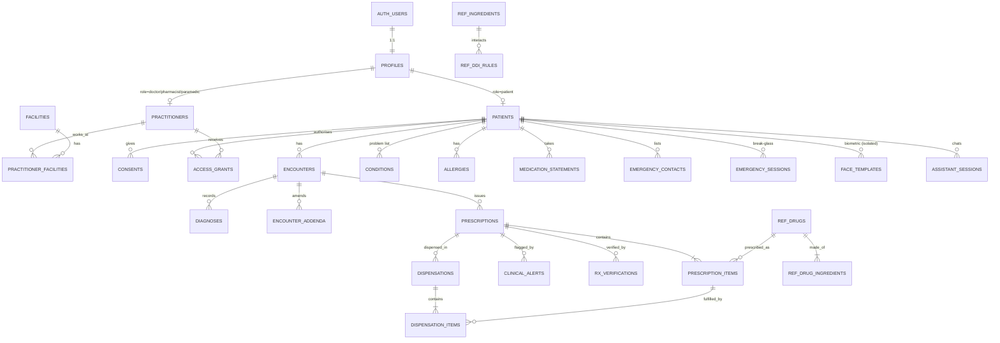

# Role 02 — Database Engineer (PostgreSQL / Supabase)

**Owner:** M2 · **Reviewers:** Security Lead (every policy/function), Backend Lead (every column used by APIs)
**Canonical names:** `00-INDEX.md §5`. **Status of this SQL:** every migration below was executed end-to-end on
PostgreSQL 16 + pgvector 0.6.0 (HNSW needs ≥ 0.5; hosted Supabase ships a newer pgvector), and the behavioural tests in §9 passed. Those tests include the concurrent
double-dispense race. They ran against a local stub of Supabase's `auth` schema, so re-run them on a
Supabase branch/local CLI in Stage 1.

---

## 1. Responsibilities

| You own | You do NOT own |
|---------|----------------|
| Schemas, tables, enums, constraints, indexes | Encryption/decryption (backend, SD-04) |
| RLS policies + helper functions (with Security Lead) | API shapes (Backend Lead) |
| SECURITY DEFINER business functions in `private` | Face embedding generation (AI) |
| Triggers enforcing invariants (prescription quantities, immutability, audit) | Drug-interaction logic (AI) — you own the `ref` tables it reads |
| Audit log schema + hash chain + verification | Seed users with encrypted PHI (backend script `backend-api/scripts/seed-dev.ts`) |
| Reference-data seed (`ref.*`) + demo facilities | |
| pg_cron jobs, performance, backups/restore drill | |
| Migration hygiene (ordered, immutable after merge) | |

## 2. Folder Structure

```text
supabase/
├── config.toml                       # supabase CLI config (auth: jwt_expiry = 900, refresh rotation on)
├── migrations/
│   ├── 20261201000001_extensions_and_schemas.sql
│   ├── 20261201000002_enums_and_reference.sql
│   ├── 20261201000003_core_tables.sql
│   ├── 20261201000004_functions_and_triggers.sql
│   ├── 20261201000005_rls_policies.sql
│   ├── 20261201000006_secure_functions.sql
│   └── 20261201000007_jobs.sql
├── seed/
│   ├── 01_reference.sql              # ref.* + demo facilities (all envs)
│   └── README.md                     # how dev users are seeded via backend script
└── tests/
    ├── 00_supabase_stub.sql          # ONLY for plain-Postgres CI; never on Supabase
    ├── 01_setup.sql                  # users + practitioners
    ├── 02_patient_doctor_pharmacy.sql
    ├── 03_race_partial.sql + 03_race_one.sql
    └── 04_emergency_biometric_audit.sql
```

Migration rules:
1. File names are timestamped. **Never edit a merged migration.** Fix forward with a new one.
2. Every migration is idempotent where cheap (`if not exists`), but correctness relies on ordering, not idempotency.
3. `supabase db reset` must succeed from zero in CI on every PR that touches `supabase/`.
4. No seed data inside migrations (E-OPS-06). Reference data lives in `seed/01_reference.sql`.

## 3. Design Conventions

| Convention | Rule |
|-----------|------|
| Primary keys | `uuid default gen_random_uuid()`; bigint identity only for append-only logs |
| Timestamps | `timestamptz`, UTC; business "today" uses `Africa/Cairo` explicitly |
| Encrypted columns | suffix `_enc` (text envelope `v1.<kid>.<iv>.<ct>.<tag>`), produced by backend AES-256-GCM |
| Blind indexes | suffix `_bidx` (bytea HMAC-SHA256), unique where identity requires it |
| Enums | in `app` schema, lower_snake values, names in `00-INDEX §5.2` |
| Ref severities | `text` + `CHECK` (so `ai_ref_reader` never needs access to `app`) |
| Functions | `SECURITY DEFINER` only in `private`/`audit`; always `set search_path = ''`; fully-qualified names; explicit `grant execute` |
| RLS | `enable` + `force` on every `app` table; helper calls wrapped as `(select auth.uid())` for initPlan caching |
| Column privileges | `UPDATE` granted per column; derived columns (`status`, `quantity_dispensed`) never client-writable |
| Error codes | business functions raise `P0001`–`P0005` (mapped by backend, see §8) or standard `42501`/`23505`/`23514` |

## 4. Entity-Relationship Overview



## 5. How the Backend Executes Queries (contract with Role 03)

The backend connects as login role **`api_server`** (`NOINHERIT`, member of `authenticated`).
Every request that touches PHI runs inside **one transaction**:

```sql
begin;
set local role authenticated;
select set_config('request.jwt.claims', $1, true);   -- $1 = JSON of the VERIFIED Supabase JWT claims
-- … domain queries / private.* function calls …
commit;
```

- `auth.uid()` and `auth.jwt()` then resolve to the caller. All RLS policies and `private.*` checks apply.
- `set local` / `set_config(…, true)` are transaction-scoped. Connection-pool reuse can't leak identity **provided every request uses a transaction**. The backend's `withUserTx()` wrapper (role-03 §5) is the only allowed entry point.
- Jobs (pg_cron) run as `postgres` and call `private.job_*` functions.

## 6. Migrations (authoritative SQL)

### 6.1 Extensions, schemas, roles — `supabase/migrations/20261201000001_extensions_and_schemas.sql`

```sql
-- 0001_extensions_and_schemas.sql
-- Extensions live in the Supabase-standard `extensions` schema.
create extension if not exists pgcrypto with schema extensions;
create extension if not exists vector   with schema extensions;
create extension if not exists pg_trgm  with schema extensions;

create schema if not exists app;
create schema if not exists biometric;
create schema if not exists audit;
create schema if not exists ref;
create schema if not exists private;

-- Lock everything down first, then grant the minimum.
revoke all on schema app, biometric, audit, ref, private from public, anon, authenticated;

-- The backend executes domain queries as `authenticated` (SD-07), so it needs USAGE on app/ref.
grant usage on schema app, ref to authenticated;
-- RLS helper functions live in `private`; execution is granted per function below.
grant usage on schema private to authenticated;
-- biometric and audit: NO usage for authenticated. Access only through SECURITY DEFINER functions.

-- Default privileges: new functions are NOT executable by public.
alter default privileges in schema private revoke execute on functions from public;
alter default privileges in schema app     revoke execute on functions from public;

-- Login roles (passwords set by ops via `alter role … password …`, never in Git).
do $$
begin
  if not exists (select 1 from pg_roles where rolname = 'api_server') then
    create role api_server login noinherit;
  end if;
  if not exists (select 1 from pg_roles where rolname = 'ai_ref_reader') then
    create role ai_ref_reader login;
  end if;
end $$;
-- api_server can switch to `authenticated` per transaction (SET LOCAL ROLE authenticated).
grant authenticated to api_server;
grant usage on schema ref to ai_ref_reader;
```

### 6.2 Enums & reference tables — `supabase/migrations/20261201000002_enums_and_reference.sql`

```sql
-- 0002_enums_and_reference.sql
-- ===== Enums (names are canonical — see docs/00-INDEX.md §5.2) =====
create type app.app_role                 as enum ('patient','doctor','pharmacist','paramedic','admin');
create type app.account_status           as enum ('pending_verification','active','suspended','deactivated');
create type app.license_status           as enum ('pending','verified','suspended','revoked','expired');
create type app.facility_type            as enum ('hospital','clinic','pharmacy','ambulance_service');
create type app.sex                      as enum ('male','female');
create type app.blood_type               as enum ('A+','A-','B+','B-','AB+','AB-','O+','O-','unknown');
create type app.data_source              as enum ('patient_reported','clinician_confirmed','imported');
create type app.allergen_type            as enum ('ingredient','drug_class','food','environmental','other');
create type app.allergy_severity         as enum ('mild','moderate','severe','anaphylaxis');
create type app.condition_status         as enum ('active','resolved','inactive');
create type app.encounter_type           as enum ('outpatient','inpatient','emergency','teleconsult');
create type app.grant_type               as enum ('patient_share','encounter','admin_override');
create type app.grant_status             as enum ('active','revoked','expired');
create type app.prescription_status      as enum ('pending','partially_dispensed','dispensed','cancelled','expired');
create type app.rx_item_status           as enum ('pending','partially_dispensed','dispensed','cancelled');
create type app.alert_type               as enum ('drug_drug','drug_allergy','duplicate_therapy','drug_condition');
create type app.alert_severity           as enum ('minor','moderate','major','contraindicated');
create type app.verification_method      as enum ('pickup_token','face_1to1','sms_otp','rx_code_only');
create type app.emergency_id_method      as enum ('face','emergency_card_qr','manual_search');
create type app.emergency_session_status as enum ('active','closed','expired');
create type app.triage_level             as enum ('emergency','urgent','soon','routine','self_care');
create type app.consent_type             as enum ('biometric_face','emergency_contacts_share','ai_assistant','terms_of_service');

-- ===== Reference data (non-PHI). Severity in ref is TEXT so ai_ref_reader needs no access to `app`. =====
create table ref.specialties (
  code        text primary key,                       -- e.g. 'internal_medicine'
  name_en     text not null,
  name_ar     text not null,
  sort_order  int  not null default 100
);

create table ref.icd10_codes (
  code               text primary key,                -- e.g. 'J45.909'
  title_en           text not null,
  title_ar           text,
  is_chronic_default boolean not null default false
);

create table ref.ingredients (
  code        text primary key check (code ~ '^ING-[A-Z0-9-]+$'),
  name_en     text not null,
  name_ar     text,
  atc_code    text,
  ddinter_id  text
);

create table ref.drug_classes (
  code            text primary key check (code ~ '^CLS-[A-Z0-9-]+$'),
  name_en         text not null,
  name_ar         text,
  duplicate_check boolean not null default false     -- true → two drugs in this class = duplicate therapy
);

create table ref.ingredient_classes (
  ingredient_code text not null references ref.ingredients(code) on update cascade,
  class_code      text not null references ref.drug_classes(code) on update cascade,
  primary key (ingredient_code, class_code)
);

create table ref.drugs (
  id            uuid primary key default gen_random_uuid(),
  code          text not null unique check (code ~ '^DRG-[A-Z0-9-]+$'),
  brand_name    text not null,
  generic_name  text not null,
  strength      text not null,                        -- display, e.g. '500 mg'
  dosage_form   text not null,                        -- tablet, capsule, syrup, inhaler, injection …
  route         text not null,                        -- oral, inhalation, iv, im, topical …
  base_unit     text not null,                        -- unit used for quantities: tablet, capsule, ml, puff, vial …
  is_controlled boolean not null default false,
  is_active     boolean not null default true,
  eda_reg_no    text                                  -- Egyptian Drug Authority registration no. (optional)
);
create index drugs_brand_trgm   on ref.drugs using gin (brand_name   extensions.gin_trgm_ops);
create index drugs_generic_trgm on ref.drugs using gin (generic_name extensions.gin_trgm_ops);

create table ref.drug_ingredients (
  drug_id         uuid not null references ref.drugs(id) on delete cascade,
  ingredient_code text not null references ref.ingredients(code) on update cascade,
  strength_value  numeric(12,4),
  strength_unit   text,
  primary key (drug_id, ingredient_code)
);

create table ref.ddi_rules (
  id             bigint generated always as identity primary key,
  ingredient_a   text not null references ref.ingredients(code) on update cascade,
  ingredient_b   text not null references ref.ingredients(code) on update cascade,
  severity       text not null check (severity in ('minor','moderate','major','contraindicated')),
  mechanism_en   text not null,
  mechanism_ar   text,
  management_en  text not null,
  management_ar  text,
  source         text not null,                       -- 'seed' | 'ddinter2'
  source_ref     text,
  check (ingredient_a < ingredient_b),                -- canonical ordering, one row per pair per source
  unique (ingredient_a, ingredient_b, source)
);

create table ref.allergy_cross_reactivity (
  id                 bigint generated always as identity primary key,
  allergen_class     text not null references ref.drug_classes(code),
  target_class       text not null references ref.drug_classes(code),
  severity_if_severe text not null check (severity_if_severe in ('minor','moderate','major','contraindicated')),
  severity_if_mild   text not null check (severity_if_mild   in ('minor','moderate','major','contraindicated')),
  note_en            text not null,
  note_ar            text,
  unique (allergen_class, target_class)
);

create table ref.drug_condition_rules (
  id              bigint generated always as identity primary key,
  class_code      text references ref.drug_classes(code),
  ingredient_code text references ref.ingredients(code),
  icd10_prefix    text not null,                      -- matches icd10_code LIKE prefix || '%'
  severity        text not null check (severity in ('minor','moderate','major','contraindicated')),
  message_en      text not null,
  message_ar      text,
  check (num_nonnulls(class_code, ingredient_code) = 1)
);

create table ref.crisis_resources (
  id          bigint generated always as identity primary key,
  country     text not null default 'EG',
  label_en    text not null,
  label_ar    text not null,
  phone       text not null,
  verified_at date                                    -- must be set before production use
);

grant select on all tables in schema ref to authenticated, ai_ref_reader;
```

### 6.3 Core tables — `supabase/migrations/20261201000003_core_tables.sql`

```sql
-- 0003_core_tables.sql
-- Column suffix conventions:
--   *_enc  : text envelope "v1.<kid>.<iv_b64url>.<ct_b64url>.<tag_b64url>" (AES-256-GCM, app-level, SD-04)
--   *_bidx : bytea HMAC-SHA256 blind index for equality search on encrypted values

-- ===== Identity =====
create table app.profiles (
  id               uuid primary key references auth.users(id) on delete cascade,
  role             app.app_role       not null default 'patient',
  status           app.account_status not null default 'pending_verification',
  full_name        text not null default '' check (char_length(full_name) <= 120),
  phone_enc        text,
  phone_bidx       bytea,
  preferred_locale text not null default 'ar' check (preferred_locale in ('ar','en')),
  session_epoch    int  not null default 0,
  security_flag    boolean not null default false,
  created_at       timestamptz not null default now(),
  updated_at       timestamptz not null default now()
);

create table app.facilities (
  id             uuid primary key default gen_random_uuid(),
  name           text not null,
  name_ar        text,
  type           app.facility_type not null,
  license_number text unique,
  governorate    text,
  address        text,
  phone          text,
  is_active      boolean not null default true,
  created_at     timestamptz not null default now(),
  updated_at     timestamptz not null default now()
);

create table app.practitioners (
  id                        uuid primary key references app.profiles(id) on delete cascade,
  practitioner_type         app.app_role not null check (practitioner_type in ('doctor','pharmacist','paramedic')),
  license_number            text not null unique,
  license_authority         text not null default 'EG-MOH',
  license_status            app.license_status not null default 'pending',
  license_status_changed_at timestamptz not null default now(),
  license_expires_at        date,
  specialty_code            text references ref.specialties(code),
  verified_by               uuid references app.profiles(id),
  verified_at               timestamptz,
  created_at                timestamptz not null default now(),
  updated_at                timestamptz not null default now(),
  check (practitioner_type <> 'doctor' or specialty_code is not null)
);

create table app.practitioner_facilities (
  practitioner_id  uuid not null references app.practitioners(id) on delete cascade,
  facility_id      uuid not null references app.facilities(id),
  role_at_facility text,
  started_at       timestamptz not null default now(),
  ended_at         timestamptz,
  primary key (practitioner_id, facility_id, started_at),
  check (ended_at is null or ended_at > started_at)
);
create index practitioner_facilities_active on app.practitioner_facilities (practitioner_id) where ended_at is null;

create table app.patients (
  id                     uuid primary key references app.profiles(id) on delete cascade,
  mrn                    text not null unique check (mrn ~ '^SH-[0-9A-HJKMNP-TV-Z]{8}$'),
  id_document_type       text not null default 'national_id'
                         check (id_document_type in ('national_id','passport','birth_certificate')),
  id_document_enc        text not null,
  id_document_bidx       bytea not null unique,
  date_of_birth          date not null check (date_of_birth > date '1900-01-01'),
  sex                    app.sex not null,
  blood_type             app.blood_type not null default 'unknown',
  blood_type_source      app.data_source,
  blood_type_confirmed_by uuid references app.profiles(id),
  blood_type_confirmed_at timestamptz,
  created_at             timestamptz not null default now(),
  updated_at             timestamptz not null default now()
);

create table app.consents (
  id           bigint generated always as identity primary key,
  patient_id   uuid not null references app.patients(id) on delete cascade,
  consent_type app.consent_type not null,
  version      text not null,
  granted      boolean not null,
  recorded_at  timestamptz not null default now()
);
create index consents_latest on app.consents (patient_id, consent_type, recorded_at desc);

create table app.devices (
  id                uuid primary key,                -- client-generated device_id
  user_id           uuid not null references app.profiles(id) on delete cascade,
  platform          text not null check (platform in ('android','ios','web')),
  model             text,
  public_key_spki   bytea not null,
  key_algorithm     text not null default 'ES256' check (key_algorithm in ('ES256')),
  biometric_bound   boolean not null default true,
  registered_at     timestamptz not null default now(),
  last_used_at      timestamptz,
  revoked_at        timestamptz
);
create index devices_user on app.devices (user_id) where revoked_at is null;

-- ===== Access control =====
create table app.share_codes (
  id                  uuid primary key default gen_random_uuid(),
  patient_id          uuid not null references app.patients(id) on delete cascade,
  code_hmac           bytea not null,
  scope               text not null default 'read_write' check (scope in ('read_only','read_write')),
  grant_duration_days int  not null default 30 check (grant_duration_days between 1 and 365),
  expires_at          timestamptz not null default now() + interval '10 minutes',
  redeemed_at         timestamptz,
  redeemed_by         uuid references app.profiles(id),
  failed_attempts     int not null default 0,
  created_at          timestamptz not null default now()
);
create index share_codes_lookup on app.share_codes (patient_id) where redeemed_at is null;

create table app.access_grants (
  id                   uuid primary key default gen_random_uuid(),
  patient_id           uuid not null references app.patients(id) on delete cascade,
  practitioner_id      uuid not null references app.practitioners(id) on delete cascade,
  grant_type           app.grant_type   not null,
  scope                text not null default 'read_write' check (scope in ('read_only','read_write')),
  status               app.grant_status not null default 'active',
  granted_at           timestamptz not null default now(),
  expires_at           timestamptz not null,
  revoked_at           timestamptz,
  revoked_by           uuid references app.profiles(id),
  source_share_code_id uuid references app.share_codes(id),
  check (expires_at > granted_at),
  check ((status = 'revoked') = (revoked_at is not null))
);
create index access_grants_active on app.access_grants (practitioner_id, patient_id) where status = 'active';
create index access_grants_patient on app.access_grants (patient_id, granted_at desc);

-- ===== Clinical record =====
create table app.encounters (
  id                     uuid primary key default gen_random_uuid(),
  patient_id             uuid not null references app.patients(id) on delete cascade,
  doctor_id              uuid not null references app.practitioners(id),
  facility_id            uuid not null references app.facilities(id),
  encounter_type         app.encounter_type not null default 'outpatient',
  status                 text not null default 'open' check (status in ('open','closed','entered_in_error')),
  chief_complaint_enc    text,
  notes_internal_enc     text,
  patient_summary_enc    text,
  visibility             text not null default 'normal' check (visibility in ('normal','restricted')),
  started_at             timestamptz not null default now(),
  ended_at               timestamptz,
  entered_in_error_reason text,
  version                int not null default 1,
  created_at             timestamptz not null default now(),
  updated_at             timestamptz not null default now()
);
create index encounters_patient_time on app.encounters (patient_id, started_at desc);
create index encounters_doctor_time  on app.encounters (doctor_id, started_at desc);

create table app.encounter_addenda (
  id           uuid primary key default gen_random_uuid(),
  encounter_id uuid not null references app.encounters(id) on delete cascade,
  patient_id   uuid not null references app.patients(id) on delete cascade,
  author_id    uuid not null references app.practitioners(id),
  text_enc     text not null,
  created_at   timestamptz not null default now()
);

create table app.conditions (
  id          uuid primary key default gen_random_uuid(),
  patient_id  uuid not null references app.patients(id) on delete cascade,
  icd10_code  text references ref.icd10_codes(code),
  free_text   text check (char_length(free_text) <= 200),
  is_chronic  boolean not null default false,
  status      app.condition_status not null default 'active',
  source      app.data_source not null,
  onset_year  int check (onset_year between 1900 and 2100),
  recorded_by uuid references app.profiles(id),
  created_at  timestamptz not null default now(),
  updated_at  timestamptz not null default now(),
  check (icd10_code is not null or free_text is not null)
);
create index conditions_patient on app.conditions (patient_id) where status = 'active';

create table app.diagnoses (
  id                 uuid primary key default gen_random_uuid(),
  encounter_id       uuid not null references app.encounters(id) on delete cascade,
  patient_id         uuid not null references app.patients(id) on delete cascade,
  icd10_code         text not null references ref.icd10_codes(code),
  is_primary         boolean not null default false,
  clinical_notes_enc text,
  condition_id       uuid references app.conditions(id),
  recorded_by        uuid not null references app.practitioners(id),
  created_at         timestamptz not null default now()
);
create unique index diagnoses_one_primary on app.diagnoses (encounter_id) where is_primary;
create index diagnoses_patient on app.diagnoses (patient_id, created_at desc);

create table app.allergies (
  id              uuid primary key default gen_random_uuid(),
  patient_id      uuid not null references app.patients(id) on delete cascade,
  allergen_type   app.allergen_type not null,
  ingredient_code text references ref.ingredients(code),
  drug_class_code text references ref.drug_classes(code),
  free_text       text check (char_length(free_text) <= 200),
  severity        app.allergy_severity not null,
  reaction        text check (char_length(reaction) <= 200),
  source          app.data_source not null,
  verification    text not null default 'unverified' check (verification in ('unverified','confirmed','refuted')),
  recorded_by     uuid references app.profiles(id),
  is_active       boolean not null default true,
  created_at      timestamptz not null default now(),
  updated_at      timestamptz not null default now(),
  check (
    (allergen_type = 'ingredient' and ingredient_code is not null and drug_class_code is null) or
    (allergen_type = 'drug_class' and drug_class_code is not null and ingredient_code is null) or
    (allergen_type in ('food','environmental','other') and free_text is not null
       and ingredient_code is null and drug_class_code is null)
  )
);
create index allergies_patient on app.allergies (patient_id) where is_active;

create table app.medication_statements (
  id                   uuid primary key default gen_random_uuid(),
  patient_id           uuid not null references app.patients(id) on delete cascade,
  drug_id              uuid not null references ref.drugs(id),
  source               text not null check (source in ('prescription','patient_reported')),
  prescription_item_id uuid,                          -- FK added after prescription_items exists
  dose_text            text,
  status               text not null default 'active' check (status in ('active','stopped','completed')),
  effective_from       date not null default current_date,
  effective_until      date,
  created_at           timestamptz not null default now(),
  updated_at           timestamptz not null default now()
);
create index medication_statements_active on app.medication_statements (patient_id) where status = 'active';

create table app.emergency_contacts (
  id                   uuid primary key default gen_random_uuid(),
  patient_id           uuid not null references app.patients(id) on delete cascade,
  full_name_enc        text not null,
  relationship         text not null check (relationship in
                       ('parent','father','mother','spouse','sibling','child','relative','friend','guardian','other')),
  phone_enc            text not null,
  priority             smallint not null default 1 check (priority between 1 and 5),
  share_with_emergency boolean not null default true,
  deleted_at           timestamptz,
  created_at           timestamptz not null default now(),
  updated_at           timestamptz not null default now()
);
create index emergency_contacts_patient on app.emergency_contacts (patient_id) where deleted_at is null;

-- ===== Prescriptions & dispensing =====
create sequence app.rx_number_seq;

create table app.prescriptions (
  id                     uuid primary key default gen_random_uuid(),
  rx_number              text not null unique check (rx_number ~ '^RX-\d{4}-\d{6,}$'),
  patient_id             uuid not null references app.patients(id),
  doctor_id              uuid not null references app.practitioners(id),
  facility_id            uuid not null references app.facilities(id),
  encounter_id           uuid not null references app.encounters(id),
  status                 app.prescription_status not null default 'pending',
  issued_at              timestamptz not null default now(),
  expires_at             timestamptz not null,
  notes_to_pharmacist_enc text,
  safety_check_bypassed  boolean not null default false,
  verification_code_hash text not null,                -- Argon2id of the 6-char paper code
  signature              bytea,                        -- Ed25519 over JCS payload (set once, same tx)
  signature_kid          text,
  payload_sha256         bytea,
  prescriber_invalid     boolean not null default false,
  cancel_reason_code     text check (cancel_reason_code in
                         ('prescribing_error','patient_request','therapy_changed','adverse_reaction','other')),
  cancelled_at           timestamptz,
  version                int not null default 1,
  created_at             timestamptz not null default now(),
  updated_at             timestamptz not null default now(),
  check (expires_at > issued_at)
);
create index prescriptions_patient on app.prescriptions (patient_id, issued_at desc);
create index prescriptions_doctor  on app.prescriptions (doctor_id, issued_at desc);
create index prescriptions_open    on app.prescriptions (expires_at) where status in ('pending','partially_dispensed');

create table app.prescription_items (
  id                       uuid primary key default gen_random_uuid(),
  prescription_id          uuid not null references app.prescriptions(id) on delete cascade,
  drug_id                  uuid not null references ref.drugs(id),
  dose                     text not null check (char_length(dose) <= 60),
  route                    text not null,
  frequency                text not null check (frequency in ('once_daily','twice_daily','three_times_daily',
                           'four_times_daily','every_x_hours','at_bedtime','as_needed','once','weekly')),
  frequency_interval_hours smallint check (frequency_interval_hours between 1 and 24),
  duration_days            smallint not null check (duration_days between 1 and 365),
  quantity_prescribed      numeric(10,2) not null check (quantity_prescribed > 0),
  quantity_unit            text not null,
  quantity_dispensed       numeric(10,2) not null default 0,
  dispense_count           smallint not null default 0,
  instructions             text check (char_length(instructions) <= 300),
  substitution_allowed     boolean not null default true,
  status                   app.rx_item_status not null default 'pending',
  created_at               timestamptz not null default now(),
  updated_at               timestamptz not null default now(),
  -- LAST LINE OF DEFENCE against over-dispensing (E-RX-02)
  constraint quantity_dispensed_within_bounds
    check (quantity_dispensed >= 0 and quantity_dispensed <= quantity_prescribed),
  check ((frequency = 'every_x_hours') = (frequency_interval_hours is not null))
);
create index prescription_items_rx on app.prescription_items (prescription_id);

alter table app.medication_statements
  add constraint medication_statements_item_fk
  foreign key (prescription_item_id) references app.prescription_items(id) on delete set null;

create table app.clinical_alerts (
  id                         uuid primary key default gen_random_uuid(),
  prescription_id            uuid not null references app.prescriptions(id) on delete cascade,
  patient_id                 uuid not null references app.patients(id),
  doctor_id                  uuid not null references app.practitioners(id),
  alert_key                  text not null,
  alert_type                 app.alert_type not null,
  severity                   app.alert_severity not null,
  rule_id                    text not null,
  source                     text not null,
  engine_version             text not null,
  dataset_version            text not null,
  overridden                 boolean not null default false,
  override_reason_code       text check (override_reason_code in
                             ('benefit_outweighs_risk','allergy_disputed','desensitisation_protocol','monitored_setting','other')),
  override_justification_enc text,
  overridden_at              timestamptz,
  created_at                 timestamptz not null default now(),
  check (not overridden or (override_reason_code is not null and override_justification_enc is not null))
);
create index clinical_alerts_rx on app.clinical_alerts (prescription_id);
create index clinical_alerts_review on app.clinical_alerts (patient_id, alert_key, created_at desc);

create table app.rx_verifications (
  id              uuid primary key default gen_random_uuid(),
  prescription_id uuid not null references app.prescriptions(id),
  pharmacist_id   uuid not null references app.practitioners(id),
  pharmacy_id     uuid not null references app.facilities(id),
  method          app.verification_method not null,
  result          text not null check (result in ('valid','already_dispensed','expired','cancelled','prescriber_invalid')),
  pickup_jti      text,
  created_at      timestamptz not null default now(),
  expires_at      timestamptz not null default now() + interval '15 minutes'
);
create index rx_verifications_ctx on app.rx_verifications (pharmacist_id, prescription_id, expires_at desc);

create table app.dispense_leases (
  prescription_id uuid primary key references app.prescriptions(id) on delete cascade,
  pharmacy_id     uuid not null references app.facilities(id),
  pharmacist_id   uuid not null references app.practitioners(id),
  created_at      timestamptz not null default now(),
  expires_at      timestamptz not null default now() + interval '5 minutes'
);

create table app.dispensations (
  id                  uuid primary key default gen_random_uuid(),
  prescription_id     uuid not null references app.prescriptions(id),
  pharmacy_id         uuid not null references app.facilities(id),
  pharmacist_id       uuid not null references app.practitioners(id),
  verification_id     uuid not null references app.rx_verifications(id),
  verification_method app.verification_method not null,
  idempotency_key     uuid not null unique,
  pickup_jti          text unique,                   -- single-use pickup tokens
  counselling_given   boolean not null default false,
  notes_enc           text,
  dispensed_at        timestamptz not null default now()
);
create index dispensations_rx on app.dispensations (prescription_id);
create index dispensations_pharmacy on app.dispensations (pharmacy_id, dispensed_at desc);

create table app.dispensation_items (
  id                   uuid primary key default gen_random_uuid(),
  dispensation_id      uuid not null references app.dispensations(id) on delete cascade,
  prescription_item_id uuid not null references app.prescription_items(id),
  quantity             numeric(10,2) not null check (quantity > 0),
  substituted_drug_id  uuid references ref.drugs(id),
  batch_number         text,
  expiry_date          date,
  unique (dispensation_id, prescription_item_id)
);

-- ===== Emergency =====
create table app.emergency_sessions (
  id                    uuid primary key default gen_random_uuid(),
  paramedic_id          uuid not null references app.practitioners(id),
  facility_id           uuid references app.facilities(id),
  patient_id            uuid not null references app.patients(id),
  method                app.emergency_id_method not null,
  match_score           real,
  match_margin          real,
  low_confidence        boolean not null default false,
  confirmed_by_operator boolean not null default false,
  reason_code           text not null check (reason_code in
                        ('unconscious','unable_to_communicate','altered_mental_status','language_barrier','other')),
  incident_ref          text check (char_length(incident_ref) <= 64),
  location_lat          numeric(9,6),
  location_lng          numeric(9,6),
  idempotency_key       uuid unique,
  status                app.emergency_session_status not null default 'active',
  started_at            timestamptz not null default now(),
  expires_at            timestamptz not null default now() + interval '60 minutes',
  extended              boolean not null default false,
  extend_reason         text,
  closed_at             timestamptz,
  patient_notified_at   timestamptz,
  review_status         text not null default 'pending' check (review_status in ('pending','appropriate','inappropriate')),
  reviewed_by           uuid references app.profiles(id),
  reviewed_at           timestamptz,
  review_note           text
);
create index emergency_sessions_paramedic on app.emergency_sessions (paramedic_id, started_at desc);
create index emergency_sessions_review on app.emergency_sessions (started_at desc) where review_status = 'pending';
create index emergency_sessions_patient on app.emergency_sessions (patient_id, started_at desc);

-- ===== AI assistant =====
create table app.assistant_sessions (
  id              uuid primary key default gen_random_uuid(),
  patient_id      uuid not null references app.patients(id) on delete cascade,
  locale          text not null default 'ar' check (locale in ('ar','en')),
  status          text not null default 'open' check (status in ('open','closed')),
  closed_reason   text,
  created_at      timestamptz not null default now(),
  last_message_at timestamptz not null default now()
);
create index assistant_sessions_patient on app.assistant_sessions (patient_id, created_at desc);

create table app.assistant_messages (
  id             uuid primary key default gen_random_uuid(),
  session_id     uuid not null references app.assistant_sessions(id) on delete cascade,
  patient_id     uuid not null references app.patients(id) on delete cascade,
  role           text not null check (role in ('user','assistant')),
  content_enc    text not null,
  triage_level   app.triage_level,
  red_flag       boolean not null default false,
  rule_ids       text[] not null default '{}',
  specialty_code text references ref.specialties(code),
  created_at     timestamptz not null default now()
);
create index assistant_messages_session on app.assistant_messages (session_id, created_at);

-- ===== Ops =====
create table app.notifications (
  id         uuid primary key default gen_random_uuid(),
  user_id    uuid not null references app.profiles(id) on delete cascade,
  channel    text not null check (channel in ('push','sms','email','in_app')),
  template   text not null,                          -- e.g. 'emergency_profile_accessed'
  payload    jsonb not null default '{}'::jsonb,      -- NO PHI: ids, timestamps, facility names only
  status     text not null default 'pending' check (status in ('pending','sent','failed')),
  attempts   int not null default 0,
  created_at timestamptz not null default now(),
  sent_at    timestamptz
);
create index notifications_pending on app.notifications (created_at) where status = 'pending';

create table app.admin_approvals (
  id           uuid primary key default gen_random_uuid(),
  action       text not null check (action in ('assign_admin_role','revoke_admin_role','reset_admin_mfa')),
  target_id    uuid not null references app.profiles(id),
  payload      jsonb not null default '{}'::jsonb,
  requested_by uuid not null references app.profiles(id),
  approved_by  uuid references app.profiles(id),
  status       text not null default 'pending' check (status in ('pending','approved','rejected','expired')),
  created_at   timestamptz not null default now(),
  decided_at   timestamptz,
  check (approved_by is null or approved_by <> requested_by)   -- two-person rule
);

create table app.drug_requests (
  id           uuid primary key default gen_random_uuid(),
  requested_by uuid not null references app.profiles(id),
  drug_name    text not null,
  notes        text,
  status       text not null default 'open' check (status in ('open','added','rejected')),
  resolved_by  uuid references app.profiles(id),
  resolved_drug_id uuid references ref.drugs(id),
  created_at   timestamptz not null default now(),
  resolved_at  timestamptz
);

-- ===== Biometric (isolated; no grants to authenticated) =====
create table biometric.face_templates (
  id                    uuid primary key default gen_random_uuid(),
  patient_id            uuid not null references app.patients(id) on delete cascade,
  template              extensions.vector(512) not null,   -- TRANSFORMED (SD-03), L2-normalised
  model_version         text not null,
  transform_key_version int  not null,
  quality_score         real not null,
  liveness_score        real,
  source                text not null check (source in ('enrollment','refresh')),
  is_active             boolean not null default true,
  created_at            timestamptz not null default now()
);
create index face_templates_hnsw on biometric.face_templates
  using hnsw (template extensions.vector_cosine_ops) with (m = 16, ef_construction = 64);
create index face_templates_patient on biometric.face_templates (patient_id) where is_active;

create table biometric.attempts (
  id                bigint generated always as identity primary key,
  actor_id          uuid not null,
  purpose           text not null check (purpose in ('enroll','identify','verify','duplicate_check')),
  result            text not null,          -- match | possible_match | no_match | liveness_failed | low_quality | …
  top_score         real,
  second_score      real,
  liveness_score    real,
  model_version     text,
  created_at        timestamptz not null default now()
);
create index biometric_attempts_actor on biometric.attempts (actor_id, created_at desc);

-- ===== Audit (append-only, hash-chained) =====
create type audit.outcome as enum ('success','denied','error');

create table audit.system_logs (
  id            bigint generated always as identity primary key,
  chain_seq     bigint not null unique,               -- assigned under advisory lock (gap-free order)
  occurred_at   timestamptz not null default clock_timestamp(),
  actor_id      uuid,
  actor_role    text,
  action        text not null check (action ~ '^[A-Z][A-Z0-9_]+$'),
  resource_type text,
  resource_id   uuid,
  patient_id    uuid,
  outcome       audit.outcome not null default 'success',
  reason        text,
  request_id    uuid,
  ip            inet,
  user_agent    text,
  metadata      jsonb not null default '{}'::jsonb,   -- NEVER PHI values; field NAMES and ids only
  prev_hash     bytea not null,
  row_hash      bytea not null
);
create index system_logs_patient on audit.system_logs (patient_id, occurred_at desc);
create index system_logs_actor   on audit.system_logs (actor_id, occurred_at desc);
create index system_logs_action  on audit.system_logs (action, occurred_at desc);
```

### 6.4 Helper functions, auth hook, audit, invariants — `supabase/migrations/20261201000004_functions_and_triggers.sql`

```sql
-- 0004_functions_and_triggers.sql
-- All SECURITY DEFINER functions: owner = postgres, `set search_path = ''`, fully-qualified names.

-- ===== Generic helpers =====
create or replace function private.tg_set_updated_at() returns trigger
language plpgsql set search_path = '' as $$
begin
  new.updated_at := now();
  return new;
end $$;

do $$
declare t text;
begin
  foreach t in array array['profiles','facilities','practitioners','patients','encounters','conditions',
                           'allergies','medication_statements','emergency_contacts','prescriptions','prescription_items']
  loop
    execute format('create trigger set_updated_at before update on app.%I
                    for each row execute function private.tg_set_updated_at()', t);
  end loop;
end $$;

-- Crockford base32 MRN, e.g. SH-7K2M9Q4D
create or replace function private.generate_mrn() returns text
language plpgsql volatile set search_path = '' as $$
declare
  alphabet constant text := '0123456789ABCDEFGHJKMNPQRSTVWXYZ';
  bytes bytea;
  result text;
  i int;
begin
  loop
    bytes := extensions.gen_random_bytes(8);
    result := 'SH-';
    for i in 0..7 loop
      result := result || substr(alphabet, (get_byte(bytes, i) % 32) + 1, 1);
    end loop;
    exit when not exists (select 1 from app.patients where mrn = result);
  end loop;
  return result;
end $$;
alter table app.patients alter column mrn set default private.generate_mrn();

create or replace function private.next_rx_number() returns text
language sql volatile set search_path = '' as $$
  select 'RX-' || to_char(now() at time zone 'Africa/Cairo', 'YYYY') || '-' ||
         lpad(nextval('app.rx_number_seq')::text, 6, '0')
$$;
alter table app.prescriptions alter column rx_number set default private.next_rx_number();

create or replace function private.age_years(p_dob date) returns int
language sql immutable set search_path = '' as $$
  select extract(year from age(current_date, p_dob))::int
$$;

-- ===== Identity of the caller (used by RLS) =====
-- Role is read from app.profiles, NOT trusted from the JWT, and only for ACTIVE accounts.
create or replace function private.current_app_role() returns app.app_role
language sql stable security definer set search_path = '' as $$
  select p.role from app.profiles p
  where p.id = (select auth.uid()) and p.status = 'active'
$$;

create or replace function private.is_verified_practitioner() returns boolean
language sql stable security definer set search_path = '' as $$
  select exists (
    select 1 from app.practitioners pr
    join app.profiles p on p.id = pr.id
    where pr.id = (select auth.uid())
      and p.status = 'active'
      and pr.license_status = 'verified'
      and (pr.license_expires_at is null or pr.license_expires_at >= current_date)
  )
$$;

create or replace function private.has_grant(p_patient uuid, p_write boolean default false) returns boolean
language sql stable security definer set search_path = '' as $$
  select private.current_app_role() = 'doctor'
     and private.is_verified_practitioner()
     and exists (
       select 1 from app.access_grants g
       where g.patient_id = p_patient
         and g.practitioner_id = (select auth.uid())
         and g.status = 'active'
         and g.expires_at > now()
         and (not p_write or g.scope = 'read_write'))
$$;

create or replace function private.has_pharmacy_context(p_prescription uuid) returns boolean
language sql stable security definer set search_path = '' as $$
  select private.current_app_role() = 'pharmacist'
     and private.is_verified_practitioner()
     and exists (
       select 1 from app.rx_verifications v
       where v.prescription_id = p_prescription
         and v.pharmacist_id = (select auth.uid())
         and v.expires_at > now())
$$;

create or replace function private.pharmacy_context_patient(p_patient uuid) returns boolean
language sql stable security definer set search_path = '' as $$
  select private.current_app_role() = 'pharmacist'
     and exists (
       select 1 from app.rx_verifications v
       join app.prescriptions rx on rx.id = v.prescription_id
       where rx.patient_id = p_patient
         and v.pharmacist_id = (select auth.uid())
         and v.expires_at > now())
$$;

create or replace function private.has_consent(p_patient uuid, p_type app.consent_type) returns boolean
language sql stable security definer set search_path = '' as $$
  select coalesce((
    select c.granted from app.consents c
    where c.patient_id = p_patient and c.consent_type = p_type
    order by c.recorded_at desc, c.id desc limit 1), false)
$$;

create or replace function private.is_member_of(p_facility uuid, p_type app.facility_type) returns boolean
language sql stable security definer set search_path = '' as $$
  select exists (
    select 1 from app.practitioner_facilities pf
    join app.facilities f on f.id = pf.facility_id
    where pf.practitioner_id = (select auth.uid())
      and pf.facility_id = p_facility
      and pf.ended_at is null
      and f.is_active
      and f.type = p_type)
$$;

grant execute on function
  private.current_app_role(), private.is_verified_practitioner(), private.has_grant(uuid, boolean),
  private.has_pharmacy_context(uuid), private.pharmacy_context_patient(uuid),
  private.has_consent(uuid, app.consent_type), private.is_member_of(uuid, app.facility_type),
  private.age_years(date)
to authenticated;

-- ===== New auth user → profile (role is NEVER taken from user-controlled metadata) =====
create or replace function private.handle_new_user() returns trigger
language plpgsql security definer set search_path = '' as $$
declare
  v_role app.app_role := 'patient';
  v_invited text := new.raw_app_meta_data ->> 'invited_role';   -- app_meta_data: service-role only
begin
  if v_invited in ('doctor','pharmacist','paramedic','admin') then
    v_role := v_invited::app.app_role;
  end if;
  insert into app.profiles (id, role, status, full_name)
  values (new.id, v_role, 'pending_verification',
          left(coalesce(new.raw_user_meta_data ->> 'full_name', ''), 120));
  if (new.raw_user_meta_data ? 'role') or (new.raw_user_meta_data ? 'app_role') then
    insert into audit.system_logs (action, actor_id, resource_type, resource_id, outcome, reason)
    values ('ROLE_ESCALATION_ATTEMPT', new.id, 'profile', new.id, 'denied', 'role in user metadata ignored');
  end if;
  return new;
end $$;

create trigger on_auth_user_created
  after insert on auth.users
  for each row execute function private.handle_new_user();

-- ===== Supabase Custom Access Token Hook =====
-- Enable in Dashboard → Authentication → Hooks → Custom Access Token → private.custom_access_token_hook
create or replace function private.custom_access_token_hook(event jsonb) returns jsonb
language plpgsql stable set search_path = '' as $$
declare
  v_claims jsonb := event -> 'claims';
  v_profile record;
begin
  select role, status, session_epoch into v_profile
  from app.profiles where id = (event ->> 'user_id')::uuid;

  if found then
    v_claims := v_claims
      || jsonb_build_object('app_role', v_profile.role,
                            'account_status', v_profile.status,
                            'session_epoch', v_profile.session_epoch);
  else
    v_claims := v_claims || jsonb_build_object('app_role', null, 'account_status', 'pending_verification', 'session_epoch', 0);
  end if;
  return jsonb_set(event, '{claims}', v_claims);
end $$;

grant usage on schema app, private to supabase_auth_admin;
grant execute on function private.custom_access_token_hook(jsonb) to supabase_auth_admin;
revoke execute on function private.custom_access_token_hook(jsonb) from authenticated, anon, public;
grant select (id, role, status, session_epoch) on app.profiles to supabase_auth_admin;

-- ===== Audit: append-only + hash chain =====
create or replace function audit.tg_chain() returns trigger
language plpgsql security definer set search_path = '' as $$
declare
  v_prev_hash bytea;
  v_prev_seq  bigint;
begin
  -- Serialise writers so chain_seq order == hash-chain order (held until commit).
  perform pg_advisory_xact_lock(7243001);
  select l.chain_seq, l.row_hash into v_prev_seq, v_prev_hash
  from audit.system_logs l order by l.chain_seq desc limit 1;

  new.chain_seq := coalesce(v_prev_seq, 0) + 1;
  new.prev_hash := coalesce(v_prev_hash, '\x00'::bytea);
  new.row_hash  := extensions.digest(
      new.prev_hash || convert_to(concat_ws('|',
        new.chain_seq, new.occurred_at, new.actor_id, new.actor_role, new.action, new.resource_type,
        new.resource_id, new.patient_id, new.outcome, new.reason, new.request_id, new.ip,
        new.metadata::text), 'UTF8'),
      'sha256');
  return new;
end $$;

create trigger chain before insert on audit.system_logs
  for each row execute function audit.tg_chain();

create or replace function audit.tg_immutable() returns trigger
language plpgsql set search_path = '' as $$
begin
  raise exception 'audit.system_logs is append-only (% blocked)', tg_op using errcode = '42501';
end $$;

create trigger no_update_delete before update or delete on audit.system_logs
  for each row execute function audit.tg_immutable();
create trigger no_truncate before truncate on audit.system_logs
  for each statement execute function audit.tg_immutable();

revoke all on audit.system_logs from public, anon, authenticated, api_server;

-- Explicit event logging (used by backend for READS, which triggers can't see).
create or replace function private.log_event(
  p_action text, p_resource_type text, p_resource_id uuid, p_patient_id uuid,
  p_outcome audit.outcome default 'success', p_reason text default null,
  p_metadata jsonb default '{}'::jsonb, p_request_id uuid default null,
  p_ip inet default null, p_user_agent text default null
) returns bigint
language plpgsql security definer set search_path = '' as $$
declare v_id bigint;
begin
  insert into audit.system_logs (actor_id, actor_role, action, resource_type, resource_id, patient_id,
                                 outcome, reason, request_id, ip, user_agent, metadata)
  values ((select auth.uid()), (select auth.jwt() ->> 'app_role'), p_action, p_resource_type, p_resource_id,
          p_patient_id, p_outcome, left(p_reason, 500), p_request_id, p_ip, left(p_user_agent, 300),
          coalesce(p_metadata, '{}'::jsonb))
  returning id into v_id;
  return v_id;
end $$;
grant execute on function private.log_event(text, text, uuid, uuid, audit.outcome, text, jsonb, uuid, inet, text) to authenticated;

-- Automatic row-change logging for clinically/security relevant tables.
-- Logs column NAMES that changed, never values.
create or replace function audit.tg_row_change() returns trigger
language plpgsql security definer set search_path = '' as $$
declare
  v_new jsonb := case when tg_op <> 'DELETE' then to_jsonb(new) end;
  v_old jsonb := case when tg_op <> 'INSERT' then to_jsonb(old) end;
  v_row jsonb := coalesce(v_new, v_old);
  v_changed text[];
  v_patient uuid;
begin
  if tg_op = 'UPDATE' then
    select array_agg(k order by k) into v_changed
    from jsonb_object_keys(v_new) k
    where k not in ('updated_at','version') and (v_new -> k) is distinct from (v_old -> k);
    if v_changed is null then return null; end if;   -- no meaningful change
  end if;

  v_patient := case
    when tg_table_name = 'patients' then (v_row ->> 'id')::uuid
    when v_row ? 'patient_id'       then (v_row ->> 'patient_id')::uuid
  end;

  insert into audit.system_logs (actor_id, actor_role, action, resource_type, resource_id, patient_id, metadata)
  values ((select auth.uid()), (select auth.jwt() ->> 'app_role'),
          upper(tg_table_name) || '_' || tg_op, tg_table_name,
          case when (v_row ->> 'id') ~ '^[0-9a-f]{8}-[0-9a-f]{4}-[0-9a-f]{4}-[0-9a-f]{4}-[0-9a-f]{12}$'
               then (v_row ->> 'id')::uuid end,
          v_patient,
          jsonb_build_object('schema', tg_table_schema, 'row_id', v_row ->> 'id',
                             'changed', coalesce(to_jsonb(v_changed), '[]'::jsonb)));
  return null;
end $$;

do $$
declare t text;
begin
  foreach t in array array['profiles','practitioners','patients','consents','devices','access_grants','encounters',
                           'diagnoses','conditions','allergies','emergency_contacts','prescriptions',
                           'prescription_items','clinical_alerts','dispensations','emergency_sessions','admin_approvals']
  loop
    execute format('create trigger audit_row_change after insert or update or delete on app.%I
                    for each row execute function audit.tg_row_change()', t);
  end loop;
end $$;
create trigger audit_row_change after insert or update or delete on biometric.face_templates
  for each row execute function audit.tg_row_change();

create or replace function private.verify_audit_chain()
returns table (ok boolean, checked bigint, broken_at_seq bigint)
language plpgsql security definer set search_path = '' as $$
declare
  r record;
  v_prev bytea := '\x00'::bytea;
  v_expected bytea;
  v_n bigint := 0;
begin
  for r in select * from audit.system_logs order by chain_seq loop
    v_n := v_n + 1;
    v_expected := extensions.digest(
      v_prev || convert_to(concat_ws('|',
        r.chain_seq, r.occurred_at, r.actor_id, r.actor_role, r.action, r.resource_type,
        r.resource_id, r.patient_id, r.outcome, r.reason, r.request_id, r.ip, r.metadata::text), 'UTF8'),
      'sha256');
    if r.prev_hash <> v_prev or r.row_hash <> v_expected or r.chain_seq <> v_n then
      return query select false, v_n, r.chain_seq; return;
    end if;
    v_prev := r.row_hash;
  end loop;
  return query select true, v_n, null::bigint;
end $$;

-- ===== Prescription invariants =====

-- 1) Items: clinical columns immutable after insert; derive item status from quantities.
create or replace function app.tg_items_guard() returns trigger
language plpgsql set search_path = '' as $$
begin
  if (new.drug_id, new.dose, new.route, new.frequency, new.frequency_interval_hours, new.duration_days,
      new.quantity_prescribed, new.quantity_unit, new.instructions, new.substitution_allowed, new.prescription_id)
     is distinct from
     (old.drug_id, old.dose, old.route, old.frequency, old.frequency_interval_hours, old.duration_days,
      old.quantity_prescribed, old.quantity_unit, old.instructions, old.substitution_allowed, old.prescription_id) then
    raise exception 'prescription item clinical fields are immutable' using errcode = '42501';
  end if;
  if new.quantity_dispensed < old.quantity_dispensed then
    raise exception 'quantity_dispensed cannot decrease' using errcode = '23514';
  end if;
  if old.status = 'cancelled' and new.quantity_dispensed <> old.quantity_dispensed then
    raise exception 'cannot dispense a cancelled item' using errcode = '23514';
  end if;
  if new.status <> 'cancelled' then
    new.status := case
      when new.quantity_dispensed = new.quantity_prescribed then 'dispensed'
      when new.quantity_dispensed > 0                       then 'partially_dispensed'
      else 'pending' end::app.rx_item_status;
  end if;
  return new;
end $$;
create trigger items_guard before update on app.prescription_items
  for each row execute function app.tg_items_guard();

-- 2) Dispensation item → atomically increment the prescription item (row lock + CHECK = no over-dispense).
create or replace function app.tg_apply_dispensation_item() returns trigger
language plpgsql security definer set search_path = '' as $$
declare
  v_rx uuid;
  v_item_rx uuid;
begin
  select d.prescription_id into v_rx from app.dispensations d where d.id = new.dispensation_id;
  select pi.prescription_id into v_item_rx from app.prescription_items pi where pi.id = new.prescription_item_id;
  if v_rx is distinct from v_item_rx then
    raise exception 'item does not belong to this prescription' using errcode = '23514';
  end if;

  update app.prescription_items
     set quantity_dispensed = quantity_dispensed + new.quantity,
         dispense_count     = dispense_count + 1
   where id = new.prescription_item_id;      -- waits on concurrent dispensers; CHECK fires on overflow
  return new;
end $$;
create trigger apply_dispensation_item after insert on app.dispensation_items
  for each row execute function app.tg_apply_dispensation_item();

-- 3) Recompute prescription status from its items.
create or replace function app.tg_recompute_rx_status() returns trigger
language plpgsql security definer set search_path = '' as $$
declare
  v_total int; v_done int; v_any_dispensed boolean; v_cur app.prescription_status;
begin
  select status into v_cur from app.prescriptions where id = new.prescription_id for no key update;  -- compatible with FK KEY SHARE locks → no deadlock
  if v_cur in ('cancelled','expired') and new.quantity_dispensed > old.quantity_dispensed then
    raise exception 'prescription is %', v_cur using errcode = '23514';
  end if;

  select count(*),
         count(*) filter (where status in ('dispensed','cancelled')),
         bool_or(quantity_dispensed > 0)
    into v_total, v_done, v_any_dispensed
    from app.prescription_items where prescription_id = new.prescription_id;

  update app.prescriptions
     set status = case
           when v_done = v_total and v_any_dispensed then 'dispensed'
           when v_done = v_total and not v_any_dispensed then 'cancelled'
           when v_any_dispensed then 'partially_dispensed'
           else 'pending' end::app.prescription_status,
         version = version + 1
   where id = new.prescription_id
     and status not in ('expired');
  return null;
end $$;
create trigger recompute_rx_status after update of quantity_dispensed, status on app.prescription_items
  for each row execute function app.tg_recompute_rx_status();

-- 4) Prescription header guard: allowed status transitions + signature write-once.
create or replace function app.tg_rx_guard() returns trigger
language plpgsql set search_path = '' as $$
begin
  if old.signature is not null and (new.signature, new.signature_kid, new.payload_sha256)
       is distinct from (old.signature, old.signature_kid, old.payload_sha256) then
    raise exception 'prescription signature is write-once' using errcode = '42501';
  end if;
  if (new.patient_id, new.doctor_id, new.facility_id, new.encounter_id, new.issued_at, new.expires_at, new.rx_number)
     is distinct from
     (old.patient_id, old.doctor_id, old.facility_id, old.encounter_id, old.issued_at, old.expires_at, old.rx_number) then
    raise exception 'prescription header is immutable' using errcode = '42501';
  end if;
  if old.status <> new.status and not (
       (old.status = 'pending'             and new.status in ('partially_dispensed','dispensed','cancelled','expired')) or
       (old.status = 'partially_dispensed' and new.status in ('dispensed','expired','cancelled'))
     ) then
    raise exception 'illegal prescription status transition % -> %', old.status, new.status using errcode = '23514';
  end if;
  if new.status = 'cancelled' and old.status <> 'cancelled' then
    new.cancelled_at := coalesce(new.cancelled_at, now());
  end if;
  return new;
end $$;
create trigger rx_guard before update on app.prescriptions
  for each row execute function app.tg_rx_guard();

-- 5) A prescription must be signed by the end of the issuing transaction.
create or replace function app.tg_rx_must_be_signed() returns trigger
language plpgsql set search_path = '' as $$
begin
  if exists (select 1 from app.prescriptions where id = new.id and (signature is null or payload_sha256 is null)) then
    raise exception 'prescription % committed without signature', new.id using errcode = '23514';
  end if;
  return null;
end $$;
create constraint trigger rx_must_be_signed after insert on app.prescriptions
  deferrable initially deferred
  for each row execute function app.tg_rx_must_be_signed();

-- 6) Items can only be inserted while the prescription is being issued (same transaction, unsigned).
create or replace function app.tg_items_insert_guard() returns trigger
language plpgsql set search_path = '' as $$
begin
  if exists (select 1 from app.prescriptions where id = new.prescription_id and signature is not null) then
    raise exception 'cannot add items to a signed prescription' using errcode = '42501';
  end if;
  new.quantity_dispensed := 0;
  new.status := 'pending';
  return new;
end $$;
create trigger items_insert_guard before insert on app.prescription_items
  for each row execute function app.tg_items_insert_guard();

-- 7) Issued items feed the current-medication list.
create or replace function app.tg_items_to_medication_statements() returns trigger
language plpgsql security definer set search_path = '' as $$
begin
  insert into app.medication_statements (patient_id, drug_id, source, prescription_item_id, dose_text,
                                         effective_from, effective_until)
  select rx.patient_id, new.drug_id, 'prescription', new.id,
         new.dose || ' ' || replace(new.frequency, '_', ' '),
         (rx.issued_at at time zone 'Africa/Cairo')::date,
         (rx.issued_at at time zone 'Africa/Cairo')::date + new.duration_days
  from app.prescriptions rx where rx.id = new.prescription_id;
  return null;
end $$;
create trigger items_to_medication_statements after insert on app.prescription_items
  for each row execute function app.tg_items_to_medication_statements();

create or replace function app.tg_cancelled_items_stop_meds() returns trigger
language plpgsql security definer set search_path = '' as $$
begin
  if new.status = 'cancelled' and old.status <> 'cancelled' then
    update app.medication_statements set status = 'stopped', effective_until = current_date
    where prescription_item_id = new.id and status = 'active';
  end if;
  return null;
end $$;
create trigger cancelled_items_stop_meds after update of status on app.prescription_items
  for each row execute function app.tg_cancelled_items_stop_meds();

-- ===== Clinical record guards =====
create or replace function app.tg_encounter_guard() returns trigger
language plpgsql set search_path = '' as $$
begin
  if old.status = 'closed' and old.ended_at < now() - interval '24 hours'
     and (new.chief_complaint_enc, new.notes_internal_enc, new.patient_summary_enc)
         is distinct from (old.chief_complaint_enc, old.notes_internal_enc, old.patient_summary_enc) then
    raise exception 'edit window closed; add an addendum' using errcode = '42501';
  end if;
  if (new.patient_id, new.doctor_id, new.facility_id, new.started_at)
     is distinct from (old.patient_id, old.doctor_id, old.facility_id, old.started_at) then
    raise exception 'encounter identity fields are immutable' using errcode = '42501';
  end if;
  if new.status = 'closed' and old.status = 'open' then
    new.ended_at := coalesce(new.ended_at, now());
  end if;
  new.version := old.version + 1;
  return new;
end $$;
create trigger encounter_guard before update on app.encounters
  for each row execute function app.tg_encounter_guard();

create or replace function app.tg_max_emergency_contacts() returns trigger
language plpgsql set search_path = '' as $$
begin
  if (select count(*) from app.emergency_contacts
      where patient_id = new.patient_id and deleted_at is null) >= 5 then
    raise exception 'maximum 5 emergency contacts' using errcode = '23514';
  end if;
  return new;
end $$;
create trigger max_emergency_contacts before insert on app.emergency_contacts
  for each row execute function app.tg_max_emergency_contacts();

-- Patient-reported data may never claim to be clinician-confirmed.
create or replace function app.tg_source_matches_role() returns trigger
language plpgsql set search_path = '' as $$
begin
  if private.current_app_role() = 'patient' and new.source <> 'patient_reported' then
    raise exception 'patients can only add patient_reported data' using errcode = '42501';
  end if;
  if private.current_app_role() = 'doctor' and new.source = 'patient_reported' then
    new.source := 'clinician_confirmed';
  end if;
  new.recorded_by := coalesce(new.recorded_by, (select auth.uid()));
  return new;
end $$;
create trigger source_matches_role before insert on app.allergies
  for each row execute function app.tg_source_matches_role();
create trigger source_matches_role before insert on app.conditions
  for each row execute function app.tg_source_matches_role();

-- Protected identity fields on profiles/patients: only via SECURITY DEFINER admin functions.
create or replace function app.tg_protect_identity() returns trigger
language plpgsql set search_path = '' as $$
begin
  -- Inside SECURITY DEFINER admin functions current_user is the owner (postgres), not `authenticated`.
  if current_user <> 'authenticated' then return new; end if;
  if tg_table_name = 'profiles' and
     (new.role, new.status, new.session_epoch) is distinct from (old.role, old.status, old.session_epoch) then
    raise exception 'role/status/session_epoch change requires admin function' using errcode = '42501';
  end if;
  if tg_table_name = 'patients' and
     (new.id_document_enc, new.id_document_bidx, new.date_of_birth, new.mrn)
       is distinct from (old.id_document_enc, old.id_document_bidx, old.date_of_birth, old.mrn) then
    raise exception 'identity fields require admin function' using errcode = '42501';
  end if;
  if tg_table_name = 'patients' and old.blood_type_source = 'clinician_confirmed'
     and new.blood_type is distinct from old.blood_type
     and private.current_app_role() <> 'doctor' then
    raise exception 'confirmed blood type can only be changed by a doctor' using errcode = '42501';
  end if;
  return new;
end $$;
create trigger protect_identity before update on app.profiles
  for each row execute function app.tg_protect_identity();
create trigger protect_identity before update on app.patients
  for each row execute function app.tg_protect_identity();
```

### 6.5 RLS policies & privileges — `supabase/migrations/20261201000005_rls_policies.sql`

```sql
-- 0005_rls_policies.sql
-- Every table in `app` has RLS enabled. Default = deny. Policies use `(select …)` wrappers so
-- Postgres evaluates helper functions once per statement (initPlan), not once per row.

do $$
declare t text;
begin
  for t in select tablename from pg_tables where schemaname = 'app' loop
    execute format('alter table app.%I enable row level security', t);
    execute format('alter table app.%I force row level security', t);
  end loop;
end $$;
alter table biometric.face_templates enable row level security;
alter table biometric.attempts       enable row level security;
alter table audit.system_logs        enable row level security;
-- biometric/audit: no policies for authenticated → always empty even if a grant slips in.

-- Table-level privileges (RLS then filters rows). Column-level UPDATE grants restrict what can change.
grant select on all tables in schema app to authenticated;
grant usage on sequence app.rx_number_seq to authenticated;

grant insert on app.consents, app.devices, app.share_codes, app.encounters, app.encounter_addenda,
               app.diagnoses, app.conditions, app.allergies, app.medication_statements,
               app.emergency_contacts, app.prescriptions, app.prescription_items, app.clinical_alerts,
               app.dispense_leases, app.dispensations, app.dispensation_items, app.emergency_sessions,
               app.assistant_sessions, app.assistant_messages, app.notifications, app.drug_requests
  to authenticated;

grant update (full_name, phone_enc, phone_bidx, preferred_locale) on app.profiles to authenticated;
grant update (blood_type, blood_type_source, blood_type_confirmed_by, blood_type_confirmed_at) on app.patients to authenticated;
grant update (last_used_at, revoked_at) on app.devices to authenticated;
grant update (status, revoked_at, revoked_by) on app.access_grants to authenticated;
grant update (chief_complaint_enc, notes_internal_enc, patient_summary_enc, visibility, status, ended_at,
              entered_in_error_reason) on app.encounters to authenticated;
grant update (status, is_chronic, free_text, icd10_code) on app.conditions to authenticated;
grant update (severity, reaction, verification, is_active, allergen_type, ingredient_code, drug_class_code, free_text)
  on app.allergies to authenticated;
grant update (status, effective_until) on app.medication_statements to authenticated;
grant update (full_name_enc, relationship, phone_enc, priority, share_with_emergency, deleted_at)
  on app.emergency_contacts to authenticated;
-- NOTE: `status` is NOT client-updatable; it is derived from item quantities/status by trigger.
grant update (signature, signature_kid, payload_sha256, cancel_reason_code, cancelled_at)
  on app.prescriptions to authenticated;
grant update (status) on app.prescription_items to authenticated;   -- quantity changes only via trigger
grant update (overridden, override_reason_code, override_justification_enc, overridden_at) on app.clinical_alerts to authenticated;
grant delete on app.dispense_leases to authenticated;
grant update (status, closed_at) on app.emergency_sessions to authenticated;
grant update (status, closed_reason, last_message_at) on app.assistant_sessions to authenticated;
grant delete on app.assistant_sessions to authenticated;

-- ============================ profiles ============================
create policy profiles_self_select on app.profiles for select to authenticated
  using (id = (select auth.uid()));
create policy profiles_staff_directory on app.profiles for select to authenticated
  using (role in ('doctor','pharmacist','paramedic'));                     -- professional identity is public within the platform
create policy profiles_granted_patient on app.profiles for select to authenticated
  using (role = 'patient' and (private.has_grant(id) or private.pharmacy_context_patient(id)));
create policy profiles_admin_select on app.profiles for select to authenticated
  using ((select private.current_app_role()) = 'admin');
create policy profiles_self_update on app.profiles for update to authenticated
  using (id = (select auth.uid())) with check (id = (select auth.uid()));

-- ============================ facilities / practitioners ============================
create policy facilities_read on app.facilities for select to authenticated using (true);
create policy practitioners_read on app.practitioners for select to authenticated using (true);
create policy practitioner_facilities_read on app.practitioner_facilities for select to authenticated using (true);
-- writes: admin SECURITY DEFINER functions only (0006)

-- ============================ patients ============================
create policy patients_self on app.patients for select to authenticated
  using (id = (select auth.uid()));
create policy patients_doctor on app.patients for select to authenticated
  using (private.has_grant(id));
create policy patients_pharmacy on app.patients for select to authenticated
  using (private.pharmacy_context_patient(id));
create policy patients_admin on app.patients for select to authenticated
  using ((select private.current_app_role()) = 'admin');
create policy patients_self_update on app.patients for update to authenticated
  using (id = (select auth.uid())) with check (id = (select auth.uid()));
create policy patients_doctor_update on app.patients for update to authenticated
  using (private.has_grant(id, true)) with check (private.has_grant(id, true));
-- insert: onboarding SECURITY DEFINER function (0006)

-- ============================ consents / devices ============================
create policy consents_self on app.consents for select to authenticated using (patient_id = (select auth.uid()));
create policy consents_self_insert on app.consents for insert to authenticated with check (patient_id = (select auth.uid()));

create policy devices_self on app.devices for select to authenticated using (user_id = (select auth.uid()));
create policy devices_self_insert on app.devices for insert to authenticated with check (user_id = (select auth.uid()));
create policy devices_self_update on app.devices for update to authenticated
  using (user_id = (select auth.uid())) with check (user_id = (select auth.uid()));

-- ============================ share codes / grants ============================
create policy share_codes_self on app.share_codes for select to authenticated using (patient_id = (select auth.uid()));
create policy share_codes_self_insert on app.share_codes for insert to authenticated
  with check (patient_id = (select auth.uid()) and (select private.current_app_role()) = 'patient');

create policy grants_patient on app.access_grants for select to authenticated using (patient_id = (select auth.uid()));
create policy grants_practitioner on app.access_grants for select to authenticated using (practitioner_id = (select auth.uid()));
create policy grants_admin on app.access_grants for select to authenticated using ((select private.current_app_role()) = 'admin');
create policy grants_patient_revoke on app.access_grants for update to authenticated
  using (patient_id = (select auth.uid()) and status = 'active')
  with check (patient_id = (select auth.uid()) and status = 'revoked' and revoked_by = (select auth.uid()));
-- insert: private.redeem_share_code() (0006)

-- ============================ encounters & addenda ============================
create policy encounters_patient on app.encounters for select to authenticated
  using (patient_id = (select auth.uid()));
create policy encounters_doctor on app.encounters for select to authenticated
  using (private.has_grant(patient_id)
         and (visibility = 'normal' or doctor_id = (select auth.uid())));
create policy encounters_doctor_insert on app.encounters for insert to authenticated
  with check (doctor_id = (select auth.uid())
              and private.has_grant(patient_id, true)
              and (private.is_member_of(facility_id, 'clinic') or private.is_member_of(facility_id, 'hospital')));
create policy encounters_doctor_update on app.encounters for update to authenticated
  using (doctor_id = (select auth.uid()) and private.has_grant(patient_id, true))
  with check (doctor_id = (select auth.uid()));
create policy encounters_patient_visibility on app.encounters for update to authenticated
  using (patient_id = (select auth.uid())) with check (patient_id = (select auth.uid()));

create policy addenda_read on app.encounter_addenda for select to authenticated
  using (patient_id = (select auth.uid())
         or exists (select 1 from app.encounters e where e.id = encounter_id));   -- inherits encounter RLS
create policy addenda_insert on app.encounter_addenda for insert to authenticated
  with check (author_id = (select auth.uid()) and private.has_grant(patient_id, true));

-- ============================ diagnoses / conditions / allergies / meds ============================
create policy diagnoses_read on app.diagnoses for select to authenticated
  using (patient_id = (select auth.uid())
         or exists (select 1 from app.encounters e where e.id = encounter_id));   -- respects visibility
create policy diagnoses_insert on app.diagnoses for insert to authenticated
  with check (recorded_by = (select auth.uid()) and private.has_grant(patient_id, true)
              and exists (select 1 from app.encounters e
                          where e.id = encounter_id and e.patient_id = diagnoses.patient_id
                            and e.doctor_id = (select auth.uid()) and e.status <> 'entered_in_error'));

create policy conditions_read on app.conditions for select to authenticated
  using (patient_id = (select auth.uid()) or private.has_grant(patient_id));
create policy conditions_insert on app.conditions for insert to authenticated
  with check (patient_id = (select auth.uid()) or private.has_grant(patient_id, true));
create policy conditions_update on app.conditions for update to authenticated
  using ((patient_id = (select auth.uid()) and source = 'patient_reported') or private.has_grant(patient_id, true));

create policy allergies_read on app.allergies for select to authenticated
  using (patient_id = (select auth.uid()) or private.has_grant(patient_id) or private.pharmacy_context_patient(patient_id));
create policy allergies_insert on app.allergies for insert to authenticated
  with check (patient_id = (select auth.uid()) or private.has_grant(patient_id, true));
create policy allergies_update on app.allergies for update to authenticated
  using ((patient_id = (select auth.uid()) and source = 'patient_reported') or private.has_grant(patient_id, true));

create policy meds_read on app.medication_statements for select to authenticated
  using (patient_id = (select auth.uid()) or private.has_grant(patient_id));
create policy meds_insert on app.medication_statements for insert to authenticated
  with check ((patient_id = (select auth.uid()) and source = 'patient_reported')
              or (private.has_grant(patient_id, true) and source = 'patient_reported'));
create policy meds_update on app.medication_statements for update to authenticated
  using ((patient_id = (select auth.uid()) and source = 'patient_reported') or private.has_grant(patient_id, true));

-- ============================ emergency contacts (patient only; paramedics via 0006 functions) ============================
create policy ec_self on app.emergency_contacts for select to authenticated using (patient_id = (select auth.uid()));
create policy ec_self_insert on app.emergency_contacts for insert to authenticated with check (patient_id = (select auth.uid()));
create policy ec_self_update on app.emergency_contacts for update to authenticated
  using (patient_id = (select auth.uid()) and deleted_at is null) with check (patient_id = (select auth.uid()));

-- ============================ prescriptions ============================
create policy rx_patient on app.prescriptions for select to authenticated
  using (patient_id = (select auth.uid()));
create policy rx_doctor on app.prescriptions for select to authenticated
  using (doctor_id = (select auth.uid()) or private.has_grant(patient_id));
create policy rx_pharmacist on app.prescriptions for select to authenticated
  using (private.has_pharmacy_context(id));
create policy rx_doctor_insert on app.prescriptions for insert to authenticated
  with check (doctor_id = (select auth.uid())
              and private.has_grant(patient_id, true)
              and exists (select 1 from app.encounters e
                          where e.id = encounter_id and e.patient_id = prescriptions.patient_id
                            and e.doctor_id = (select auth.uid())
                            and (e.status = 'open' or e.ended_at > now() - interval '24 hours')));
create policy rx_doctor_update on app.prescriptions for update to authenticated
  using (doctor_id = (select auth.uid())) with check (doctor_id = (select auth.uid()));
create policy rx_pharmacist_lock on app.prescriptions for update to authenticated
  using (private.has_pharmacy_context(id)) with check (false);               -- enables SELECT … FOR UPDATE only

create policy rx_items_read on app.prescription_items for select to authenticated
  using (exists (select 1 from app.prescriptions rx where rx.id = prescription_id));   -- inherits rx policies
create policy rx_items_insert on app.prescription_items for insert to authenticated
  with check (exists (select 1 from app.prescriptions rx
                      where rx.id = prescription_id and rx.doctor_id = (select auth.uid()) and rx.signature is null));
create policy rx_items_doctor_cancel on app.prescription_items for update to authenticated
  using (exists (select 1 from app.prescriptions rx where rx.id = prescription_id and rx.doctor_id = (select auth.uid())))
  with check (status = 'cancelled');
create policy rx_items_pharmacist_lock on app.prescription_items for update to authenticated
  using (private.has_pharmacy_context(prescription_id)) with check (false);   -- enables SELECT … FOR UPDATE only

create policy alerts_read on app.clinical_alerts for select to authenticated
  using (doctor_id = (select auth.uid()) or private.has_grant(patient_id) or private.has_pharmacy_context(prescription_id));
create policy alerts_insert on app.clinical_alerts for insert to authenticated
  with check (doctor_id = (select auth.uid())
              and exists (select 1 from app.prescriptions rx
                          where rx.id = prescription_id and rx.doctor_id = (select auth.uid()) and rx.signature is null));

-- ============================ pharmacy ============================
create policy verifications_self on app.rx_verifications for select to authenticated
  using (pharmacist_id = (select auth.uid()));
-- insert: private.open_pharmacy_context() (0006)

create policy leases_read on app.dispense_leases for select to authenticated
  using (private.has_pharmacy_context(prescription_id));
create policy leases_insert on app.dispense_leases for insert to authenticated
  with check (pharmacist_id = (select auth.uid()) and private.has_pharmacy_context(prescription_id)
              and private.is_member_of(pharmacy_id, 'pharmacy'));
create policy leases_delete on app.dispense_leases for delete to authenticated
  using (private.has_pharmacy_context(prescription_id));

create policy dispensations_read on app.dispensations for select to authenticated
  using (pharmacist_id = (select auth.uid())
         or private.is_member_of(pharmacy_id, 'pharmacy')
         or exists (select 1 from app.prescriptions rx where rx.id = prescription_id));   -- patient/doctor via rx policies
create policy dispensations_insert on app.dispensations for insert to authenticated
  with check (pharmacist_id = (select auth.uid())
              and private.has_pharmacy_context(prescription_id)
              and private.is_member_of(pharmacy_id, 'pharmacy')
              and exists (select 1 from app.rx_verifications v
                          where v.id = verification_id and v.pharmacist_id = (select auth.uid())
                            and v.prescription_id = dispensations.prescription_id
                            and v.result = 'valid' and v.expires_at > now()));

create policy dispensation_items_read on app.dispensation_items for select to authenticated
  using (exists (select 1 from app.dispensations d where d.id = dispensation_id));
create policy dispensation_items_insert on app.dispensation_items for insert to authenticated
  with check (exists (select 1 from app.dispensations d
                      where d.id = dispensation_id and d.pharmacist_id = (select auth.uid())
                        and d.dispensed_at > now() - interval '1 minute'));

-- ============================ emergency ============================
create policy es_paramedic on app.emergency_sessions for select to authenticated
  using (paramedic_id = (select auth.uid()));
create policy es_patient on app.emergency_sessions for select to authenticated
  using (patient_id = (select auth.uid()));
create policy es_admin on app.emergency_sessions for select to authenticated
  using ((select private.current_app_role()) = 'admin');
create policy es_paramedic_close on app.emergency_sessions for update to authenticated
  using (paramedic_id = (select auth.uid()) and status = 'active')
  with check (paramedic_id = (select auth.uid()));
-- insert & extend & review: SECURITY DEFINER functions (0006)

-- ============================ assistant ============================
create policy as_self on app.assistant_sessions for select to authenticated using (patient_id = (select auth.uid()));
create policy as_self_insert on app.assistant_sessions for insert to authenticated
  with check (patient_id = (select auth.uid()) and (select private.current_app_role()) = 'patient');
create policy as_self_update on app.assistant_sessions for update to authenticated
  using (patient_id = (select auth.uid())) with check (patient_id = (select auth.uid()));
create policy as_self_delete on app.assistant_sessions for delete to authenticated using (patient_id = (select auth.uid()));
create policy am_self on app.assistant_messages for select to authenticated using (patient_id = (select auth.uid()));
create policy am_self_insert on app.assistant_messages for insert to authenticated
  with check (patient_id = (select auth.uid())
              and exists (select 1 from app.assistant_sessions s where s.id = session_id and s.patient_id = (select auth.uid())));

-- ============================ ops ============================
create policy notifications_self on app.notifications for select to authenticated using (user_id = (select auth.uid()));
create policy notifications_insert on app.notifications for insert to authenticated with check (true);  -- outbox; no PHI by contract
create policy approvals_admin on app.admin_approvals for select to authenticated
  using ((select private.current_app_role()) = 'admin');
create policy drug_requests_read on app.drug_requests for select to authenticated
  using (requested_by = (select auth.uid()) or (select private.current_app_role()) = 'admin');
create policy drug_requests_insert on app.drug_requests for insert to authenticated
  with check (requested_by = (select auth.uid()) and (select private.current_app_role()) in ('doctor','pharmacist'));

-- supabase_auth_admin needs to read profiles for the access-token hook
create policy profiles_auth_hook on app.profiles for select to supabase_auth_admin using (true);
```

### 6.6 SECURITY DEFINER business functions — `supabase/migrations/20261201000006_secure_functions.sql`

```sql
-- 0006_secure_functions.sql
-- Business operations that must bypass row-level visibility in a CONTROLLED way.
-- Each function: SECURITY DEFINER, owner = postgres (BYPASSRLS on Supabase), search_path = '',
-- checks the caller's role itself, and is granted to `authenticated` explicitly.

-- ===== Patients =====
create or replace function private.onboard_patient(
  p_doc_type text, p_doc_enc text, p_doc_bidx bytea, p_dob date, p_sex app.sex,
  p_blood_type app.blood_type, p_tos_version text
) returns app.patients
language plpgsql security definer set search_path = '' as $$
declare
  v_uid uuid := (select auth.uid());
  v_row app.patients;
begin
  if not exists (select 1 from app.profiles where id = v_uid and role = 'patient'
                 and status in ('pending_verification','active')) then
    raise exception 'not a patient account' using errcode = '42501';
  end if;
  if exists (select 1 from app.patients where id = v_uid) then
    raise exception 'already onboarded' using errcode = '23505';
  end if;
  if exists (select 1 from app.patients where id_document_bidx = p_doc_bidx) then
    raise exception 'id_already_registered' using errcode = '23505';
  end if;

  insert into app.patients (id, id_document_type, id_document_enc, id_document_bidx, date_of_birth, sex,
                            blood_type, blood_type_source)
  values (v_uid, p_doc_type, p_doc_enc, p_doc_bidx, p_dob, p_sex, coalesce(p_blood_type, 'unknown'),
          case when p_blood_type is not null and p_blood_type <> 'unknown' then 'patient_reported'::app.data_source end)
  returning * into v_row;

  insert into app.consents (patient_id, consent_type, version, granted)
  values (v_uid, 'terms_of_service', p_tos_version, true);

  update app.profiles set status = 'active' where id = v_uid;
  return v_row;
end $$;

-- ===== Access grants =====
create or replace function private.redeem_share_code(p_patient_mrn text, p_code_hmac bytea)
returns app.access_grants
language plpgsql security definer set search_path = '' as $$
declare
  v_uid uuid := (select auth.uid());
  v_patient uuid;
  v_code app.share_codes;
  v_grant app.access_grants;
begin
  if private.current_app_role() <> 'doctor' or not private.is_verified_practitioner() then
    raise exception 'doctor with verified licence required' using errcode = '42501';
  end if;
  select id into v_patient from app.patients where mrn = upper(p_patient_mrn);
  select * into v_code from app.share_codes
   where patient_id = v_patient and redeemed_at is null and expires_at > now()
   order by created_at desc limit 1
   for update;
  if v_code.id is null or v_code.code_hmac <> p_code_hmac then
    if v_code.id is not null then
      -- NOTE: do NOT raise here — an exception would roll back this counter (brute-force protection).
      update app.share_codes set failed_attempts = failed_attempts + 1,
             expires_at = case when failed_attempts + 1 >= 5 then now() else expires_at end
       where id = v_code.id;
    end if;
    return null;   -- backend maps NULL → 422 VALIDATION_FAILED (detail: invalid_or_expired_code)
  end if;

  update app.share_codes set redeemed_at = now(), redeemed_by = v_uid where id = v_code.id;

  -- Replace any existing active grant for this pair
  update app.access_grants set status = 'revoked', revoked_at = now(), revoked_by = v_uid
   where patient_id = v_patient and practitioner_id = v_uid and status = 'active';

  insert into app.access_grants (patient_id, practitioner_id, grant_type, scope, expires_at, source_share_code_id)
  values (v_patient, v_uid, 'patient_share', v_code.scope, now() + make_interval(days => v_code.grant_duration_days), v_code.id)
  returning * into v_grant;
  return v_grant;
end $$;

-- ===== Pharmacy =====
create or replace function private.find_prescription_for_pharmacy(p_rx_number text)
returns table (prescription_id uuid, patient_id uuid, verification_code_hash text)
language plpgsql security definer set search_path = '' as $$
begin
  if private.current_app_role() <> 'pharmacist' or not private.is_verified_practitioner() then
    raise exception 'pharmacist with verified licence required' using errcode = '42501';
  end if;
  return query select rx.id, rx.patient_id, rx.verification_code_hash
               from app.prescriptions rx where rx.rx_number = upper(p_rx_number);
end $$;

-- Called by the backend ONLY after it has verified a pickup token, or rx code + presence proof.
create or replace function private.open_pharmacy_context(
  p_prescription_id uuid, p_pharmacy_id uuid, p_method app.verification_method, p_pickup_jti text default null
) returns app.rx_verifications
language plpgsql security definer set search_path = '' as $$
declare
  v_uid uuid := (select auth.uid());
  v_rx app.prescriptions;
  v_pr app.practitioners;
  v_result text;
  v_row app.rx_verifications;
begin
  if private.current_app_role() <> 'pharmacist' or not private.is_verified_practitioner() then
    raise exception 'pharmacist with verified licence required' using errcode = '42501';
  end if;
  if not private.is_member_of(p_pharmacy_id, 'pharmacy') then
    raise exception 'not a member of this pharmacy' using errcode = '42501';
  end if;
  select * into v_rx from app.prescriptions where id = p_prescription_id;
  if v_rx.id is null then raise exception 'rx_not_found' using errcode = 'P0002'; end if;
  select * into v_pr from app.practitioners where id = v_rx.doctor_id;

  v_result := case
    when v_rx.prescriber_invalid or v_pr.license_status = 'revoked'
      or (v_pr.license_status in ('suspended','expired') and v_pr.license_status_changed_at <= v_rx.issued_at)
      then 'prescriber_invalid'
    when v_rx.status = 'cancelled' then 'cancelled'
    when v_rx.status = 'dispensed' then 'already_dispensed'
    when v_rx.status = 'expired' or v_rx.expires_at <= now() then 'expired'
    else 'valid' end;

  insert into app.rx_verifications (prescription_id, pharmacist_id, pharmacy_id, method, result, pickup_jti)
  values (p_prescription_id, v_uid, p_pharmacy_id, p_method, v_result, p_pickup_jti)
  returning * into v_row;
  return v_row;
end $$;

-- ===== Emergency =====
create or replace function private.open_emergency_session(
  p_patient_id uuid, p_method app.emergency_id_method, p_score real, p_margin real,
  p_low_confidence boolean, p_confirmed_by_operator boolean, p_reason_code text,
  p_incident_ref text, p_lat numeric, p_lng numeric, p_idempotency_key uuid
) returns app.emergency_sessions
language plpgsql security definer set search_path = '' as $$
declare
  v_uid uuid := (select auth.uid());
  v_facility uuid;
  v_row app.emergency_sessions;
begin
  if private.current_app_role() <> 'paramedic' or not private.is_verified_practitioner() then
    raise exception 'paramedic with verified licence required' using errcode = '42501';
  end if;
  select pf.facility_id into v_facility
    from app.practitioner_facilities pf join app.facilities f on f.id = pf.facility_id
   where pf.practitioner_id = v_uid and pf.ended_at is null and f.type in ('ambulance_service','hospital')
   order by pf.started_at desc limit 1;
  if v_facility is null then
    raise exception 'paramedic must belong to an ambulance service or hospital' using errcode = '42501';
  end if;

  select * into v_row from app.emergency_sessions where idempotency_key = p_idempotency_key;
  if found then
    if v_row.paramedic_id <> v_uid then raise exception 'idempotency key conflict' using errcode = '23505'; end if;
    return v_row;
  end if;

  insert into app.emergency_sessions (paramedic_id, facility_id, patient_id, method, match_score, match_margin,
       low_confidence, confirmed_by_operator, reason_code, incident_ref, location_lat, location_lng, idempotency_key)
  values (v_uid, v_facility, p_patient_id, p_method, p_score, p_margin, p_low_confidence, p_confirmed_by_operator,
          p_reason_code, p_incident_ref, p_lat, p_lng, p_idempotency_key)
  returning * into v_row;

  insert into app.notifications (user_id, channel, template, payload)
  values (p_patient_id, 'push', 'emergency_profile_accessed',
          jsonb_build_object('session_id', v_row.id, 'facility_id', v_facility, 'at', v_row.started_at));
  return v_row;
end $$;

create or replace function private.active_emergency_session(p_session_id uuid) returns app.emergency_sessions
language plpgsql security definer set search_path = '' as $$
declare v_s app.emergency_sessions;
begin
  if private.current_app_role() <> 'paramedic' or not private.is_verified_practitioner() then
    raise exception 'paramedic with verified licence required' using errcode = '42501';
  end if;
  select * into v_s from app.emergency_sessions where id = p_session_id and paramedic_id = (select auth.uid());
  if v_s.id is null then raise exception 'session_not_found' using errcode = 'P0002'; end if;
  if v_s.status <> 'active' or v_s.expires_at <= now() then
    if v_s.status = 'active' then
      update app.emergency_sessions set status = 'expired' where id = v_s.id;
    end if;
    raise exception 'session_expired' using errcode = 'P0003';
  end if;
  return v_s;
end $$;

-- The ONLY way to read emergency data. Output shape is closed (US-17-AC1).
create or replace function private.get_emergency_profile(p_session_id uuid) returns jsonb
language plpgsql security definer set search_path = '' as $$
declare
  v_s app.emergency_sessions := private.active_emergency_session(p_session_id);
  v_p record;
begin
  select pr.full_name, pa.date_of_birth, pa.sex, pa.mrn, pa.blood_type, pa.blood_type_source
    into v_p
    from app.patients pa join app.profiles pr on pr.id = pa.id
   where pa.id = v_s.patient_id;

  return jsonb_build_object(
    'session', jsonb_build_object('id', v_s.id, 'expires_at', v_s.expires_at,
                                  'low_confidence', v_s.low_confidence, 'method', v_s.method),
    'patient', jsonb_build_object('full_name', v_p.full_name, 'age', private.age_years(v_p.date_of_birth),
                                  'sex', v_p.sex, 'mrn_last4', right(v_p.mrn, 4)),
    'blood_type', jsonb_build_object('value', v_p.blood_type,
                                     'verified', v_p.blood_type_source = 'clinician_confirmed'),
    'allergies', coalesce((
      select jsonb_agg(jsonb_build_object(
               'name', coalesce(i.name_en, c.name_en, a.free_text),
               'severity', a.severity,
               'verified', a.verification = 'confirmed' or a.source = 'clinician_confirmed')
             order by array_position(array['anaphylaxis','severe','moderate','mild']::app.allergy_severity[], a.severity))
        from app.allergies a
        left join ref.ingredients  i on i.code = a.ingredient_code
        left join ref.drug_classes c on c.code = a.drug_class_code
       where a.patient_id = v_s.patient_id and a.is_active and a.verification <> 'refuted'), '[]'::jsonb),
    'chronic_conditions', coalesce((
      select jsonb_agg(jsonb_build_object('name', coalesce(ic.title_en, co.free_text), 'since_year', co.onset_year))
        from app.conditions co left join ref.icd10_codes ic on ic.code = co.icd10_code
       where co.patient_id = v_s.patient_id and co.is_chronic and co.status = 'active'), '[]'::jsonb),
    'current_medications', coalesce((
      select jsonb_agg(jsonb_build_object('name', d.brand_name || ' ' || d.strength, 'dose_text', ms.dose_text))
        from app.medication_statements ms join ref.drugs d on d.id = ms.drug_id
       where ms.patient_id = v_s.patient_id and ms.status = 'active'
         and (ms.effective_until is null or ms.effective_until >= current_date)), '[]'::jsonb),
    'has_shared_contacts',
      private.has_consent(v_s.patient_id, 'emergency_contacts_share')
      and exists (select 1 from app.emergency_contacts ec where ec.patient_id = v_s.patient_id
                   and ec.deleted_at is null and ec.share_with_emergency),
    'generated_at', now()
  );
end $$;

-- Returns ENCRYPTED contact fields; the backend decrypts (keys never enter the DB).
create or replace function private.get_emergency_contacts(p_session_id uuid)
returns table (full_name_enc text, relationship text, phone_enc text, priority smallint)
language plpgsql security definer set search_path = '' as $$
declare v_s app.emergency_sessions := private.active_emergency_session(p_session_id);
begin
  if not private.has_consent(v_s.patient_id, 'emergency_contacts_share') then
    raise exception 'contacts_not_shared' using errcode = 'P0004';
  end if;
  return query
    select ec.full_name_enc, ec.relationship, ec.phone_enc, ec.priority
      from app.emergency_contacts ec
     where ec.patient_id = v_s.patient_id and ec.deleted_at is null and ec.share_with_emergency
     order by ec.priority, ec.created_at;
  if not found then raise exception 'contacts_not_shared' using errcode = 'P0004'; end if;
end $$;

create or replace function private.extend_emergency_session(p_session_id uuid, p_reason text)
returns app.emergency_sessions
language plpgsql security definer set search_path = '' as $$
declare v_s app.emergency_sessions := private.active_emergency_session(p_session_id);
begin
  if v_s.extended then raise exception 'already_extended' using errcode = 'P0001'; end if;
  if coalesce(char_length(p_reason), 0) < 5 then raise exception 'reason required' using errcode = 'P0001'; end if;
  update app.emergency_sessions set extended = true, extend_reason = p_reason, expires_at = expires_at + interval '30 minutes'
   where id = v_s.id returning * into v_s;
  return v_s;
end $$;

-- ===== Biometrics =====
-- 1:N search for paramedics. Probe is already TRANSFORMED by ai-service (SD-03).
create or replace function private.match_face(
  p_probe extensions.vector(512), p_model_version text, p_transform_version int, p_k int default 5
) returns table (patient_id uuid, similarity real)
language plpgsql security definer set search_path = '' as $$
begin
  if private.current_app_role() <> 'paramedic' or not private.is_verified_practitioner() then
    raise exception 'paramedic with verified licence required' using errcode = '42501';
  end if;
  perform set_config('hnsw.ef_search', '100', true);
  return query
    with nn as (
      select ft.patient_id as pid,
             (1 - (ft.template operator(extensions.<=>) p_probe))::real as sim
        from biometric.face_templates ft
       where ft.is_active and ft.model_version = p_model_version
         and ft.transform_key_version = p_transform_version
       order by ft.template operator(extensions.<=>) p_probe
       limit greatest(p_k, 1) * 3)
    select nn.pid, max(nn.sim) from nn group by nn.pid order by 2 desc limit greatest(p_k, 1);
end $$;

-- Used at enrolment: answers only yes/no so a patient learns nothing about others.
create or replace function private.face_duplicate_exists(
  p_probe extensions.vector(512), p_model_version text, p_transform_version int, p_threshold real
) returns boolean
language plpgsql security definer set search_path = '' as $$
begin
  if private.current_app_role() <> 'patient' then
    raise exception 'patient only' using errcode = '42501';
  end if;
  perform set_config('hnsw.ef_search', '100', true);
  return exists (
    select 1 from (
      select ft.patient_id, (1 - (ft.template operator(extensions.<=>) p_probe))::real as sim
        from biometric.face_templates ft
       where ft.is_active and ft.model_version = p_model_version and ft.transform_key_version = p_transform_version
       order by ft.template operator(extensions.<=>) p_probe limit 5) x
    where x.sim >= p_threshold and x.patient_id <> (select auth.uid()));
end $$;

-- 1:1 verification at a pharmacy (patient resolved from the prescription by the backend).
create or replace function private.verify_face(
  p_patient_id uuid, p_probe extensions.vector(512), p_model_version text, p_transform_version int
) returns real
language plpgsql security definer set search_path = '' as $$
declare v_sim real;
begin
  if private.current_app_role() not in ('pharmacist') or not private.is_verified_practitioner() then
    raise exception 'pharmacist with verified licence required' using errcode = '42501';
  end if;
  select max((1 - (ft.template operator(extensions.<=>) p_probe))::real) into v_sim
    from biometric.face_templates ft
   where ft.patient_id = p_patient_id and ft.is_active
     and ft.model_version = p_model_version and ft.transform_key_version = p_transform_version;
  return v_sim;   -- NULL = no template
end $$;

create or replace function private.enroll_face_template(
  p_template extensions.vector(512), p_model_version text, p_transform_version int,
  p_quality real, p_liveness real, p_source text default 'enrollment'
) returns uuid
language plpgsql security definer set search_path = '' as $$
declare
  v_uid uuid := (select auth.uid());
  v_id uuid;
begin
  if private.current_app_role() <> 'patient' then raise exception 'patient only' using errcode = '42501'; end if;
  if not private.has_consent(v_uid, 'biometric_face') then
    raise exception 'consent_required' using errcode = 'P0005';
  end if;
  insert into biometric.face_templates (patient_id, template, model_version, transform_key_version,
                                        quality_score, liveness_score, source)
  values (v_uid, p_template, p_model_version, p_transform_version, p_quality, p_liveness, p_source)
  returning id into v_id;
  -- keep at most 3 active templates per patient and model (newest win)
  update biometric.face_templates set is_active = false
   where id in (select id from biometric.face_templates
                 where patient_id = v_uid and model_version = p_model_version and is_active
                 order by created_at desc offset 3);
  return v_id;
end $$;

create or replace function private.delete_my_face_templates() returns int
language plpgsql security definer set search_path = '' as $$
declare v_n int;
begin
  delete from biometric.face_templates where patient_id = (select auth.uid());
  get diagnostics v_n = row_count;
  insert into app.consents (patient_id, consent_type, version, granted)
  select (select auth.uid()), 'biometric_face', 'withdrawal', false
   where exists (select 1 from app.patients where id = (select auth.uid()));
  return v_n;
end $$;

create or replace function private.record_biometric_attempt(
  p_purpose text, p_result text, p_top real, p_second real, p_liveness real, p_model text
) returns void
language sql security definer set search_path = '' as $$
  insert into biometric.attempts (actor_id, purpose, result, top_score, second_score, liveness_score, model_version)
  values ((select auth.uid()), p_purpose, p_result, p_top, p_second, p_liveness, p_model);
$$;

create or replace function private.recent_liveness_failures(p_minutes int) returns int
language sql stable security definer set search_path = '' as $$
  select count(*)::int from biometric.attempts
   where actor_id = (select auth.uid()) and result = 'liveness_failed'
     and created_at > now() - make_interval(mins => p_minutes);
$$;

-- ===== Self-service security =====
create or replace function private.bump_my_session_epoch() returns int
language sql security definer set search_path = '' as $$
  update app.profiles set session_epoch = session_epoch + 1 where id = (select auth.uid()) returning session_epoch;
$$;

create or replace function private.patient_access_log(p_limit int default 50, p_before timestamptz default null)
returns table (occurred_at timestamptz, actor_name text, actor_role text, action text, facility_name text)
language sql stable security definer set search_path = '' as $$
  select l.occurred_at, pr.full_name, l.actor_role, l.action,
         (select f.name from app.practitioner_facilities pf join app.facilities f on f.id = pf.facility_id
           where pf.practitioner_id = l.actor_id and pf.ended_at is null order by pf.started_at desc limit 1)
    from audit.system_logs l
    left join app.profiles pr on pr.id = l.actor_id
   where l.patient_id = (select auth.uid())
     and l.actor_id is distinct from (select auth.uid())
     and l.action in ('PATIENT_RECORD_READ','EMERGENCY_PROFILE_READ','EMERGENCY_CONTACTS_READ','RX_DISPENSED',
                      'PRESCRIPTIONS_INSERT','ENCOUNTERS_INSERT','DIAGNOSES_INSERT','ALLERGIES_INSERT','RX_VERIFIED')
     and (p_before is null or l.occurred_at < p_before)
     and l.occurred_at > now() - interval '12 months'
   order by l.occurred_at desc
   limit least(greatest(p_limit, 1), 100);
$$;

-- ===== Admin =====
create or replace function private.assert_admin(p_recent_auth boolean default false) returns uuid
language plpgsql stable security definer set search_path = '' as $$
begin
  if private.current_app_role() <> 'admin' then raise exception 'admin only' using errcode = '42501'; end if;
  if coalesce(auth.jwt() ->> 'aal', '') <> 'aal2' then raise exception 'aal2 required' using errcode = '42501'; end if;
  if p_recent_auth and coalesce((auth.jwt() ->> 'auth_time')::bigint, 0) < extract(epoch from now())::bigint - 300 then
    raise exception 'recent re-authentication required' using errcode = '42501';
  end if;
  return (select auth.uid());
end $$;

create or replace function private.admin_set_user_status(p_user uuid, p_status app.account_status, p_reason text)
returns app.profiles
language plpgsql security definer set search_path = '' as $$
declare v_admin uuid := private.assert_admin(true); v_row app.profiles;
begin
  if p_user = v_admin then raise exception 'cannot change own status' using errcode = '42501'; end if;
  update app.profiles set status = p_status, session_epoch = session_epoch + 1 where id = p_user returning * into v_row;
  perform private.log_event('USER_STATUS_CHANGED', 'profile', p_user, null, 'success', p_reason,
                            jsonb_build_object('status', p_status));
  return v_row;
end $$;

create or replace function private.admin_create_practitioner(
  p_user uuid, p_type app.app_role, p_license_number text, p_license_authority text,
  p_license_expires_at date, p_specialty_code text, p_facility_ids uuid[]
) returns app.practitioners
language plpgsql security definer set search_path = '' as $$
declare v_admin uuid := private.assert_admin(); v_row app.practitioners; v_f uuid;
begin
  update app.profiles set role = p_type where id = p_user;
  insert into app.practitioners (id, practitioner_type, license_number, license_authority, license_expires_at, specialty_code)
  values (p_user, p_type, p_license_number, coalesce(p_license_authority, 'EG-MOH'), p_license_expires_at, p_specialty_code)
  returning * into v_row;
  foreach v_f in array coalesce(p_facility_ids, '{}') loop
    insert into app.practitioner_facilities (practitioner_id, facility_id) values (p_user, v_f);
  end loop;
  return v_row;
end $$;

create or replace function private.admin_set_license_status(
  p_practitioner uuid, p_status app.license_status, p_reason text, p_expires date default null
) returns app.practitioners
language plpgsql security definer set search_path = '' as $$
declare v_admin uuid := private.assert_admin(true); v_row app.practitioners;
begin
  if p_practitioner = v_admin then raise exception 'cannot change own licence' using errcode = '42501'; end if;
  update app.practitioners
     set license_status = p_status, license_status_changed_at = now(),
         license_expires_at = coalesce(p_expires, license_expires_at),
         verified_by = case when p_status = 'verified' then v_admin else verified_by end,
         verified_at = case when p_status = 'verified' then now() else verified_at end
   where id = p_practitioner returning * into v_row;

  if p_status in ('suspended','revoked') then
    update app.profiles set session_epoch = session_epoch + 1 where id = p_practitioner;
  end if;
  if p_status = 'revoked' then          -- E-LIC-02: invalidate open prescriptions
    update app.prescriptions set prescriber_invalid = true
     where doctor_id = p_practitioner and status in ('pending','partially_dispensed');
  end if;
  perform private.log_event('LICENSE_STATUS_CHANGED', 'practitioner', p_practitioner, null, 'success', p_reason,
                            jsonb_build_object('license_status', p_status));
  return v_row;
end $$;

create or replace function private.admin_activate_staff(p_user uuid) returns void
language plpgsql security definer set search_path = '' as $$
declare v_admin uuid := private.assert_admin();
begin
  update app.profiles set status = 'active' where id = p_user and role <> 'patient';
end $$;

create or replace function private.admin_review_emergency_session(p_session uuid, p_outcome text, p_note text)
returns void
language plpgsql security definer set search_path = '' as $$
declare v_admin uuid := private.assert_admin();
begin
  update app.emergency_sessions
     set review_status = p_outcome, reviewed_by = v_admin, reviewed_at = now(), review_note = left(p_note, 1000)
   where id = p_session;
end $$;

create or replace function private.admin_search_audit(
  p_actor uuid default null, p_action text default null, p_patient uuid default null,
  p_outcome audit.outcome default null, p_from timestamptz default null, p_to timestamptz default null,
  p_limit int default 50, p_before_seq bigint default null
) returns setof audit.system_logs
language plpgsql stable security definer set search_path = '' as $$
begin
  perform private.assert_admin();
  return query
    select * from audit.system_logs l
     where (p_actor is null or l.actor_id = p_actor)
       and (p_action is null or l.action = p_action)
       and (p_patient is null or l.patient_id = p_patient)
       and (p_outcome is null or l.outcome = p_outcome)
       and (p_from is null or l.occurred_at >= p_from)
       and (p_to is null or l.occurred_at < p_to)
       and (p_before_seq is null or l.chain_seq < p_before_seq)
     order by l.chain_seq desc
     limit least(greatest(p_limit, 1), 500);
end $$;

create or replace function private.admin_verify_audit_chain()
returns table (ok boolean, checked bigint, broken_at_seq bigint)
language plpgsql security definer set search_path = '' as $$
begin
  perform private.assert_admin();
  return query select * from private.verify_audit_chain();
end $$;

-- ===== Grants =====
grant execute on function
  private.onboard_patient(text, text, bytea, date, app.sex, app.blood_type, text),
  private.redeem_share_code(text, bytea),
  private.find_prescription_for_pharmacy(text),
  private.open_pharmacy_context(uuid, uuid, app.verification_method, text),
  private.open_emergency_session(uuid, app.emergency_id_method, real, real, boolean, boolean, text, text, numeric, numeric, uuid),
  private.get_emergency_profile(uuid),
  private.get_emergency_contacts(uuid),
  private.extend_emergency_session(uuid, text),
  private.match_face(extensions.vector, text, int, int),
  private.face_duplicate_exists(extensions.vector, text, int, real),
  private.verify_face(uuid, extensions.vector, text, int),
  private.enroll_face_template(extensions.vector, text, int, real, real, text),
  private.delete_my_face_templates(),
  private.record_biometric_attempt(text, text, real, real, real, text),
  private.recent_liveness_failures(int),
  private.bump_my_session_epoch(),
  private.patient_access_log(int, timestamptz),
  private.admin_set_user_status(uuid, app.account_status, text),
  private.admin_create_practitioner(uuid, app.app_role, text, text, date, text, uuid[]),
  private.admin_set_license_status(uuid, app.license_status, text, date),
  private.admin_activate_staff(uuid),
  private.admin_review_emergency_session(uuid, text, text),
  private.admin_search_audit(uuid, text, uuid, audit.outcome, timestamptz, timestamptz, int, bigint),
  private.admin_verify_audit_chain()
to authenticated;
```

### 6.7 Jobs (pg_cron) — `supabase/migrations/20261201000007_jobs.sql`

```sql
-- 0007_jobs.sql — housekeeping functions, scheduled with pg_cron on Supabase.
create or replace function private.job_expire_prescriptions() returns int
language plpgsql security definer set search_path = '' as $$
declare v_n int;
begin
  update app.prescriptions set status = 'expired'
   where status in ('pending','partially_dispensed') and expires_at <= now();
  get diagnostics v_n = row_count;
  return v_n;
end $$;

create or replace function private.job_expire_grants() returns int
language plpgsql security definer set search_path = '' as $$
declare v_n int;
begin
  update app.access_grants set status = 'expired' where status = 'active' and expires_at <= now();
  get diagnostics v_n = row_count;
  return v_n;
end $$;

create or replace function private.job_expire_emergency_sessions() returns int
language plpgsql security definer set search_path = '' as $$
declare v_n int;
begin
  update app.emergency_sessions set status = 'expired' where status = 'active' and expires_at <= now();
  get diagnostics v_n = row_count;
  return v_n;
end $$;

create or replace function private.job_expire_licenses() returns int
language plpgsql security definer set search_path = '' as $$
declare v_n int;
begin
  update app.practitioners set license_status = 'expired', license_status_changed_at = now()
   where license_status = 'verified' and license_expires_at < current_date;
  get diagnostics v_n = row_count;
  return v_n;
end $$;

create or replace function private.job_purge_assistant() returns int
language plpgsql security definer set search_path = '' as $$
declare v_n int;
begin
  delete from app.assistant_sessions where last_message_at < now() - interval '90 days';
  get diagnostics v_n = row_count;
  return v_n;
end $$;

create or replace function private.job_cleanup_ephemeral() returns void
language sql security definer set search_path = '' as $$
  delete from app.dispense_leases where expires_at < now();
  delete from app.share_codes where expires_at < now() - interval '1 day';
  delete from app.rx_verifications where expires_at < now() - interval '30 days';
$$;

-- On Supabase (pg_cron enabled in Dashboard → Database → Extensions):
-- select cron.schedule('expire-rx',        '*/15 * * * *', $$select private.job_expire_prescriptions()$$);
-- select cron.schedule('expire-grants',    '*/15 * * * *', $$select private.job_expire_grants()$$);
-- select cron.schedule('expire-emergency', '*/5 * * * *',  $$select private.job_expire_emergency_sessions()$$);
-- select cron.schedule('expire-licenses',  '10 0 * * *',   $$select private.job_expire_licenses()$$);
-- select cron.schedule('purge-assistant',  '20 0 * * *',   $$select private.job_purge_assistant()$$);
-- select cron.schedule('cleanup',          '0 * * * *',    $$select private.job_cleanup_ephemeral()$$);
-- select cron.schedule('audit-verify',     '30 1 * * *',
--   $$insert into audit.system_logs (action, outcome, metadata)
--     select 'AUDIT_CHAIN_VERIFIED', case when ok then 'success' else 'error' end::audit.outcome,
--            jsonb_build_object('checked', checked, 'broken_at_seq', broken_at_seq)
--       from private.verify_audit_chain()$$);
```

## 7. Seed Data

### 7.1 Reference data & demo facilities — `supabase/seed/01_reference.sql`

```sql
-- supabase/seed/01_reference.sql — reference data (safe for every environment).
-- Clinical seed rules are a DEMO subset curated from standard pharmacology references.
-- They are NOT a substitute for a licensed interaction database. The DDInter 2.0 import
-- (CC BY-NC-SA 4.0, attribution required) is loaded by ai-service/scripts/import_ddinter.py.

insert into ref.specialties (code, name_en, name_ar, sort_order) values
 ('general_practice','General Practice','الممارس العام',1),
 ('internal_medicine','Internal Medicine','الباطنة',2),
 ('emergency_medicine','Emergency Medicine','الطوارئ',3),
 ('cardiology','Cardiology','القلب والأوعية الدموية',10),
 ('pulmonology','Pulmonology / Chest','الصدر',11),
 ('gastroenterology','Gastroenterology','الجهاز الهضمي',12),
 ('neurology','Neurology','المخ والأعصاب',13),
 ('dermatology','Dermatology','الجلدية',14),
 ('ent','Ear, Nose & Throat','الأنف والأذن والحنجرة',15),
 ('ophthalmology','Ophthalmology','الرمد',16),
 ('orthopedics','Orthopedics','العظام',17),
 ('pediatrics','Pediatrics','الأطفال',18),
 ('obstetrics_gynecology','Obstetrics & Gynecology','النساء والتوليد',19),
 ('urology','Urology','المسالك البولية',20),
 ('nephrology','Nephrology','الكلى',21),
 ('endocrinology','Endocrinology & Diabetes','الغدد الصماء والسكر',22),
 ('psychiatry','Psychiatry','الطب النفسي',23),
 ('dentistry','Dentistry','الأسنان',24),
 ('rheumatology','Rheumatology','الروماتيزم',25),
 ('oncology','Oncology','الأورام',26),
 ('pharmacy','Pharmacy','الصيدلة',90),
 ('paramedicine','Paramedicine','الإسعاف',91);

insert into ref.icd10_codes (code, title_en, title_ar, is_chronic_default) values
 ('E11.9','Type 2 diabetes mellitus without complications','السكري من النوع الثاني',true),
 ('E10.9','Type 1 diabetes mellitus without complications','السكري من النوع الأول',true),
 ('I10','Essential (primary) hypertension','ارتفاع ضغط الدم',true),
 ('I25.10','Atherosclerotic heart disease of native coronary artery','مرض الشريان التاجي',true),
 ('I48.91','Unspecified atrial fibrillation','الرجفان الأذيني',true),
 ('I50.9','Heart failure, unspecified','قصور القلب',true),
 ('J45.909','Unspecified asthma, uncomplicated','الربو',true),
 ('J44.9','Chronic obstructive pulmonary disease, unspecified','الانسداد الرئوي المزمن',true),
 ('N18.3','Chronic kidney disease, stage 3','مرض الكلى المزمن - المرحلة ٣',true),
 ('N18.4','Chronic kidney disease, stage 4','مرض الكلى المزمن - المرحلة ٤',true),
 ('N18.5','Chronic kidney disease, stage 5','مرض الكلى المزمن - المرحلة ٥',true),
 ('K27.9','Peptic ulcer, unspecified','قرحة هضمية',false),
 ('K21.9','Gastro-esophageal reflux disease without esophagitis','ارتجاع المريء',true),
 ('G40.909','Epilepsy, unspecified','الصرع',true),
 ('F32.9','Major depressive disorder, single episode, unspecified','اكتئاب',false),
 ('B18.2','Chronic viral hepatitis C','التهاب الكبد الفيروسي سي المزمن',true),
 ('K74.60','Unspecified cirrhosis of liver','تليف الكبد',true),
 ('E03.9','Hypothyroidism, unspecified','قصور الغدة الدرقية',true),
 ('D57.1','Sickle-cell disease without crisis','أنيميا الخلايا المنجلية',true),
 ('O09.90','Supervision of high risk pregnancy, unspecified','حمل عالي الخطورة',false),
 ('J06.9','Acute upper respiratory infection, unspecified','عدوى الجهاز التنفسي العلوي',false),
 ('J02.9','Acute pharyngitis, unspecified','التهاب البلعوم',false),
 ('N39.0','Urinary tract infection, site not specified','التهاب المسالك البولية',false),
 ('R51.9','Headache, unspecified','صداع',false),
 ('M54.5','Low back pain','ألم أسفل الظهر',false),
 ('L30.9','Dermatitis, unspecified','التهاب الجلد',false),
 ('A09','Infectious gastroenteritis and colitis, unspecified','نزلة معوية',false),
 ('Z95.5','Presence of coronary angioplasty implant and graft','وجود دعامة تاجية',true);

insert into ref.drug_classes (code, name_en, name_ar, duplicate_check) values
 ('CLS-PENICILLINS','Penicillins','البنسلينات',true),
 ('CLS-CEPHALOSPORINS','Cephalosporins','السيفالوسبورينات',true),
 ('CLS-MACROLIDES','Macrolides','الماكروليدات',true),
 ('CLS-FLUOROQUINOLONES','Fluoroquinolones','الفلوروكينولونات',true),
 ('CLS-SULFONAMIDE-ANTIBIOTICS','Sulfonamide antibiotics','السلفوناميدات',true),
 ('CLS-NSAIDS','Non-steroidal anti-inflammatory drugs','مضادات الالتهاب غير الستيرويدية',true),
 ('CLS-ANTICOAGULANTS','Anticoagulants','مضادات التجلط',true),
 ('CLS-ANTIPLATELETS','Antiplatelets','مضادات الصفائح',false),
 ('CLS-STATINS','Statins','الستاتينات',true),
 ('CLS-PPIS','Proton pump inhibitors','مثبطات مضخة البروتون',true),
 ('CLS-SSRIS','Selective serotonin reuptake inhibitors','مثبطات استرداد السيروتونين',true),
 ('CLS-OPIOIDS','Opioids','الأفيونات',true),
 ('CLS-BENZODIAZEPINES','Benzodiazepines','البنزوديازيبينات',true),
 ('CLS-ACE-INHIBITORS','ACE inhibitors','مثبطات الإنزيم المحول',true),
 ('CLS-K-SPARING-DIURETICS','Potassium-sparing diuretics','مدرات حافظة للبوتاسيوم',false),
 ('CLS-BETA-BLOCKERS','Beta blockers','حاصرات بيتا',true),
 ('CLS-NITRATES','Nitrates','النترات',false),
 ('CLS-PDE5-INHIBITORS','PDE5 inhibitors','مثبطات PDE5',true),
 ('CLS-AZOLE-ANTIFUNGALS','Azole antifungals','مضادات الفطريات الآزولية',false),
 ('CLS-SULFONYLUREAS','Sulfonylureas','السلفونيل يوريا',true),
 ('CLS-BIGUANIDES','Biguanides','البيجوانيدات',false),
 ('CLS-ANTIEPILEPTICS','Antiepileptics','مضادات الصرع',false),
 ('CLS-BETA2-AGONISTS','Beta-2 agonists','منبهات بيتا ٢',false),
 ('CLS-ANALGESICS-SIMPLE','Simple analgesics','مسكنات بسيطة',true);

insert into ref.ingredients (code, name_en, name_ar, atc_code) values
 ('ING-AMOXICILLIN','Amoxicillin','أموكسيسيلين','J01CA04'),
 ('ING-CLAVULANATE','Clavulanic acid','حمض الكلافيولانيك','J01CR02'),
 ('ING-CEPHALEXIN','Cephalexin','سيفاليكسين','J01DB01'),
 ('ING-CEFTRIAXONE','Ceftriaxone','سيفترياكسون','J01DD04'),
 ('ING-AZITHROMYCIN','Azithromycin','أزيثرومايسين','J01FA10'),
 ('ING-CLARITHROMYCIN','Clarithromycin','كلاريثرومايسين','J01FA09'),
 ('ING-CIPROFLOXACIN','Ciprofloxacin','سيبروفلوكساسين','J01MA02'),
 ('ING-SULFAMETHOXAZOLE','Sulfamethoxazole','سلفاميثوكسازول','J01EE01'),
 ('ING-TRIMETHOPRIM','Trimethoprim','تريميثوبريم','J01EA01'),
 ('ING-METRONIDAZOLE','Metronidazole','ميترونيدازول','P01AB01'),
 ('ING-PARACETAMOL','Paracetamol','باراسيتامول','N02BE01'),
 ('ING-IBUPROFEN','Ibuprofen','إيبوبروفين','M01AE01'),
 ('ING-DICLOFENAC','Diclofenac','ديكلوفيناك','M01AB05'),
 ('ING-KETOROLAC','Ketorolac','كيتورولاك','M01AB15'),
 ('ING-ASPIRIN','Aspirin (acetylsalicylic acid)','أسبرين','B01AC06'),
 ('ING-CLOPIDOGREL','Clopidogrel','كلوبيدوجريل','B01AC04'),
 ('ING-WARFARIN','Warfarin','وارفارين','B01AA03'),
 ('ING-ATORVASTATIN','Atorvastatin','أتورفاستاتين','C10AA05'),
 ('ING-SIMVASTATIN','Simvastatin','سيمفاستاتين','C10AA01'),
 ('ING-OMEPRAZOLE','Omeprazole','أوميبرازول','A02BC01'),
 ('ING-ESOMEPRAZOLE','Esomeprazole','إيزوميبرازول','A02BC05'),
 ('ING-SERTRALINE','Sertraline','سيرترالين','N06AB06'),
 ('ING-FLUOXETINE','Fluoxetine','فلوكستين','N06AB03'),
 ('ING-TRAMADOL','Tramadol','ترامادول','N02AX02'),
 ('ING-ALPRAZOLAM','Alprazolam','ألبرازولام','N05BA12'),
 ('ING-RAMIPRIL','Ramipril','راميبريل','C09AA05'),
 ('ING-CAPTOPRIL','Captopril','كابتوبريل','C09AA01'),
 ('ING-SPIRONOLACTONE','Spironolactone','سبيرونولاكتون','C03DA01'),
 ('ING-BISOPROLOL','Bisoprolol','بيسوبرولول','C07AB07'),
 ('ING-ISOSORBIDE-DINITRATE','Isosorbide dinitrate','أيزوسوربيد ثنائي النترات','C01DA08'),
 ('ING-SILDENAFIL','Sildenafil','سيلدينافيل','G04BE03'),
 ('ING-FLUCONAZOLE','Fluconazole','فلوكونازول','J02AC01'),
 ('ING-GLIMEPIRIDE','Glimepiride','جليميبيريد','A10BB12'),
 ('ING-METFORMIN','Metformin','ميتفورمين','A10BA02'),
 ('ING-CARBAMAZEPINE','Carbamazepine','كاربامازيبين','N03AF01'),
 ('ING-PHENYTOIN','Phenytoin','فينيتوين','N03AB02'),
 ('ING-DIGOXIN','Digoxin','ديجوكسين','C01AA05'),
 ('ING-AMIODARONE','Amiodarone','أميودارون','C01BD01'),
 ('ING-SALBUTAMOL','Salbutamol','سالبوتامول','R03AC02'),
 ('ING-FUROSEMIDE','Furosemide','فوروسيميد','C03CA01');

insert into ref.ingredient_classes (ingredient_code, class_code) values
 ('ING-AMOXICILLIN','CLS-PENICILLINS'),
 ('ING-CEPHALEXIN','CLS-CEPHALOSPORINS'), ('ING-CEFTRIAXONE','CLS-CEPHALOSPORINS'),
 ('ING-AZITHROMYCIN','CLS-MACROLIDES'), ('ING-CLARITHROMYCIN','CLS-MACROLIDES'),
 ('ING-CIPROFLOXACIN','CLS-FLUOROQUINOLONES'),
 ('ING-SULFAMETHOXAZOLE','CLS-SULFONAMIDE-ANTIBIOTICS'),
 ('ING-IBUPROFEN','CLS-NSAIDS'), ('ING-DICLOFENAC','CLS-NSAIDS'), ('ING-KETOROLAC','CLS-NSAIDS'),
 ('ING-ASPIRIN','CLS-ANTIPLATELETS'), ('ING-CLOPIDOGREL','CLS-ANTIPLATELETS'),
 ('ING-WARFARIN','CLS-ANTICOAGULANTS'),
 ('ING-ATORVASTATIN','CLS-STATINS'), ('ING-SIMVASTATIN','CLS-STATINS'),
 ('ING-OMEPRAZOLE','CLS-PPIS'), ('ING-ESOMEPRAZOLE','CLS-PPIS'),
 ('ING-SERTRALINE','CLS-SSRIS'), ('ING-FLUOXETINE','CLS-SSRIS'),
 ('ING-TRAMADOL','CLS-OPIOIDS'),
 ('ING-ALPRAZOLAM','CLS-BENZODIAZEPINES'),
 ('ING-RAMIPRIL','CLS-ACE-INHIBITORS'), ('ING-CAPTOPRIL','CLS-ACE-INHIBITORS'),
 ('ING-SPIRONOLACTONE','CLS-K-SPARING-DIURETICS'),
 ('ING-BISOPROLOL','CLS-BETA-BLOCKERS'),
 ('ING-ISOSORBIDE-DINITRATE','CLS-NITRATES'),
 ('ING-SILDENAFIL','CLS-PDE5-INHIBITORS'),
 ('ING-FLUCONAZOLE','CLS-AZOLE-ANTIFUNGALS'),
 ('ING-GLIMEPIRIDE','CLS-SULFONYLUREAS'),
 ('ING-METFORMIN','CLS-BIGUANIDES'),
 ('ING-CARBAMAZEPINE','CLS-ANTIEPILEPTICS'), ('ING-PHENYTOIN','CLS-ANTIEPILEPTICS'),
 ('ING-SALBUTAMOL','CLS-BETA2-AGONISTS'),
 ('ING-PARACETAMOL','CLS-ANALGESICS-SIMPLE');

-- Brand names are common Egyptian-market examples for demo purposes.
insert into ref.drugs (code, brand_name, generic_name, strength, dosage_form, route, base_unit, is_controlled) values
 ('DRG-AUGMENTIN-1G','Augmentin','Amoxicillin/Clavulanate','875/125 mg','tablet','oral','tablet',false),
 ('DRG-AMOXIL-500','Amoxil','Amoxicillin','500 mg','capsule','oral','capsule',false),
 ('DRG-CEPOREX-500','Ceporex','Cephalexin','500 mg','capsule','oral','capsule',false),
 ('DRG-ROCEPHIN-1G','Rocephin','Ceftriaxone','1 g','vial','im','vial',false),
 ('DRG-ZITHROMAX-500','Zithromax','Azithromycin','500 mg','tablet','oral','tablet',false),
 ('DRG-KLACID-500','Klacid','Clarithromycin','500 mg','tablet','oral','tablet',false),
 ('DRG-CIPROBAY-500','Ciprobay','Ciprofloxacin','500 mg','tablet','oral','tablet',false),
 ('DRG-SEPTRIN-DS','Septrin DS','Sulfamethoxazole/Trimethoprim','800/160 mg','tablet','oral','tablet',false),
 ('DRG-FLAGYL-500','Flagyl','Metronidazole','500 mg','tablet','oral','tablet',false),
 ('DRG-PANADOL-500','Panadol','Paracetamol','500 mg','tablet','oral','tablet',false),
 ('DRG-BRUFEN-400','Brufen','Ibuprofen','400 mg','tablet','oral','tablet',false),
 ('DRG-CATAFLAM-50','Cataflam','Diclofenac potassium','50 mg','tablet','oral','tablet',false),
 ('DRG-KETOLAC-10','Ketolac','Ketorolac','10 mg','tablet','oral','tablet',false),
 ('DRG-ASPOCID-75','Aspocid','Aspirin','75 mg','tablet','oral','tablet',false),
 ('DRG-PLAVIX-75','Plavix','Clopidogrel','75 mg','tablet','oral','tablet',false),
 ('DRG-MAREVAN-5','Marevan','Warfarin','5 mg','tablet','oral','tablet',false),
 ('DRG-LIPITOR-20','Lipitor','Atorvastatin','20 mg','tablet','oral','tablet',false),
 ('DRG-ZOCOR-20','Zocor','Simvastatin','20 mg','tablet','oral','tablet',false),
 ('DRG-GASEC-20','Gasec','Omeprazole','20 mg','capsule','oral','capsule',false),
 ('DRG-NEXIUM-40','Nexium','Esomeprazole','40 mg','tablet','oral','tablet',false),
 ('DRG-LUSTRAL-50','Lustral','Sertraline','50 mg','tablet','oral','tablet',false),
 ('DRG-PROZAC-20','Prozac','Fluoxetine','20 mg','capsule','oral','capsule',false),
 ('DRG-TRAMAL-50','Tramal','Tramadol','50 mg','capsule','oral','capsule',true),
 ('DRG-XANAX-05','Xanax','Alprazolam','0.5 mg','tablet','oral','tablet',true),
 ('DRG-TRITACE-5','Tritace','Ramipril','5 mg','tablet','oral','tablet',false),
 ('DRG-CAPOTEN-25','Capoten','Captopril','25 mg','tablet','oral','tablet',false),
 ('DRG-ALDACTONE-25','Aldactone','Spironolactone','25 mg','tablet','oral','tablet',false),
 ('DRG-CONCOR-5','Concor','Bisoprolol','5 mg','tablet','oral','tablet',false),
 ('DRG-ISORDIL-10','Isordil','Isosorbide dinitrate','10 mg','tablet','oral','tablet',false),
 ('DRG-VIAGRA-50','Viagra','Sildenafil','50 mg','tablet','oral','tablet',false),
 ('DRG-DIFLUCAN-150','Diflucan','Fluconazole','150 mg','capsule','oral','capsule',false),
 ('DRG-AMARYL-2','Amaryl','Glimepiride','2 mg','tablet','oral','tablet',false),
 ('DRG-GLUCOPHAGE-500','Glucophage','Metformin','500 mg','tablet','oral','tablet',false),
 ('DRG-TEGRETOL-200','Tegretol','Carbamazepine','200 mg','tablet','oral','tablet',false),
 ('DRG-EPANUTIN-100','Epanutin','Phenytoin','100 mg','capsule','oral','capsule',false),
 ('DRG-LANOXIN-025','Lanoxin','Digoxin','0.25 mg','tablet','oral','tablet',false),
 ('DRG-CORDARONE-200','Cordarone','Amiodarone','200 mg','tablet','oral','tablet',false),
 ('DRG-VENTOLIN-100','Ventolin','Salbutamol','100 mcg/puff','inhaler','inhalation','puff',false),
 ('DRG-LASIX-40','Lasix','Furosemide','40 mg','tablet','oral','tablet',false);

insert into ref.drug_ingredients (drug_id, ingredient_code, strength_value, strength_unit)
select d.id, x.ing, x.val, x.unit from ref.drugs d join (values
 ('DRG-AUGMENTIN-1G','ING-AMOXICILLIN',875,'mg'), ('DRG-AUGMENTIN-1G','ING-CLAVULANATE',125,'mg'),
 ('DRG-AMOXIL-500','ING-AMOXICILLIN',500,'mg'),
 ('DRG-CEPOREX-500','ING-CEPHALEXIN',500,'mg'),
 ('DRG-ROCEPHIN-1G','ING-CEFTRIAXONE',1000,'mg'),
 ('DRG-ZITHROMAX-500','ING-AZITHROMYCIN',500,'mg'),
 ('DRG-KLACID-500','ING-CLARITHROMYCIN',500,'mg'),
 ('DRG-CIPROBAY-500','ING-CIPROFLOXACIN',500,'mg'),
 ('DRG-SEPTRIN-DS','ING-SULFAMETHOXAZOLE',800,'mg'), ('DRG-SEPTRIN-DS','ING-TRIMETHOPRIM',160,'mg'),
 ('DRG-FLAGYL-500','ING-METRONIDAZOLE',500,'mg'),
 ('DRG-PANADOL-500','ING-PARACETAMOL',500,'mg'),
 ('DRG-BRUFEN-400','ING-IBUPROFEN',400,'mg'),
 ('DRG-CATAFLAM-50','ING-DICLOFENAC',50,'mg'),
 ('DRG-KETOLAC-10','ING-KETOROLAC',10,'mg'),
 ('DRG-ASPOCID-75','ING-ASPIRIN',75,'mg'),
 ('DRG-PLAVIX-75','ING-CLOPIDOGREL',75,'mg'),
 ('DRG-MAREVAN-5','ING-WARFARIN',5,'mg'),
 ('DRG-LIPITOR-20','ING-ATORVASTATIN',20,'mg'),
 ('DRG-ZOCOR-20','ING-SIMVASTATIN',20,'mg'),
 ('DRG-GASEC-20','ING-OMEPRAZOLE',20,'mg'),
 ('DRG-NEXIUM-40','ING-ESOMEPRAZOLE',40,'mg'),
 ('DRG-LUSTRAL-50','ING-SERTRALINE',50,'mg'),
 ('DRG-PROZAC-20','ING-FLUOXETINE',20,'mg'),
 ('DRG-TRAMAL-50','ING-TRAMADOL',50,'mg'),
 ('DRG-XANAX-05','ING-ALPRAZOLAM',0.5,'mg'),
 ('DRG-TRITACE-5','ING-RAMIPRIL',5,'mg'),
 ('DRG-CAPOTEN-25','ING-CAPTOPRIL',25,'mg'),
 ('DRG-ALDACTONE-25','ING-SPIRONOLACTONE',25,'mg'),
 ('DRG-CONCOR-5','ING-BISOPROLOL',5,'mg'),
 ('DRG-ISORDIL-10','ING-ISOSORBIDE-DINITRATE',10,'mg'),
 ('DRG-VIAGRA-50','ING-SILDENAFIL',50,'mg'),
 ('DRG-DIFLUCAN-150','ING-FLUCONAZOLE',150,'mg'),
 ('DRG-AMARYL-2','ING-GLIMEPIRIDE',2,'mg'),
 ('DRG-GLUCOPHAGE-500','ING-METFORMIN',500,'mg'),
 ('DRG-TEGRETOL-200','ING-CARBAMAZEPINE',200,'mg'),
 ('DRG-EPANUTIN-100','ING-PHENYTOIN',100,'mg'),
 ('DRG-LANOXIN-025','ING-DIGOXIN',0.25,'mg'),
 ('DRG-CORDARONE-200','ING-AMIODARONE',200,'mg'),
 ('DRG-VENTOLIN-100','ING-SALBUTAMOL',100,'mcg'),
 ('DRG-LASIX-40','ING-FUROSEMIDE',40,'mg')
) as x(code, ing, val, unit) on x.code = d.code;

-- Helper: insert DDI pairs in canonical order (a < b).
insert into ref.ddi_rules (ingredient_a, ingredient_b, severity, mechanism_en, management_en, source, source_ref)
select least(a,b), greatest(a,b), sev, mech, mgmt, 'seed', ref from (values
 ('ING-WARFARIN','ING-ASPIRIN','major','Additive anticoagulant/antiplatelet effect; increased bleeding risk.','Avoid unless clearly indicated; monitor INR and signs of bleeding.','SEED-001'),
 ('ING-WARFARIN','ING-IBUPROFEN','major','NSAID antiplatelet effect and GI mucosal injury increase bleeding risk.','Prefer paracetamol; if unavoidable, shortest course with gastroprotection and INR monitoring.','SEED-002'),
 ('ING-WARFARIN','ING-DICLOFENAC','major','NSAID antiplatelet effect and GI injury increase bleeding risk.','Prefer paracetamol; monitor INR.','SEED-003'),
 ('ING-WARFARIN','ING-KETOROLAC','contraindicated','High bleeding risk with ketorolac in anticoagulated patients.','Do not combine.','SEED-004'),
 ('ING-WARFARIN','ING-METRONIDAZOLE','major','Inhibition of warfarin metabolism (CYP2C9) raises INR.','Consider warfarin dose reduction; check INR within 3–5 days.','SEED-005'),
 ('ING-WARFARIN','ING-FLUCONAZOLE','major','CYP2C9 inhibition increases warfarin effect.','Monitor INR closely; consider dose reduction.','SEED-006'),
 ('ING-WARFARIN','ING-AMIODARONE','major','CYP2C9/3A4 inhibition increases INR for weeks.','Reduce warfarin dose (often 30–50%); monitor INR.','SEED-007'),
 ('ING-WARFARIN','ING-CIPROFLOXACIN','moderate','May increase anticoagulant effect.','Monitor INR during and after the course.','SEED-008'),
 ('ING-WARFARIN','ING-CLARITHROMYCIN','major','CYP3A4 inhibition increases warfarin effect.','Prefer azithromycin; monitor INR.','SEED-009'),
 ('ING-WARFARIN','ING-SULFAMETHOXAZOLE','major','CYP2C9 inhibition markedly increases INR.','Avoid or reduce warfarin dose with close INR monitoring.','SEED-010'),
 ('ING-SIMVASTATIN','ING-CLARITHROMYCIN','contraindicated','Strong CYP3A4 inhibition → very high statin levels; rhabdomyolysis risk.','Do not combine; suspend simvastatin during the course or use azithromycin.','SEED-011'),
 ('ING-SIMVASTATIN','ING-AMIODARONE','major','Increased simvastatin exposure; myopathy risk.','Do not exceed simvastatin 20 mg/day.','SEED-012'),
 ('ING-ATORVASTATIN','ING-CLARITHROMYCIN','major','CYP3A4 inhibition increases atorvastatin exposure.','Limit atorvastatin dose or pause during the course.','SEED-013'),
 ('ING-SILDENAFIL','ING-ISOSORBIDE-DINITRATE','contraindicated','Synergistic vasodilation → profound hypotension.','Do not combine.','SEED-014'),
 ('ING-SPIRONOLACTONE','ING-RAMIPRIL','major','Additive potassium retention → hyperkalaemia.','Monitor potassium and renal function; avoid in CKD.','SEED-015'),
 ('ING-SPIRONOLACTONE','ING-CAPTOPRIL','major','Additive potassium retention → hyperkalaemia.','Monitor potassium and renal function.','SEED-016'),
 ('ING-DIGOXIN','ING-AMIODARONE','major','Amiodarone raises digoxin levels (P-gp inhibition).','Reduce digoxin dose by ~50%; monitor levels.','SEED-017'),
 ('ING-DIGOXIN','ING-CLARITHROMYCIN','major','P-gp inhibition increases digoxin toxicity risk.','Prefer azithromycin; monitor digoxin level.','SEED-018'),
 ('ING-CLOPIDOGREL','ING-OMEPRAZOLE','moderate','CYP2C19 inhibition reduces clopidogrel activation.','Prefer pantoprazole if a PPI is required.','SEED-019'),
 ('ING-CLOPIDOGREL','ING-ESOMEPRAZOLE','moderate','CYP2C19 inhibition reduces clopidogrel activation.','Prefer pantoprazole if a PPI is required.','SEED-020'),
 ('ING-TRAMADOL','ING-SERTRALINE','major','Serotonin syndrome and seizure-threshold lowering.','Avoid or use lowest doses with monitoring.','SEED-021'),
 ('ING-TRAMADOL','ING-FLUOXETINE','major','Serotonin syndrome; CYP2D6 inhibition alters tramadol effect.','Avoid combination.','SEED-022'),
 ('ING-CARBAMAZEPINE','ING-CLARITHROMYCIN','major','CYP3A4 inhibition → carbamazepine toxicity.','Use azithromycin; monitor levels.','SEED-023'),
 ('ING-PHENYTOIN','ING-FLUCONAZOLE','major','CYP2C9 inhibition raises phenytoin levels.','Monitor phenytoin levels and toxicity.','SEED-024'),
 ('ING-ALPRAZOLAM','ING-CLARITHROMYCIN','major','CYP3A4 inhibition increases sedation.','Reduce alprazolam dose or avoid.','SEED-025'),
 ('ING-IBUPROFEN','ING-ASPIRIN','moderate','Ibuprofen may blunt aspirin antiplatelet effect; additive GI risk.','Give aspirin ≥ 30 min before ibuprofen; consider alternatives.','SEED-026'),
 ('ING-KETOROLAC','ING-IBUPROFEN','contraindicated','Ketorolac with another NSAID greatly increases GI bleeding and renal risk.','Do not combine.','SEED-027'),
 ('ING-KETOROLAC','ING-DICLOFENAC','contraindicated','Ketorolac with another NSAID greatly increases GI bleeding and renal risk.','Do not combine.','SEED-028'),
 ('ING-GLIMEPIRIDE','ING-CLARITHROMYCIN','moderate','Increased risk of hypoglycaemia.','Monitor blood glucose.','SEED-029'),
 ('ING-ASPIRIN','ING-CLOPIDOGREL','moderate','Additive bleeding risk (often intended: dual antiplatelet therapy).','Confirm indication; consider gastroprotection.','SEED-030')
) as t(a, b, sev, mech, mgmt, ref);

insert into ref.allergy_cross_reactivity (allergen_class, target_class, severity_if_severe, severity_if_mild, note_en) values
 ('CLS-PENICILLINS','CLS-PENICILLINS','contraindicated','major','Same class as recorded penicillin allergy.'),
 ('CLS-PENICILLINS','CLS-CEPHALOSPORINS','major','moderate','Low but real cross-reactivity between penicillins and cephalosporins.'),
 ('CLS-CEPHALOSPORINS','CLS-CEPHALOSPORINS','contraindicated','major','Same class as recorded cephalosporin allergy.'),
 ('CLS-SULFONAMIDE-ANTIBIOTICS','CLS-SULFONAMIDE-ANTIBIOTICS','contraindicated','major','Same class as recorded sulfonamide antibiotic allergy.'),
 ('CLS-NSAIDS','CLS-NSAIDS','contraindicated','major','NSAID hypersensitivity commonly cross-reacts across NSAIDs.'),
 ('CLS-NSAIDS','CLS-ANTIPLATELETS','major','moderate','Aspirin-exacerbated reactions may occur in NSAID-hypersensitive patients.'),
 ('CLS-MACROLIDES','CLS-MACROLIDES','contraindicated','major','Same class as recorded macrolide allergy.'),
 ('CLS-FLUOROQUINOLONES','CLS-FLUOROQUINOLONES','contraindicated','major','Same class as recorded fluoroquinolone allergy.'),
 ('CLS-OPIOIDS','CLS-OPIOIDS','major','moderate','Possible cross-sensitivity among opioids.');

insert into ref.drug_condition_rules (class_code, ingredient_code, icd10_prefix, severity, message_en) values
 ('CLS-NSAIDS', null, 'N18.4', 'major', 'NSAIDs can worsen renal function in advanced CKD.'),
 ('CLS-NSAIDS', null, 'N18.5', 'contraindicated', 'Avoid NSAIDs in CKD stage 5.'),
 ('CLS-NSAIDS', null, 'K27', 'major', 'NSAIDs increase risk of peptic ulcer bleeding.'),
 ('CLS-NSAIDS', null, 'I50', 'major', 'NSAIDs cause fluid retention and may worsen heart failure.'),
 (null, 'ING-METFORMIN', 'N18.4', 'contraindicated', 'Metformin is contraindicated when eGFR < 30 (CKD stage 4–5).'),
 (null, 'ING-METFORMIN', 'N18.5', 'contraindicated', 'Metformin is contraindicated when eGFR < 30 (CKD stage 4–5).'),
 ('CLS-BETA-BLOCKERS', null, 'J45', 'major', 'Beta blockers may provoke bronchospasm in asthma; prefer cardioselective at low dose if essential.'),
 (null, 'ING-CARBAMAZEPINE', 'O09', 'major', 'Teratogenic risk; specialist review required in pregnancy.'),
 (null, 'ING-PHENYTOIN', 'O09', 'major', 'Teratogenic risk; specialist review required in pregnancy.');

insert into ref.crisis_resources (country, label_en, label_ar, phone, verified_at) values
 ('EG','Ambulance (emergency)','الإسعاف','123', null);
-- TEAM ACTION: add the Ministry of Health mental-health hotline after verifying the current number
-- (set verified_at). Do not ship unverified numbers.

-- Demo facilities (non-PHI)
insert into app.facilities (id, name, name_ar, type, license_number, governorate) values
 ('00000000-0000-4000-8000-00000000f001','Ismailia Medical Center','مركز الإسماعيلية الطبي','hospital','EG-HOSP-0001','Ismailia'),
 ('00000000-0000-4000-8000-00000000f002','Canal Family Clinic','عيادة القناة للأسرة','clinic','EG-CLIN-0002','Ismailia'),
 ('00000000-0000-4000-8000-00000000f003','El-Shifa Pharmacy','صيدلية الشفاء','pharmacy','EG-PHAR-0003','Ismailia'),
 ('00000000-0000-4000-8000-00000000f004','Nour Pharmacy','صيدلية النور','pharmacy','EG-PHAR-0004','Port Said'),
 ('00000000-0000-4000-8000-00000000f005','Ismailia Ambulance Service','إسعاف الإسماعيلية','ambulance_service','EG-AMB-0005','Ismailia');
```

### 7.2 Development users (PHI → seeded by backend, not SQL)

Patient identifiers and contacts must be encrypted with the backend's keys, so dev users are created by
`backend-api/scripts/seed-dev.ts` (role-03 §11). It uses the Supabase Admin API to create:

| Email (local only) | Role | Notes |
|--------------------|------|-------|
| `admin1@smarthealth.test`, `admin2@smarthealth.test` | admin | two admins for the two-person rule |
| `dr.karim@smarthealth.test` | doctor (internal_medicine) @ Canal Family Clinic | |
| `dr.heba@smarthealth.test` | doctor (cardiology) @ Ismailia Medical Center | |
| `ph.salma@smarthealth.test` | pharmacist @ El-Shifa Pharmacy | |
| `ph.nour@smarthealth.test` | pharmacist @ Nour Pharmacy | for race demos |
| `pm.ahmed@smarthealth.test` | paramedic @ Ismailia Ambulance Service | |
| `mona@smarthealth.test` | patient: penicillin anaphylaxis, asthma, on warfarin | E2E hero patient |
| `hany@smarthealth.test` | patient: CKD stage 4, diabetic | for drug-condition alerts |

Password for all: from env `DEV_SEED_PASSWORD` (never committed). The script refuses to run when `APP_ENV=production`.

### 7.3 First admin bootstrap (hosted project)

1. In the Supabase Dashboard → Authentication → Users → *Invite user*, set **App metadata** `{"invited_role":"admin"}`.
2. In the SQL editor (runs as `postgres`): `update app.profiles set status = 'active' where id = '<uuid>';`
3. The admin logs in, enrols TOTP (aal2), and invites a second admin through the app (two-person rule from then on).

## 8. Error Mapping (DB → API)

| SQLSTATE / message | Raised by | API error |
|--------------------|-----------|-----------|
| `42501` (insufficient_privilege) | RLS `WITH CHECK`, column grants, role checks | `403 RBAC_FORBIDDEN` (or `ACCESS_GRANT_REQUIRED` when the route is patient-scoped) |
| `42501` "pharmacist with verified licence required" etc. | `private.*` | `403 LICENSE_NOT_VALID` |
| `23505` "id_already_registered" | `onboard_patient` | `409 VALIDATION_FAILED (detail: id_already_registered)` |
| `23505` "already onboarded" | `onboard_patient` | `409 VALIDATION_FAILED (detail: already_onboarded)` |
| `23514` `quantity_dispensed_within_bounds` | CHECK on `prescription_items` | `409 RX_QUANTITY_EXCEEDED` (or `RX_ALREADY_DISPENSED` if remaining was 0 before the request) |
| `23514` "prescription is cancelled/expired" | `tg_recompute_rx_status` | `409 RX_CANCELLED` / `RX_EXPIRED` |
| `23514` "maximum 5 emergency contacts" | trigger | `422 VALIDATION_FAILED` |
| `23514` "committed without signature" | deferred trigger | `500 INTERNAL_ERROR` (bug: backend must sign before commit) |
| `P0001` "already_extended" / "reason required" | `extend_emergency_session` | `409/422 VALIDATION_FAILED` |
| `P0002` "rx_not_found" / "session_not_found" | functions | `404 RX_NOT_FOUND` / `404 RESOURCE_NOT_FOUND` |
| `P0003` "session_expired" | `active_emergency_session` | `410 EMERG_SESSION_EXPIRED` |
| `P0004` "contacts_not_shared" | `get_emergency_contacts` | `403 EMERG_CONTACTS_NOT_SHARED` |
| `P0005` "consent_required" | `enroll_face_template` | `403 BIO_CONSENT_REQUIRED` |
| `NULL` return | `redeem_share_code` | `422 VALIDATION_FAILED (detail: invalid_or_expired_code)` |
| `40P01` deadlock / `40001` serialization | any | retry once inside backend, then `409 CONFLICT_VERSION` |

## 9. Database Tests (executed)

The scripts below are the CI suite for plain Postgres (the stub emulates `auth.users`, `auth.uid()`,
`auth.jwt()` and Supabase roles). On Supabase local, skip `00_supabase_stub.sql` and use pgTAP
wrappers (`select plan(n); … select * from finish();`) around the same assertions.

### 9.1 Test impersonation helper
```sql
create or replace function pg_temp.as_user(p uuid, p_role text) returns void language sql as $$
  select set_config('request.jwt.claims', json_build_object('sub',p,'app_role',p_role,'aal','aal2',
     'auth_time', extract(epoch from now())::bigint)::text, true); $$;
-- usage: begin; set local role authenticated; select pg_temp.as_user('<uuid>','doctor'); … commit;
```

### 9.2 Results observed (must stay green)

| # | Assertion | Observed |
|---|-----------|----------|
| T01 | `role` in user metadata is ignored; escalation logged | profile role `patient`; `ROLE_ESCALATION_ATTEMPT` row |
| T02 | Admin cannot suspend self | `42501` |
| T03 | Duplicate national ID (blind index) | `23505 id_already_registered` |
| T04 | Patient cannot update own `role` | `permission denied for table profiles` (column grant) |
| T05 | Patient B reads patient A's rows | 0 rows |
| T06 | Doctor reads patient before grant | 0 rows |
| T07 | Wrong share code → NULL **and** `failed_attempts` persisted | `t`, counter = 1 |
| T08 | Right share code → active `read_write` grant | ok |
| T09 | Doctor inserts patient-reported condition → forced `clinician_confirmed` | ok |
| T10 | Prescription committed without signature | `23514` at COMMIT |
| T11 | Signature rewrite | `42501 write-once` |
| T12 | Doctor marks item dispensed | blocked by RLS `WITH CHECK (status='cancelled')` |
| T13 | Doctor without grant sees prescription | 0 rows |
| T14 | Pharmacist before/after `open_pharmacy_context` | 0 → 1 rows; diagnoses still 0 |
| T15 | Partial dispense (item 1 full) | rx `partially_dispensed`, item 2 `pending` |
| T16 | **Race:** 2 pharmacies dispense last 30 tablets concurrently (no app-level lock) | exactly 1 success, loser `23514`, `quantity_dispensed = 30`, rx `dispensed` |
| T17 | Duplicate face at enrolment detected; enrolment needs consent | `t`; `P0005` |
| T18 | Patient calls 1:N `match_face`; anyone reads `biometric.*` directly | `42501` both |
| T19 | Paramedic identify → match; direct table reads | match sim 1.0; 0 rows on `patients`/`diagnoses` |
| T20 | Emergency profile JSON has exactly the closed field set | ok |
| T21 | Expired session | `P0003` |
| T22 | Patient revokes grant → doctor reads | 0 rows |
| T23 | Licence revoked → `is_verified_practitioner()` false, `session_epoch` bumped | ok |
| T24 | `UPDATE audit.system_logs` | `42501` |
| T25 | Superuser tampers row 5 with trigger disabled → `verify_audit_chain()` | `ok=false, broken_at_seq=5` |

### 9.3 Race test script (`supabase/tests/03_race_one.sql`)
Run two copies in parallel with different `who`/`pharmacy` variables:
```bash
psql "$DB" -v who=<pharmacist_A> -v pharmacy=<pharmacy_A> -f 03_race_one.sql &
psql "$DB" -v who=<pharmacist_B> -v pharmacy=<pharmacy_B> -f 03_race_one.sql &
wait
```

```sql
\set ON_ERROR_STOP 1
create or replace function pg_temp.as_user(p uuid, p_role text) returns void language sql as $$
  select set_config('request.jwt.claims', json_build_object('sub',p,'app_role',p_role,'aal','aal2','auth_time', extract(epoch from now())::bigint)::text, true); $$;
begin; set local role authenticated; select pg_temp.as_user(:'who','pharmacist');
select id as vid from app.rx_verifications where pharmacist_id = auth.uid() order by created_at desc limit 1 \gset
-- deliberately NO "FOR UPDATE" here: proves the trigger + CHECK alone prevent over-dispensing
insert into app.dispensations(prescription_id, pharmacy_id, pharmacist_id, verification_id, verification_method, idempotency_key)
 values ('99999999-0000-4000-8000-000000000001', :'pharmacy', auth.uid(), :'vid', 'sms_otp', gen_random_uuid());
select pg_sleep(1);
insert into app.dispensation_items(dispensation_id, prescription_item_id, quantity)
 select id, '11111111-0000-4000-8000-000000000002', 30 from app.dispensations where pharmacist_id=auth.uid() order by dispensed_at desc limit 1;
select pg_sleep(1);
commit;
\echo DISPENSE_SUCCESS
```

### 9.4 Supabase stub for plain-Postgres CI — `supabase/tests/00_supabase_stub.sql`

```sql
-- LOCAL TEST STUB ONLY: emulates the parts of Supabase that migrations depend on.
-- Never run this against a real Supabase project.
create role anon nologin;
create role authenticated nologin;
create role service_role nologin bypassrls;
create role supabase_auth_admin nologin;
create schema auth;
create schema extensions;
create table auth.users (
  id uuid primary key default gen_random_uuid(),
  email text unique,
  phone text unique,
  raw_user_meta_data jsonb default '{}'::jsonb,
  raw_app_meta_data jsonb default '{}'::jsonb,
  created_at timestamptz default now()
);
create function auth.uid() returns uuid language sql stable as $$
  select nullif(coalesce(current_setting('request.jwt.claim.sub', true),
    (nullif(current_setting('request.jwt.claims', true), '')::jsonb ->> 'sub')), '')::uuid
$$;
create function auth.jwt() returns jsonb language sql stable as $$
  select coalesce(nullif(current_setting('request.jwt.claims', true), ''), '{}')::jsonb
$$;
grant usage on schema auth to authenticated, anon, supabase_auth_admin;
grant usage on schema extensions to authenticated, anon, supabase_auth_admin;
```

### 9.5 Test scripts as executed (convert the `select … as <name>` checks into assertions in Stage 1)

#### `supabase/tests/01_setup.sql`

```sql
\set ON_ERROR_STOP 1
-- bootstrap (as postgres / service role)
insert into auth.users (id, email, raw_app_meta_data, raw_user_meta_data) values
 ('a0000000-0000-4000-8000-000000000001','admin@sh.test','{"invited_role":"admin"}','{}'),
 ('a0000000-0000-4000-8000-000000000002','admin2@sh.test','{"invited_role":"admin"}','{}'),
 ('d0000000-0000-4000-8000-000000000001','karim@sh.test','{"invited_role":"doctor"}','{"full_name":"Dr. Karim Nabil"}'),
 ('d0000000-0000-4000-8000-000000000002','other@sh.test','{"invited_role":"doctor"}','{"full_name":"Dr. Other"}'),
 ('c0000000-0000-4000-8000-000000000001','salma@sh.test','{"invited_role":"pharmacist"}','{"full_name":"Dr. Salma"}'),
 ('c0000000-0000-4000-8000-000000000002','nour@sh.test','{"invited_role":"pharmacist"}','{"full_name":"Dr. Nour"}'),
 ('e0000000-0000-4000-8000-000000000001','ahmed@sh.test','{"invited_role":"paramedic"}','{"full_name":"Ahmed Paramedic"}'),
 ('b0000000-0000-4000-8000-000000000001','mona@sh.test','{}','{"full_name":"Mona Adel","role":"doctor"}'),
 ('b0000000-0000-4000-8000-000000000002','hany@sh.test','{}','{"full_name":"Hany Samir"}');
update app.profiles set status='active' where role='admin';
create or replace function pg_temp.as_user(p uuid, p_role text) returns void language sql as $$
  select set_config('request.jwt.claims', json_build_object('sub',p,'app_role',p_role,'aal','aal2',
     'auth_time', extract(epoch from now())::bigint)::text, true); $$;

begin;
set local role authenticated;
select pg_temp.as_user('a0000000-0000-4000-8000-000000000001','admin');
select private.admin_create_practitioner('d0000000-0000-4000-8000-000000000001','doctor','EG-MD-123456',null,'2028-01-01','internal_medicine',array['00000000-0000-4000-8000-00000000f002'::uuid]);
select private.admin_create_practitioner('d0000000-0000-4000-8000-000000000002','doctor','EG-MD-999999',null,'2028-01-01','cardiology',array['00000000-0000-4000-8000-00000000f001'::uuid]);
select private.admin_create_practitioner('c0000000-0000-4000-8000-000000000001','pharmacist','EG-PH-111',null,'2028-01-01',null,array['00000000-0000-4000-8000-00000000f003'::uuid]);
select private.admin_create_practitioner('c0000000-0000-4000-8000-000000000002','pharmacist','EG-PH-222',null,'2028-01-01',null,array['00000000-0000-4000-8000-00000000f004'::uuid]);
select private.admin_create_practitioner('e0000000-0000-4000-8000-000000000001','paramedic','EG-PM-333',null,'2028-01-01',null,array['00000000-0000-4000-8000-00000000f005'::uuid]);
select private.admin_set_license_status(id,'verified','docs checked') from app.practitioners;
select private.admin_activate_staff(id) from app.practitioners;
commit;
```

#### `supabase/tests/02_patient_doctor_pharmacy.sql`

```sql
\set ON_ERROR_STOP 1
create or replace function pg_temp.as_user(p uuid, p_role text) returns void language sql as $$
  select set_config('request.jwt.claims', json_build_object('sub',p,'app_role',p_role,'aal','aal2',
     'auth_time', extract(epoch from now())::bigint)::text, true); $$;
\set mona '''b0000000-0000-4000-8000-000000000001'''
\set karim '''d0000000-0000-4000-8000-000000000001'''
-- patients onboard
begin; set local role authenticated; select pg_temp.as_user(:mona,'patient') \gset
select 1 from private.onboard_patient('national_id','v1.k1.iv.ct.tag','\x01','1990-01-01','female','O+','2026-10');
insert into app.consents(patient_id, consent_type, version, granted) values (auth.uid(),'emergency_contacts_share','2026-10',true),(auth.uid(),'biometric_face','2026-10',true);
insert into app.emergency_contacts(patient_id, full_name_enc, relationship, phone_enc, priority) values (auth.uid(),'enc-name','father','enc-phone',1);
insert into app.allergies(patient_id, allergen_type, drug_class_code, severity, reaction, source) values (auth.uid(),'drug_class','CLS-PENICILLINS','anaphylaxis','Throat swelling','patient_reported');
insert into app.share_codes(patient_id, code_hmac) values (auth.uid(), '\xaabbcc');
commit;
begin; set local role authenticated; select pg_temp.as_user('b0000000-0000-4000-8000-000000000002','patient') \gset
do $$ begin perform private.onboard_patient('national_id','x','\x01','1980-01-01','male',null,'2026-10'); raise exception 'SHOULD FAIL';
 exception when unique_violation then raise notice 'OK duplicate national id blocked: %', sqlerrm; end $$;
commit;
select mrn as mona_mrn from app.patients where id=:mona \gset
-- wrong code increments counter (persisted)
begin; set local role authenticated; select pg_temp.as_user(:karim,'doctor') \gset
select private.redeem_share_code(:'mona_mrn', '\x000000') is null as wrong_code_returns_null;
commit;
select failed_attempts as failed_attempts_persisted from app.share_codes;
-- right code
begin; set local role authenticated; select pg_temp.as_user(:karim,'doctor') \gset
select status, scope from private.redeem_share_code(:'mona_mrn', '\xaabbcc');
select count(*) as doctor_sees_mona_after_grant from app.patients where id=:mona;
-- encounter + diagnosis
insert into app.encounters(id, patient_id, doctor_id, facility_id) values ('eeeeeeee-0000-4000-8000-000000000001', :mona, :karim, '00000000-0000-4000-8000-00000000f002');
insert into app.diagnoses(encounter_id, patient_id, icd10_code, is_primary, recorded_by) values ('eeeeeeee-0000-4000-8000-000000000001', :mona, 'J45.909', true, :karim);
insert into app.conditions(patient_id, icd10_code, is_chronic, source) values (:mona,'J45.909',true,'patient_reported');
select source as doctor_condition_source_forced from app.conditions where patient_id=:mona;
-- prescription (2 items) — must be signed in same tx
insert into app.prescriptions(id, patient_id, doctor_id, facility_id, encounter_id, expires_at, verification_code_hash)
 values ('99999999-0000-4000-8000-000000000001', :mona, :karim, '00000000-0000-4000-8000-00000000f002', 'eeeeeeee-0000-4000-8000-000000000001', now()+interval '30 days', '$argon2id$dummy');
insert into app.prescription_items(id, prescription_id, drug_id, dose, route, frequency, duration_days, quantity_prescribed, quantity_unit)
 select '11111111-0000-4000-8000-000000000001','99999999-0000-4000-8000-000000000001', id, '1 tablet','oral','twice_daily',7,14,'tablet' from ref.drugs where code='DRG-PANADOL-500';
insert into app.prescription_items(id, prescription_id, drug_id, dose, route, frequency, duration_days, quantity_prescribed, quantity_unit)
 select '11111111-0000-4000-8000-000000000002','99999999-0000-4000-8000-000000000001', id, '1 tablet','oral','once_daily',30,30,'tablet' from ref.drugs where code='DRG-ASPOCID-75';
update app.prescriptions set signature='\x01', signature_kid='rx-2026-11', payload_sha256='\x02' where id='99999999-0000-4000-8000-000000000001';
commit;
select rx_number, status from app.prescriptions;
select count(*) as med_statements_created from app.medication_statements;
-- unsigned prescription must fail at commit
begin; set local role authenticated; select pg_temp.as_user(:karim,'doctor') \gset
insert into app.prescriptions(patient_id, doctor_id, facility_id, encounter_id, expires_at, verification_code_hash)
 values (:mona, :karim, '00000000-0000-4000-8000-00000000f002', 'eeeeeeee-0000-4000-8000-000000000001', now()+interval '30 days', 'h');
\set ON_ERROR_STOP 0
commit;
\set ON_ERROR_STOP 1
-- signature write-once & item immutability
begin; set local role authenticated; select pg_temp.as_user(:karim,'doctor') \gset
do $$ begin update app.prescriptions set signature='\x09' where id='99999999-0000-4000-8000-000000000001'; raise exception 'SHOULD FAIL';
 exception when insufficient_privilege then raise notice 'OK signature write-once'; end $$;
do $$ begin update app.prescription_items set status='dispensed' where id='11111111-0000-4000-8000-000000000001'; raise exception 'SHOULD FAIL';
 exception when insufficient_privilege or check_violation then raise notice 'OK doctor cannot mark dispensed: %', sqlerrm; end $$;
commit;
-- other doctor (no grant) cannot see prescription
begin; set local role authenticated; select pg_temp.as_user('d0000000-0000-4000-8000-000000000002','doctor') \gset
select count(*) as other_doctor_sees_rx from app.prescriptions;
commit;
-- pharmacist without context sees nothing; opens context; sees
begin; set local role authenticated; select pg_temp.as_user('c0000000-0000-4000-8000-000000000001','pharmacist') \gset
select count(*) as pharm_sees_before_ctx from app.prescriptions;
select result from private.open_pharmacy_context('99999999-0000-4000-8000-000000000001','00000000-0000-4000-8000-00000000f003','pickup_token','jti-1');
select count(*) as pharm_sees_after_ctx from app.prescriptions;
select count(*) as pharm_sees_patient_allergies from app.allergies;
select count(*) as pharm_sees_diagnoses from app.diagnoses;
commit;
begin; set local role authenticated; select pg_temp.as_user('c0000000-0000-4000-8000-000000000002','pharmacist') \gset
select result from private.open_pharmacy_context('99999999-0000-4000-8000-000000000001','00000000-0000-4000-8000-00000000f004','sms_otp',null);
commit;
```

#### `supabase/tests/03_race_partial.sql`

```sql
\set ON_ERROR_STOP 1
create or replace function pg_temp.as_user(p uuid, p_role text) returns void language sql as $$
  select set_config('request.jwt.claims', json_build_object('sub',p,'app_role',p_role,'aal','aal2','auth_time', extract(epoch from now())::bigint)::text, true); $$;
-- Pharmacy A dispenses item 1 fully (partial for the prescription)
begin; set local role authenticated; select pg_temp.as_user('c0000000-0000-4000-8000-000000000001','pharmacist');
select id as vid from app.rx_verifications where pharmacist_id = auth.uid() order by created_at desc limit 1 \gset
select 1 from app.prescriptions where id='99999999-0000-4000-8000-000000000001' for update;
insert into app.dispensations(id, prescription_id, pharmacy_id, pharmacist_id, verification_id, verification_method, idempotency_key, pickup_jti)
 values ('dddddddd-0000-4000-8000-000000000001','99999999-0000-4000-8000-000000000001','00000000-0000-4000-8000-00000000f003',auth.uid(), :'vid','pickup_token', gen_random_uuid(), 'jti-1');
insert into app.dispensation_items(dispensation_id, prescription_item_id, quantity) values ('dddddddd-0000-4000-8000-000000000001','11111111-0000-4000-8000-000000000001',14);
commit;
select status from app.prescriptions; select id, quantity_dispensed, status from app.prescription_items order by id;
```

#### `supabase/tests/04_emergency_biometric_audit.sql`

```sql
\set ON_ERROR_STOP 1
create or replace function pg_temp.as_user(p uuid, p_role text) returns void language sql as $$
  select set_config('request.jwt.claims', json_build_object('sub',p,'app_role',p_role,'aal','aal2','auth_time', extract(epoch from now())::bigint)::text, true); $$;
create or replace function pg_temp.rand_unit_vec(seed float) returns extensions.vector language plpgsql as $$
declare a float8[]; n float8 := 0; i int; begin perform setseed(seed);
 for i in 1..512 loop a[i] := random()-0.5; n := n + a[i]*a[i]; end loop;
 for i in 1..512 loop a[i] := a[i]/sqrt(n); end loop; return a::extensions.vector; end $$;
-- Mona enrolls a face template
begin; set local role authenticated; select pg_temp.as_user('b0000000-0000-4000-8000-000000000001','patient') \gset
select private.face_duplicate_exists(pg_temp.rand_unit_vec(0.11), 'buffalo_l-arcface-r50@1', 1, 0.5) as dup_before_enroll;
select private.enroll_face_template(pg_temp.rand_unit_vec(0.11), 'buffalo_l-arcface-r50@1', 1, 0.8, 0.95) is not null as enrolled;
commit;
-- Hany (no consent) cannot enroll; Hany tries to enroll Mona's face (duplicate)
begin; set local role authenticated; select pg_temp.as_user('b0000000-0000-4000-8000-000000000002','patient') \gset
select private.face_duplicate_exists(pg_temp.rand_unit_vec(0.11), 'buffalo_l-arcface-r50@1', 1, 0.5) as hany_dup_detected;
do $$ begin perform private.enroll_face_template(pg_temp.rand_unit_vec(0.22), 'buffalo_l-arcface-r50@1', 1, 0.8, 0.95); raise exception 'SHOULD FAIL';
 exception when sqlstate 'P0005' then raise notice 'OK consent required for enrolment'; end $$;
-- patients cannot run 1:N match
do $$ begin perform * from private.match_face(pg_temp.rand_unit_vec(0.11), 'buffalo_l-arcface-r50@1', 1, 5); raise exception 'SHOULD FAIL';
 exception when insufficient_privilege then raise notice 'OK patient cannot 1:N search'; end $$;
-- nobody can read biometric schema directly
do $$ begin perform count(*) from biometric.face_templates; raise exception 'SHOULD FAIL';
 exception when insufficient_privilege then raise notice 'OK biometric schema not readable'; end $$;
commit;
-- Paramedic identifies Mona
begin; set local role authenticated; select pg_temp.as_user('e0000000-0000-4000-8000-000000000001','paramedic') \gset
select patient_id = 'b0000000-0000-4000-8000-000000000001' as matched_mona, round(similarity::numeric,3) as sim from private.match_face(pg_temp.rand_unit_vec(0.11), 'buffalo_l-arcface-r50@1', 1, 5);
select count(*) as paramedic_direct_patient_rows from app.patients;
select count(*) as paramedic_direct_diagnoses from app.diagnoses;
select id as sid from private.open_emergency_session('b0000000-0000-4000-8000-000000000001','face',0.99,0.5,false,false,'unconscious','AMB-1',30.59,32.27,'12345678-0000-4000-8000-000000000001') \gset
select jsonb_pretty(private.get_emergency_profile(:'sid'));
select relationship, priority from private.get_emergency_contacts(:'sid');
commit;
select count(*) as patient_notified from app.notifications where template='emergency_profile_accessed';
-- expire the session and retry
update app.emergency_sessions set expires_at = now() - interval '1 minute';
begin; set local role authenticated; select pg_temp.as_user('e0000000-0000-4000-8000-000000000001','paramedic') \gset
do $$ begin perform private.get_emergency_profile((select id from app.emergency_sessions limit 1)); raise exception 'SHOULD FAIL';
 exception when sqlstate 'P0003' then raise notice 'OK expired session rejected'; end $$;
commit;
-- Patient revokes doctor grant → doctor loses access immediately
begin; set local role authenticated; select pg_temp.as_user('b0000000-0000-4000-8000-000000000001','patient') \gset
update app.access_grants set status='revoked', revoked_at=now(), revoked_by=auth.uid() where patient_id=auth.uid();
select count(*) as patient_access_log_rows from private.patient_access_log(50, null);
commit;
begin; set local role authenticated; select pg_temp.as_user('d0000000-0000-4000-8000-000000000001','doctor') \gset
select count(*) as doctor_sees_after_revoke from app.patients;
select count(*) as doctor_still_sees_own_rx from app.prescriptions;
commit;
-- Licence revoke → open prescriptions flagged
begin; set local role authenticated; select pg_temp.as_user('a0000000-0000-4000-8000-000000000002','admin') \gset
select license_status from private.admin_set_license_status('d0000000-0000-4000-8000-000000000001','revoked','fraud investigation');
commit;
select session_epoch as karim_epoch_bumped from app.profiles where id='d0000000-0000-4000-8000-000000000001';
begin; set local role authenticated; select pg_temp.as_user('d0000000-0000-4000-8000-000000000001','doctor') \gset
select private.is_verified_practitioner() as revoked_doctor_verified;
commit;
-- Audit: chain ok, then immutability, then tamper detection
select ok, checked > 20 as many_events from private.verify_audit_chain();
do $$ begin update audit.system_logs set reason='x' where chain_seq=1; raise exception 'SHOULD FAIL';
 exception when insufficient_privilege then raise notice 'OK audit update blocked'; end $$;
alter table audit.system_logs disable trigger no_update_delete;   -- simulate a superuser attacker
update audit.system_logs set reason='tampered' where chain_seq=5;
alter table audit.system_logs enable trigger no_update_delete;
select ok, broken_at_seq from private.verify_audit_chain();
select action, count(*) from audit.system_logs group by 1 order by 2 desc limit 12;
```

## 10. Performance & Operations

| Topic | Decision |
|-------|----------|
| Face search | HNSW (`m=16, ef_construction=64`), cosine ops; `hnsw.ef_search=100` set per call. At 100k templates expect < 50 ms. pgvector ≥ 0.8 iterative scans keep recall with the `model_version` filter. Rebuild the index after bulk re-keying. |
| Hot paths | `encounters(patient_id, started_at desc)`, `prescriptions(patient_id, issued_at desc)`, `access_grants(practitioner_id, patient_id) where active`. Verify with `explain (analyze, buffers)` in Stage 7. |
| RLS cost | Helpers are `stable` + `security definer`; wrap `auth.uid()` in `(select …)`. Avoid per-row joins in policies on large tables; `has_grant` hits a partial index. |
| Audit chain | Writers serialise on advisory lock `7243001` (fine for < ~500 writes/s). If it becomes a bottleneck, switch to per-day chains. |
| Connection pooling | Backend uses Supavisor **transaction mode**; all PHI work runs inside a transaction (required for `set local`). |
| Backups | Supabase daily backups (+ PITR if on a paid plan). Restore drill once before the defence: restore to a branch, run `verify_audit_chain()`, run the test suite. |
| Retention | Assistant chats 90 days (`job_purge_assistant`); audit ≥ 6 years; verifications 30 days; share codes 1 day after expiry. |
| Vault | Not used for data keys (SD-04). Only non-data secrets that pg_cron jobs might need. |

## 11. Handoff Contracts

| To | You provide | They provide |
|----|-------------|--------------|
| Backend (R3) | This schema; `private.*` signatures (§6); error mapping (§8); `withUserTx` execution contract (§5) | Encrypted values in `*_enc` envelope format; blind indexes; signatures |
| Security (R1) | Policy list for review; `verify_audit_chain`; grants matrix | Approval of every policy/definer function; key-rotation runbook |
| AI (R4) | `ref.*` tables + `ai_ref_reader` role; DDInter import target columns | `import_ddinter.py` that upserts into `ref.ddi_rules` with `source='ddinter2'` |
| Web/Mobile | Enum values & field names (via OpenAPI from backend) | — |
| QA (M8) | Test scripts §9 | Edge-case execution report |

## 12. Definition of Done (Role 02)

- [ ] `supabase db reset` runs migrations + `seed/01_reference.sql` from zero with no errors.
- [ ] All T01–T25 assertions pass in CI (plain-Postgres job) and on Supabase local.
- [ ] `select tablename from pg_tables where schemaname='app' and not rowsecurity` returns 0 rows.
- [ ] Every `private.*`/`audit.*` function has `set search_path = ''` (`select proname from pg_proc where prosecdef and not (proconfig::text like '%search_path=%')` returns 0).
- [ ] The Supabase Security Advisor (Dashboard → Advisors) shows no errors for exposed schemas.
- [ ] The Custom Access Token Hook is enabled and a decoded JWT shows `app_role`, `account_status`, `session_epoch`.
- [ ] Auth settings: JWT expiry 900 s, refresh-token rotation on, reuse interval 10 s, asymmetric signing key active.
- [ ] Data API: exposed schemas = `public` only (`app`, `ref`, `biometric`, `audit`, `private` not exposed).
- [ ] pg_cron jobs scheduled (§6.7) on the hosted project.
