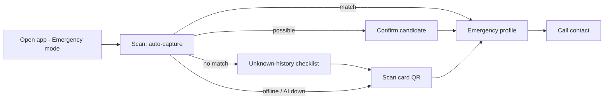
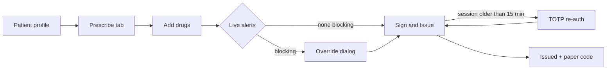
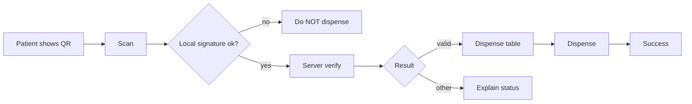

# Role 07 — UI/UX Designer (Design System · Wireframes · Flows)

**Owner:** M8 (also QA/Release) · **Consumers:** Web (R5), Mobile (R6)
**Principle:** *Zero-friction emergencies, zero-ambiguity prescriptions, calm everywhere else.*

---

## 1. Responsibilities
1. Maintain the design system (tokens → Figma variables → `tokens.json` → Tailwind/shadcn CSS variables and Flutter `ThemeData`).
2. Produce screen specs and wireframes for all five roles (§7) and interactive Figma prototypes for the P0 flows.
3. Write UX copy in Arabic and English (§6). Run usability checks (5 users per persona where possible, including one real paramedic or nurse if the faculty can arrange it).
4. Review implemented screens against the specs (visual QA) before each stage gate.

## 2. Design Principles

| # | Principle | Applied as |
|---|-----------|-----------|
| P1 | **Critical first** | Allergies with anaphylaxis severity are the first thing a clinician sees on any patient view |
| P2 | **One primary action per screen** | Exactly one filled primary button; the rest are secondary/ghost |
| P3 | **Never colour alone** | Every severity carries an icon + text label + colour |
| P4 | **Explain blocks** | Every disabled primary button has a visible reason ("2 alerts need documented overrides") |
| P5 | **Forgiving input** | Masks, autocomplete, Western digits for doses, undo for non-destructive actions |
| P6 | **Privacy visible** | "Who can see this" hints, access log, restricted-record placeholders |
| P7 | **Bilingual parity** | Every screen designed in RTL **and** LTR. Neither is a mirror afterthought |

## 3. Design Tokens

### 3.1 Colour: brand & semantic (light theme)

| Token | Hex | Use | Contrast on white |
|-------|-----|-----|-------------------|
| `color.primary.600` | `#2563EB` | Primary buttons, links, focus | 5.2:1 ✓ |
| `color.primary.700` | `#1D4ED8` | Hover/pressed | 6.7:1 |
| `color.primary.50` | `#EFF6FF` | Selected rows, subtle fills | — |
| `color.secondary.700` | `#0F766E` | Secondary accents (teal) for text/icons | 5.5:1 ✓ |
| `color.secondary.500` | `#14B8A6` | Decorative fills only (not text) | 2.5:1 ✗ text |
| `color.danger.600` | `#DC2626` | Errors, contraindicated, emergency | 4.8:1 ✓ |
| `color.danger.50` | `#FEF2F2` | Danger banner background (text uses danger.800 `#991B1B`) | — |
| `color.warning.700` | `#B45309` | Major alert text/icons | 5.0:1 ✓ |
| `color.warning.50` | `#FFFBEB` | Warning banner background | — |
| `color.caution.600` | `#CA8A04` | Moderate (icon only; text uses `#854D0E`) | — |
| `color.success.700` | `#15803D` | Valid / authentic | 5.0:1 ✓ |
| `color.info.700` | `#0369A1` | Info banners | 5.9:1 ✓ |
| `color.neutral.900` | `#111827` | Primary text | 17.7:1 |
| `color.neutral.600` | `#4B5563` | Secondary text | 7.6:1 |
| `color.neutral.300` | `#D1D5DB` | Borders | — |
| `color.neutral.100` | `#F3F4F6` | App background | — |
| `color.surface` | `#FFFFFF` | Cards | — |

**Dark theme** (web + mobile, optional toggle): background `#0B1220`, surface `#111827`, text `#F9FAFB`, primary `#60A5FA`, danger `#F87171`, warning `#FBBF24`, success `#4ADE80`. Same token names.

**Emergency theme** (mobile paramedic + patient card; also used for the web ER desk, P2):

| Token | Hex | Contrast |
|-------|-----|----------|
| `em.bg` | `#000000` | — |
| `em.text` | `#FFFFFF` | 21:1 |
| `em.danger.bg` | `#FF3B30` with text `#000000` | 5.9:1 (bold, large → AAA large) |
| `em.danger.block` | `#7F1D1D` with text `#FFFFFF` | 10.0:1 |
| `em.warning.bg` | `#FFD60A` with text `#000000` | 14.9:1 |
| `em.info.bg` | `#0A84FF` with text `#FFFFFF` | 3.65:1 (≥ 24 sp bold only; AA-large) |
| `em.divider` | `#3A3A3C` | — |

### 3.2 Severity system (shared by web, mobile, AI alerts)

| Level | Icon (lucide / Material Symbols) | Colour (light) | Label EN / AR | Blocks? |
|-------|-----------------------------------|----------------|---------------|---------|
| `contraindicated` | `OctagonX` / `dangerous` | danger | Contraindicated / ممنوع | Yes |
| `major` | `TriangleAlert` / `warning` | warning | Major / خطير | Yes |
| `moderate` | `CircleAlert` / `error` | caution | Moderate / متوسط | No |
| `minor` | `Info` / `info` | info | Minor / بسيط | No |
| Allergy `anaphylaxis` | `Siren` / `emergency` | danger (solid chip) | Anaphylaxis / تأق (حساسية مفرطة) | — |
| Triage `emergency` | `Ambulance` / `emergency` | danger full-screen | Emergency / طوارئ | — |
| Triage `urgent` | `Clock` / `schedule` | warning | Within 24 h / خلال ٢٤ ساعة | — |

### 3.3 Typography

| Script | Family | Fallback | Notes |
|--------|--------|----------|-------|
| Arabic | **IBM Plex Sans Arabic** (primary) or **Cairo** | `system-ui`, `Noto Sans Arabic` | Plex Arabic pairs well with Inter metrics; Cairo is wider and very legible for headings |
| Latin | **Inter** | `system-ui`, `Segoe UI`, `Roboto` | Tabular numbers (`font-feature-settings: "tnum"`) in tables and doses |
| Mono | **JetBrains Mono** | `ui-monospace` | Rx numbers, MRNs, codes |

Type scale (web rem / mobile sp). Arabic line-height is +0.1 relative to Latin because of tall ascenders/descenders:

| Token | Size | Weight | LH (Latin / Arabic) | Use |
|-------|------|--------|---------------------|-----|
| `display` | 2.25 / 36 | 700 | 1.2 / 1.3 | Emergency blood type, large KPIs |
| `h1` | 1.75 / 28 | 700 | 1.25 / 1.35 | Page titles |
| `h2` | 1.375 / 22 | 600 | 1.3 / 1.4 | Section titles |
| `h3` | 1.125 / 18 | 600 | 1.35 / 1.45 | Card titles |
| `body` | 1 / 16 | 400 | 1.5 / 1.65 | Default text |
| `body-sm` | 0.875 / 14 | 400 | 1.45 / 1.6 | Secondary text, table cells |
| `caption` | 0.75 / 12 | 500 | 1.4 / 1.55 | Labels, badges (never for critical info) |
| `em.body` | — / 20 | 600 | — / 1.5 | Emergency theme body |
| `em.h` | — / 28 | 800 | — / 1.35 | Emergency headings |
| `em.display` | — / 40 | 800 | — / 1.2 | Blood type in emergency |

### 3.4 Spacing, radius, elevation, motion

- **Spacing scale (4-pt):** `0, 2, 4, 8, 12, 16, 20, 24, 32, 40, 48, 64`. Page padding: web 24/32, mobile 16. Card padding 16/20.
- **Radius:** `sm 6`, `md 8` (inputs, buttons), `lg 12` (cards), `xl 16` (dialogs, bottom sheets), `full` (chips/avatars).
- **Elevation:** web uses borders first, shadow `0 1px 2px rgba(0,0,0,.06)` for cards, `0 10px 30px rgba(0,0,0,.12)` for dialogs. Mobile uses M3 tonal elevation levels 0–3.
- **Motion:** 150 ms (micro), 250 ms (panels), easing `cubic-bezier(.2,.0,.0,1)`. Respect `prefers-reduced-motion`. No animation in emergency screens except the scan progress indicator.
- **Touch targets:** web ≥ 40 px; mobile ≥ 48 dp; emergency ≥ 64 dp.

### 3.5 Token pipeline
`design/tokens/tokens.json` (W3C Design Tokens format) is exported from Figma Variables (Tokens Studio). Generated outputs:
- `web-admin/app/globals.css` CSS variables mapped to shadcn names (`--primary`, `--destructive`, `--warning`, …).
- `mobile-app/lib/core/theme/tokens.dart` (`ColorScheme.fromSeed` overridden with exact token colours; `TextTheme` per locale).

## 4. Component Parity: shadcn/ui (web) ↔ Material 3 (Flutter)

| Concept | Web (shadcn/Radix) | Mobile (Material 3 / custom) | Shared spec |
|---------|--------------------|------------------------------|-------------|
| Primary button | `Button` default | `FilledButton` | 40/48 dp height, radius md, label sentence case |
| Secondary | `Button variant="outline"` | `OutlinedButton` | — |
| Destructive | `Button variant="destructive"` | `FilledButton` with danger colours | Always confirms |
| Text input | `Input` + `Label` + `FormMessage` | `TextFormField` (outlined) | Label above, helper below, error replaces helper |
| Select / combobox | `Select`, `Command` (combobox) | `DropdownMenu` / `SearchAnchor` | Search-as-you-type for drugs/ICD |
| Severity banner | custom `Alert` variants (`danger`, `warning`, `caution`, `info`) | custom `SeverityBanner` widget | §3.2 |
| Chip | `Badge` | `Chip` / `FilterChip` | Allergy chips coloured by severity |
| Dialog | `Dialog`, `AlertDialog` | `AlertDialog`, `showModalBottomSheet` | Destructive confirm = dialog; options = bottom sheet on mobile |
| Toast | `Sonner` toast | `SnackBar` | Never used for errors that require action |
| Tabs | `Tabs` | `TabBar` / `SegmentedButton` | — |
| Data table | TanStack + `Table` | `ListView` cards (no tables on phones) | — |
| Countdown | `Countdown` (custom) | `Countdown` widget | mm:ss, turns warning at 60 s |
| QR | `qrcode` render / scanner | `qr_flutter` / `mobile_scanner` | Quiet zone ≥ 4 modules |
| Empty state | illustration + text + CTA | same | Friendly, no blame |

## 5. Layout & RTL Rules
- Web grid: 12 columns, max content width 1440 px, sidebar 264 px (collapsible to 72 px). Breakpoints `sm 640, md 768, lg 1024, xl 1280, 2xl 1536`.
- **RTL is designed, not flipped:** in Arabic, the sidebar is on the right, the reading order runs right→left, and progress steppers flow right→left. These elements **do not** flip: media playback icons, numbers, Latin drug names, QR codes, charts' time axis (keep left→right for time in both languages, as is common in Arabic medical software; validate in usability tests).
- Mixed text: a drug name in Arabic sentences is isolated (`<bdi>` / `TextDirection.ltr` span).
- Mirror directional icons (back/forward chevrons). Don't mirror check marks, the clock, or the camera.

## 6. Content & Microcopy

### 6.1 Voice
Calm, clear, respectful; short sentences; no blame. Arabic: Modern Standard Arabic with plain vocabulary (avoid heavy classical terms). Medical terms appear in Arabic with the English term in parentheses on first use where clinicians expect it (e.g. "تأق (Anaphylaxis)").

### 6.2 Key strings (EN / AR)

| Key | English | Arabic |
|-----|---------|--------|
| `assistant.disclaimer` | This assistant gives general guidance only. It is not a diagnosis. In an emergency call 123. | هذا المساعد يقدّم إرشادات عامة فقط وليس تشخيصاً. في حالات الطوارئ اتصل بالإسعاف ١٢٣. |
| `emergency.callNow` | Call ambulance 123 now | اتصل بالإسعاف ١٢٣ الآن |
| `er.noMatch.title` | No registered match | لا يوجد تطابق مسجَّل |
| `er.noMatch.body` | Treat as UNKNOWN medical history. | تعامَل مع الحالة على أن تاريخها الطبي غير معروف. |
| `er.lowConfidence` | Low-confidence identification — verify identity when possible | تعرّف منخفض الثقة — تحقّق من الهوية متى أمكن |
| `rx.doNotDispense` | FAILED AUTHENTICITY CHECK — Do NOT dispense | فشل التحقق من صحة الروشتة — لا تصرف الدواء |
| `rx.alreadyDispensed` | Already dispensed on {date} at {pharmacy} | تم صرفها بتاريخ {date} في {pharmacy} |
| `rx.overrideRequired` | {n} alerts need a documented reason before issuing | يوجد {n} تنبيهات تحتاج إلى سبب موثَّق قبل الإصدار |
| `rx.checkUnavailable` | Automated safety check unavailable — review manually | فحص السلامة الآلي غير متاح — راجع يدوياً |
| `pharmacy.offline` | Offline: you can check authenticity but cannot dispense | لا يوجد اتصال: يمكنك التحقق من صحة الروشتة لكن لا يمكن الصرف |
| `privacy.restricted` | 1 restricted record (hidden by the patient) | سجل واحد مقيَّد (أخفاه المريض) |
| `stepUp.title` | Confirm it's you | أكِّد هويتك |
| `bio.consent.title` | Use your face for emergencies | استخدم بصمة وجهك في حالات الطوارئ |
| `bio.consent.body` | We store a protected mathematical template, never your photo. You can delete it anytime. | نحفظ نموذجاً رياضياً محمياً لوجهك، ولا نحفظ صورتك أبداً. يمكنك حذفه في أي وقت. |

All strings live in `en.json`/`ar.json` (web) and `app_en.arb`/`app_ar.arb` (mobile) with identical keys.

## 7. Screen-by-Screen Specifications

Notation: `[Btn]` primary, `(btn)` secondary, `{field}`, `▣` card, `⚠` severity banner. Wireframes are shown LTR; RTL mirrors layout per §5.

### 7.1 Patient (mobile)

**P-01 Welcome / Login**
```
┌──────────────────────────────┐
│  [logo] SmartHealth          │
│  One Identity. One Record.   │
│  {Email or phone}            │
│  {Password}       (Forgot?)  │
│  [Sign in]                   │
│  (Create account)            │
│  ───────────────             │
│  🆘 Emergency card (no login)│  ← opens cached card (EXT-04)
└──────────────────────────────┘
```
**P-02 Sign-up** → OTP → **P-03 Onboarding (3 steps):** ① national ID + DOB (inline validation, explains why) ② sex + blood type ("I don't know" allowed) ③ consents (ToS required; emergency contacts share default ON with explanation; AI assistant optional).

**P-04 Home**
```
┌──────────────────────────────┐
│ Hi Mona 👋        (⚙)        │
│ ▣ Emergency card  [Show]     │  ← red-outlined card
│ ▣ Active prescriptions (2)   │
│    RX-2026-000123 · 1 item left · 6 days │
│ ▣ Critical info  O+ · 1 allergy · Asthma │
│ ▣ Ask the assistant          │
│ ▣ Who can see my records (1) │
│ [bottom nav: Home | History | Rx | Assistant | Profile] │
└──────────────────────────────┘
```
**P-05 History** timeline (filter chips). **P-06 Encounter detail.**
**P-07 Prescriptions:** list → detail → *Show at pharmacy* → step-up → **P-08 Pickup QR** (full-screen, brightness max, countdown, Rx number, "No phone? Code K7Q-2MX").
**P-09 Critical info** (sections with *Confirmed*/*Self-reported* tags; add allergy with search).
**P-10 Emergency contacts** (max 5, drag to reorder priority, share toggle with explanation).
**P-11 Emergency card** (Emergency theme; QR at the bottom; "Issued …").
**P-12 Face enrolment:** consent → tips (light, remove glasses/mask) → camera with oval guide + challenge prompts → success/failure with specific hint.
**P-13 Sharing & access:** active grants list (revoke), *Generate share code* → big 6-digit code with a 10-min countdown, *Access history* list.
**P-14 Assistant:** §6.5 of role-06; emergency takeover screen **P-14E**.
**P-15 Settings:** language, devices (revoke), log out everywhere, delete face data, delete account (explains record retention).

### 7.2 Doctor (web)

**D-01 Login → MFA.** **D-02 Dashboard** (role-05 §7.1).
**D-03 Redeem share code**
```
┌ Redeem patient access ───────────────────────────────┐
│ {Patient MRN  SH-________}  {6-digit code ______}     │
│ Access duration: 30 days (set by patient)             │
│ [Open patient]                                        │
└───────────────────────────────────────────────────────┘
```
**D-04 Patient profile**
```
┌────────────────────────────────────────────────────────────────────────────┐
│ Mona Adel · 36 F · SH-7K2M9Q4D · Grant until 24 Dec          (End visit)   │
│ ⛔ ANAPHYLAXIS: Penicillins   🩸 O+ (self-reported ⚠)   Asthma   Meds (2) ▾  │
├────────────────────────────────────────────────────────────────────────────┤
│ [Summary] [History] [Encounter] [Prescribe]                                │
│ ▣ Recent encounters          ▣ Active prescriptions      ▣ Problem list    │
│ ▣ Allergies  (Verify) on self-reported items                               │
└────────────────────────────────────────────────────────────────────────────┘
```
**D-05 Encounter** (two-column: notes left, diagnoses right; internal vs patient-visible notes clearly labelled with eye icons).
**D-06 Prescription Builder**
```
┌─────────────────────────────────────────────┬──────────────────────────────┐
│ Items                                        │ Safety alerts (live)         │
│ 1 {Drug: Augmentin 875/125 tab} ⛔           │ ⛔ CONTRAINDICATED            │
│   {1 tab} {oral} {twice daily} {7 d} {14}    │ Allergy: Penicillins          │
│   {instructions} [x] substitution            │ Recorded ANAPHYLAXIS…         │
│ 2 {Drug: Aspocid 75}  ⚠                      │ (Document override)           │
│ (+ Add drug)                                 │ ⚠ MAJOR Warfarin + Aspirin    │
│                                              │ Previously reviewed 1 Sep     │
│                                              │ (Document override)           │
│                                              │ • 1 minor note ▾              │
├─────────────────────────────────────────────┴──────────────────────────────┤
│ 2 items · 2 alerts need overrides          (Preview)   [Sign & Issue] (disabled) │
└────────────────────────────────────────────────────────────────────────────┘
```
**D-07 Override dialog** (reason radios, justification with counter, responsibility checkbox).
**D-08 Issued confirmation** (Rx number, paper code shown once, Print).

### 7.3 Pharmacist (web + mobile)

**F-01 Verify:** tabs *Scan QR* | *Rx number + code*; camera viewport with frame; recent verifications list.
**F-02 Result:** coloured header by result (role-05 §7.4 table), prescriber block, patient minimal block (name, age, sex, allergies), *Continue to dispense*.
**F-03 Dispense**
```
┌ RX-2026-000123 · valid · context 14:32 left ─────────────────────────────┐
│ Drug                    Prescribed  Dispensed   Remaining  Dispense now   │
│ Augmentin 875/125 tab   14          0           14         [14 ▲▼] (Sub) │
│ Aspocid 75 tab          30          20 (El-Shifa) 10       [10 ▲▼]       │
│ ⓘ Prescriber documented override: Warfarin + Aspirin                      │
│ [x] Counselling given   {notes}                                           │
│                                                     [Dispense]            │
└──────────────────────────────────────────────────────────────────────────┘
```
**F-04 Success** (status after dispense, "Remaining items can be dispensed at any pharmacy until …").

### 7.4 Paramedic (mobile, Emergency theme)

**E-01 Shift start:** MFA, location permission ask, default reason.
**E-02 Scan**
```
┌──────────────────────────────┐ (black)
│  EMERGENCY SCAN        ● LIVE│
│  ┌────────────────────────┐  │
│  │      (  face oval  )   │  │
│  │                        │  │
│  └────────────────────────┘  │
│  "Hold steady — more light"  │
│  [🔦]        [◉ CAPTURE]     │
│  (Scan card QR)  (Search ID) │
└──────────────────────────────┘
```
**E-03 Emergency profile**
```
┌──────────────────────────────┐ (black, white text)
│ MONA ADEL · 36 F · …9Q4D  ⏱52m│
│ ███ ALLERGIES ███████████████ │ (red block)
│ ⛔ PENICILLINS — ANAPHYLAXIS  │
│ ─────────────────────────────│
│ BLOOD TYPE   O+   ✓ verified │ (40 sp)
│ CHRONIC      Asthma          │
│ MEDICATIONS  Warfarin 5 mg   │
│              Salbutamol inh. │
│ [📞 CALL EMERGENCY CONTACT]  │ (64 dp, bottom)
└──────────────────────────────┘
```
**E-04 Possible match:** 2 candidate cards (sex + age band only) + "Confirm" per card + "None of these".
**E-05 No match:** grey card + unknown-history checklist + alternatives.
**E-06 Offline card view:** E-03 layout with an orange OFFLINE ribbon and the issued date.
**E-07 Contacts:** list with huge call buttons.

### 7.5 Admin (web)
**A-01 KPIs** · **A-02 Users** (table + filters + row actions) · **A-03 Invite** · **A-04 Licence panel** (status timeline, actions with reason, revoke impact warning) · **A-05 Facilities** · **A-06 Audit** (filters bar, virtualised table, chain integrity badge top-right) · **A-07 Break-glass review** (card queue with map) · **A-08 Security flags**.

## 8. Key User Flows

### 8.1 Emergency (target: ≤ 3 taps, ≤ 10 s to critical info)

Taps: open (1) → capture auto (0) → profile (0) → call (2). Offline QR path: open (1) → *Scan card QR* (2) → profile (0).

### 8.2 Prescribe with alert override


### 8.3 Pharmacy dispensing


## 9. Accessibility Requirements
- WCAG 2.2 AA for all web screens; Emergency theme targets AAA contrast.
- Focus visible (2 px `primary.600` ring, offset 2), logical tab order (RTL-aware), skip-to-content link.
- Severity communicated by icon + text + colour (P3). Banners announced (`role=alert` for blocking).
- Forms: labels always visible (no placeholder-only), errors linked via `aria-describedby`.
- Mobile: semantics labels, dynamic type up to 200%, haptics on success/failure in emergency.
- Colour-blind check (deuteranopia/protanopia) on severity chips: shapes and icons differ.

## 10. Usability Test Plan (Stage 5–6)

| Persona | Task | Success metric |
|---------|------|----------------|
| Paramedic | Identify the patient and state their allergy | ≤ 10 s, 0 errors |
| Doctor | Prescribe 2 drugs, handle a contraindication | Completes without help; understands why it's blocked |
| Pharmacist | Partial dispense of 2 of 3 items | ≤ 60 s; correct quantities |
| Patient | Add an emergency contact and show the emergency card | ≤ 90 s |
| Patient | Use the assistant with chest-pain wording | Sees the emergency takeover and identifies the call button |

## 11. Deliverables (Figma)
- `SmartHealth — Design System` (variables, components, severity system, emergency theme).
- `SmartHealth — Mobile` (Patient, Paramedic, Pharmacist; AR + EN frames).
- `SmartHealth — Web` (Doctor, Pharmacist, Admin; AR + EN frames; 1280 and 1440 widths).
- Prototypes for flows 8.1–8.3.
- `design/tokens/tokens.json` committed via PR.

## 12. Handoff Contracts

| To | You provide | You need |
|----|-------------|----------|
| Web | Figma frames, tokens.json, copy keys | Implemented screens for visual QA |
| Mobile | Same + Emergency theme spec + motion specs | Device screenshots |
| AI | Visual design for triage levels and templates | Final template texts |
| Everyone | Usability findings with severity | Fixes prioritised in the next stage |

## 13. Definition of Done (Role 07)
- [ ] Tokens exported and consumed by both apps (no hard-coded hex in app code: lint check).
- [ ] Every P0/P1 screen has AR + EN frames and states (loading, empty, error, offline where relevant).
- [ ] Emergency flow prototype tested with ≥ 3 users; ≤ 10 s median to critical info.
- [ ] Contrast report for all token pairs; colour-blind check done.
- [ ] Visual QA sign-off on Stage 5 (web) and Stage 6 (mobile).
